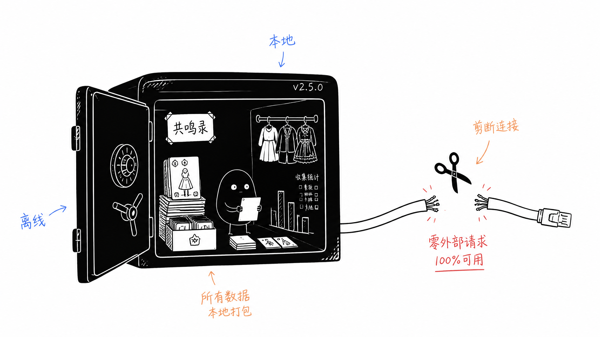
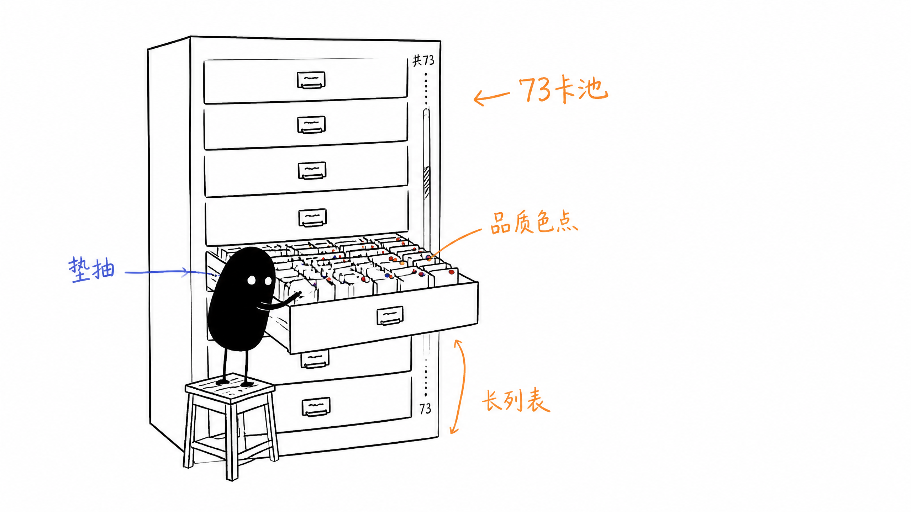
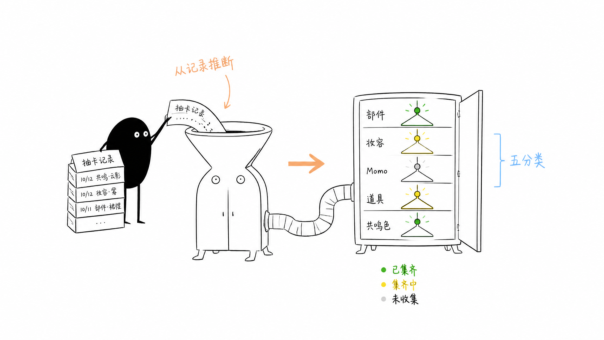
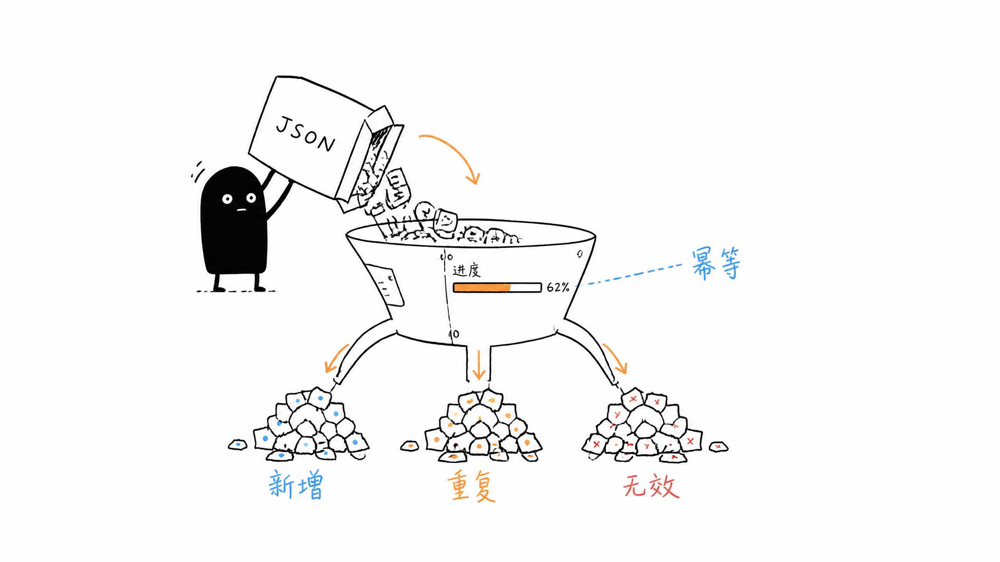
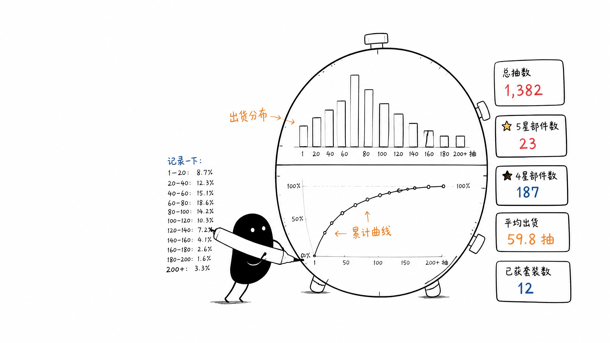
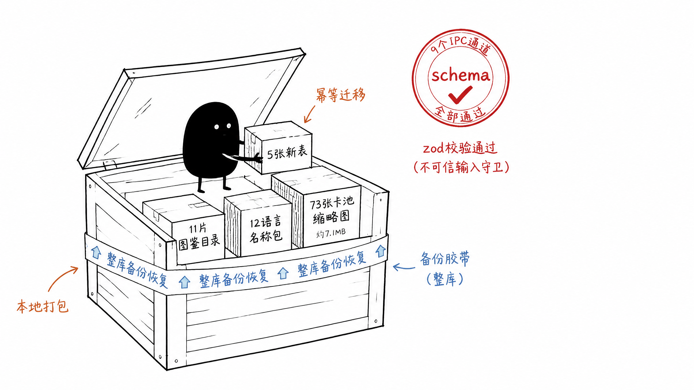
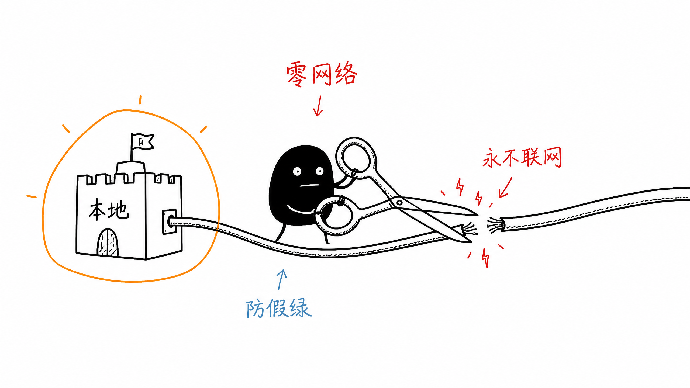

# NikkiGallery v2.5.0 — 无限暖暖相册管理工具 / Infinity Nikki Photo Manager

> 本文为 2026-09-06 轮次快照，当前口径以主规约文档为准（生命周期/约定见根 AGENTS.md 与 docs/CODING_CONVENTIONS.md；通道见 docs/IPC_CONTRACT.md）。
> **发布日期 / Released**：2026-09-06　|　**平台 / Platform**：Windows 10 (1803+) / Windows 11，x64　|　**安装包 / Installer**：`NikkiGallery-Setup-2.5.0.exe`

---

## 目录 / Contents

- [中文版](#中文版)
- [English Version](#english-version)
- [开发者信息与致谢](#开发者信息与致谢)

---

## 中文版

### 版本概览

2.5.0 的核心是全新实装的**「共鸣录」**板块——把抽卡记录、衣橱收集与数据统计完整搬进本地客户端。它**完全离线运行，断网状态下 100% 可用**：所有图鉴、卡池、套装与名称数据均随安装包分发，零外部请求、零外链资源。

共鸣录的核心逻辑复用自开源项目 [gongeo.us-nikki-tracker](https://github.com/dastrokes/gongeo.us-nikki-tracker)（作者 dastrokes，MIT License，已获原作者授权），在此郑重致谢；应用内「设置 → 致谢与开源协议」也已新增对应条目。

### 新增功能

#### 一、共鸣记录

- **73 个卡池的完整记录浏览**：本地缩略图、品质色点、该抽跨度与垫抽提示一目了然
- **手动补录**：支持新增记录、修改补录时间、删除记录，补录流程即时反馈
- **长列表虚拟滚动**：上千条记录依旧流畅滚动，不占用额外内存

#### 二、我的衣橱

- **五分类拥有状态管理**：部件 / 妆容 / Momo / 道具 / 共鸣色，逐项标记拥有情况
- **套装聚合进度**：自动聚合并展示「已集齐 / 集齐中 / 未收集」三态，收集进度一屏掌握
- **高效检索与批量操作**：名称搜索、拥有状态与稀有度筛选、批量勾选
- **「从共鸣记录推断」**：一键由抽卡记录推断拥有状态（纯文字模式，不依赖任何物品图片）

#### 三、数据导入与导出

- **本地 JSON 导入**：解析预览 → 新增 / 重复 / 无效计数与逐条定位 → 分批事务提交；进度可视、可随时取消、断点幂等
- **版本兼容策略**：数据版本不兼容时提供「兼容导入 / 放弃」双选项；兼容 gongeo.us 旧版导出格式
- **数据导出**：按需勾选导出内容，通过系统保存对话框选择目标位置
- **清空全部**：危险操作二次确认，避免误触

#### 四、个人统计

- **总览卡片**：总抽数、4★ / 5★ 部件数、平均出货、已获套装数
- **欧非百分位与档位**：静态快照数据，界面标注来源与生成日期，数据缺失时自动隐藏
- **可视化图表**：SVG 出货分布直方图、按卡池累计曲线、按卡池明细表

#### 五、数据层与可靠性

- **SQLite 新增 5 张共鸣表**：幂等迁移，并纳入既有的整库备份 / 恢复体系
- **9 个 IPC 通道全部经 zod schema 校验**：导入文件按不可信输入同等强度守卫，单文件上限 64 MB、总记录上限 20 万条

#### 六、静态数据与多语言

- **随包静态数据**：图鉴目录 11 片、卡池 / 套装 / 百分位快照、12 语言实体名称包、73 张卡池缩略图（约 7.1 MB），全部为本地打包资源
- **国际化**：共鸣录全部词条补齐 12 种语言

#### 七、离线守护

- 新增离线断言测试：核心流程零网络调用打桩断言、全部新增源码静态扫描、反向用例防假绿，从工程层面锁定「永不联网」承诺

### 体验优化

- **工程瘦身**：移除 Python 扫描器原型（`main.py` 及其配套模块与实施计划）。该原型无任何 TS / 脚本 / CI 引用，其路径定位、UID 隔离与原生缩略图复用能力已由 `src/main/scanner/` 下的 TypeScript 扫描器完整覆盖
- **测试契约同步**：IPC 契约测试更新为 39 个 `registerXxxHandlers`（现 40 个注册调用，2026-10-10 实测 `src/main/app/ipc-setup.ts`），preload 装配测试更新为 `reportReady` + 29 个命名空间（现 30 个命名空间 / 31 个键，2026-10-10 实测 `src/main/preload/api/`），随共鸣录接入同步扩展
- **文档一致性**：`ARCHITECTURE` / `DEVELOPMENT` / `README` 中英四份文档同步补齐 2.5.0 共鸣录章节与工程不变量，版本号统一为 2.5.0

### 问题修复

- 修复了若干已知问题，提升了应用稳定性

### 升级说明

- 直接运行安装包覆盖升级即可，共鸣数据以独立数据表存储，不会影响既有相册、分类与备份
- 若曾使用 gongeo.us 导出过记录，可在「共鸣录 → 导入数据」中直接选择该 JSON 文件

---

## English Version

### Overview

Version 2.5.0 introduces the brand-new **Resonance Records** module, bringing gacha records, wardrobe collection tracking and statistics into the local client. It runs **fully offline and remains 100% usable with no network connection**: every catalog, banner, outfit and name dataset ships inside the installer, with zero external requests and zero remote assets.

The core logic of Resonance Records is derived from the open-source project [gongeo.us-nikki-tracker](https://github.com/dastrokes/gongeo.us-nikki-tracker) by dastrokes (MIT License, used with the original author's permission) — our sincere thanks. A corresponding entry has also been added under **Settings → Credits & Open Source Licenses**.

### New Features

#### 1. Resonance Records

- **Browse records across all 73 banners**: local thumbnails, quality colour dots, pull span and pity-progress hints at a glance
- **Manual entry**: add records, edit the entry timestamp, or delete records, with immediate feedback
- **Virtualised long lists**: thousands of records stay smooth without extra memory cost

#### 2. My Wardrobe

- **Five-category ownership tracking**: Pieces / Makeup / Momo / Props / Resonance Colours, each item marked individually
- **Outfit aggregation progress**: automatically groups items into Completed / In Progress / Not Collected
- **Fast search and batch actions**: name search, ownership and rarity filters, batch selection
- **Infer from Resonance Records**: derive ownership from your gacha history in one click (text-only mode, no item images required)

#### 3. Import & Export

- **Local JSON import**: parse preview → new / duplicate / invalid counts with per-item location → batched transactional commits; visible progress, cancellable at any time, idempotent on resume
- **Version compatibility**: offers Compatible Import / Discard when the schema version does not match; compatible with legacy gongeo.us export format
- **Data export**: pick the content to export and choose the destination via the system save dialog
- **Clear all**: guarded by a double confirmation for this destructive action

#### 4. Personal Statistics

- **Overview cards**: total pulls, 4★ / 5★ pieces, average pulls per drop, outfits obtained
- **Luck percentile and tier**: static snapshot data with its source and generation date labelled in the UI, hidden automatically when unavailable
- **Charts**: SVG distribution histogram per drop, cumulative curve per banner, and a detailed per-banner table

#### 5. Data Layer & Reliability

- **Five new SQLite tables for resonance data**: idempotent migrations, included in the existing full-database backup / restore flow
- **All 9 IPC channels validated with zod schemas**: imported files are guarded with the same strictness as untrusted input — 64 MB per file, 200,000 records in total

#### 6. Static Data & Languages

- **Bundled static data**: 11 catalog sheets, banner / outfit / percentile snapshots, entity name packs in 12 languages, and 73 banner thumbnails (~7.1 MB), all shipped locally
- **Internationalisation**: all Resonance Records strings completed for 12 languages

#### 7. Offline Guarantee

- New offline assertion tests: stubbed zero-network assertions for core flows, static scanning of all new source files, and negative cases to prevent false positives — locking the "never goes online" promise at the engineering level

### Improvements

- **Leaner codebase**: removed the Python scanner prototype (`main.py` and its modules and plan). It had no TS / script / CI reference, and its path resolution, UID isolation and native thumbnail reuse are fully covered by the TypeScript scanner under `src/main/scanner/`
- **Test contract sync**: the IPC contract test now covers 39 `registerXxxHandlers`, and the preload assembly test covers `reportReady` + 29 namespaces, extended alongside the Resonance Records integration
- **Documentation consistency**: the Chinese and English `ARCHITECTURE` / `DEVELOPMENT` / `README` documents were updated with the 2.5.0 Resonance Records sections and engineering invariants, with versions unified to 2.5.0

### Bug Fixes

- Fixed several known issues and improved overall application stability

### Upgrade Notes

- Simply run the installer to upgrade in place. Resonance data is stored in dedicated tables and will not affect your existing albums, categories or backups
- If you previously exported records from gongeo.us, you can select that JSON file directly in **Resonance Records → Import Data**

---

## 开发者信息与致谢

感谢每一位玩家的反馈与陪伴，也感谢开源社区的无私贡献——本版本的共鸣录得以实装，离不开 [gongeo.us-nikki-tracker](https://github.com/dastrokes/gongeo.us-nikki-tracker)（作者 dastrokes，MIT License）的开源支持与授权。

**作者 / Author**：纤璐不会玩摄影

- **抖音 / Douyin**：纤璐不会玩摄影 — https://v.douyin.com/Dx67wYkw48A/
- **小红书 / Xiaohongshu (RED)**：纤璐不会玩摄影 — https://www.xiaohongshu.com/user/profile/69270bb200000000370092db
- **哔哩哔哩 / Bilibili**：纤璐不会玩摄影 — https://b23.tv/zCR5oGE
- **GitHub**：[QianQianLuLu1](https://github.com/QianQianLuLu1)
- **CSDN 博客 / CSDN Blog**：[QianQian-LuLu](https://blog.csdn.net/2604_96788940)
- **作者官网 / Author Site**：https://ppebv9al.qwenwork.host/

欢迎在以上平台关注、留言与反馈，或在 GitHub 提交 Issue 与 Pull Request。

**License**：本项目基于 MIT License 开源。
