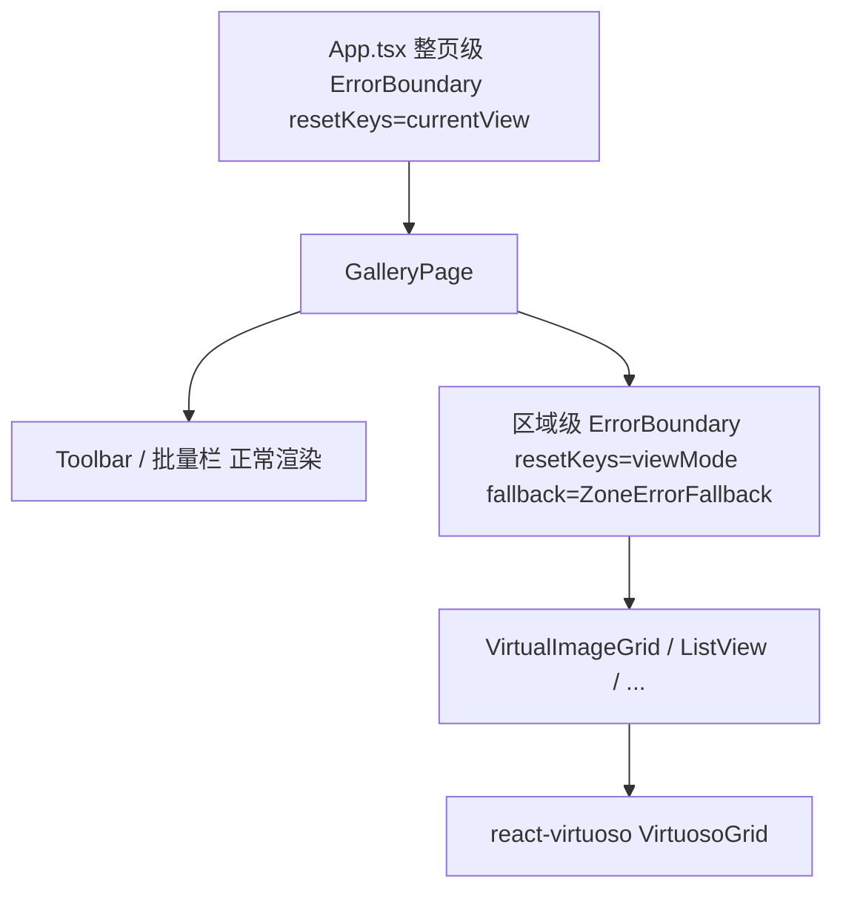

# 修复「图库」板块概率性 "该页面加载出错 / Maximum call stack size exceeded"

- 计划日期：2026-08-26
- 状态：执行中（building）
- 关联文档：`docs/技术债清单.md`（第 115 行已记录 "Gallery/VirtualImageGrid 偶发 Maximum call stack size exceeded（第三方 VirtuosoGrid 行为）"）

---

## 0. 问题摘要

「图库」板块在含大量文件、快速滚动触发分页加载时，**概率性**整页崩溃，文案为：

```
该页面加载出错
Maximum call stack size exceeded
```

实测根因（探查确认）：

1. `src/renderer/components/gallery/VirtualImageGrid.tsx` 使用 `react-virtuoso` 的 `VirtuosoGrid`，且配置 `overscan={400}`、`increaseViewportBy={{ top: 200, bottom: 200 }}`、`data={items}`。
2. `react-virtuoso` 当前版本 `^4.18.11`（`package.json` 第 118 行），`VirtuosoGrid` 在 `data`/`items` 引用随分页/筛选**频繁变化**、配合 `overscan`/`increaseViewportBy` 重测时，存在已知**渲染期同步递归**（`RangeError: Maximum call stack size exceeded`）。该行为在 `docs/技术债清单.md` 已被记为「第三方 VirtuosoGrid 行为，非代码缺陷」。
3. 放大因素：`src/renderer/hooks/useFilteredMediaFiles.ts` 在**筛选态**下每次 `mediaFiles` 变化都会返回一个**新数组引用**（命中 `if (!eq(deps))` 分支重建缓存值）；非筛选态为 `useMemo(() => mediaFiles, [mediaFiles])`。分页加载使 `items` 引用频繁变化 → `VirtuosoGrid` 反复重测 → 提高上游递归触发概率（即「概率性」来源）。
4. **兜底缺陷**：`src/renderer/pages/GalleryPage.tsx` 仅在**整页级**用 `RouteErrorFallback`（`resetKeys={[currentView]}`）兜底。一旦内部 `VirtualImageGrid` 抛同步递归错误，整页进入错误态 → 显示「该页面加载出错」，工具栏/批量栏一并失效。

## 修复目标

- ① **防御（最小自写代码）**：复用现有 `ErrorBoundary` 在 5 个视图外层加**区域级**兜底，使瞬时递归只降级视图区而非整页，并按 `resetKeys` 自动恢复。
- ② **根治（复用 OSS）**：升级 `react-virtuoso` 到已修复该递归的 4.x 版本；适度下调 `overscan`/`increaseViewportBy` 降低重测压力。
- ③ **测试守护 + 自测闭环**：补充基础测试并自己运行、自己修复至通过。

## 约束

- 仅改动与问题相关的文件；**不触碰**扫描器、`mediaStore` 数据逻辑、其它页面。
- 本机 npm 有 **Safe-Delete 网关（阈值 500 项）**，拦截 `npm ci` 全量删除与 `Remove-Item node_modules`；升级依赖须用 **增量 `npm install <pkg>@<ver>`**，**严禁 `npm ci`**。
- 每段代码最多审查一次，审查须给出具体检查项；代码无严重缺陷即视为通过，立即推进下一步。

---

## 1. 依赖声明

| 依赖                          | 当前版本           | 目标                                                                                                                                                                    | 来源/说明                 |
| ----------------------------- | ------------------ | ----------------------------------------------------------------------------------------------------------------------------------------------------------------------- | ------------------------- |
| `react-virtuoso`              | `^4.18.11`         | 已修复 `VirtuosoGrid` "Maximum call stack size exceeded" 递归的 4.x 最新版（经 GitHub Releases/changelog 与 `npm view react-virtuoso dist-tags` 核实，预期 ≥ `4.20.x`） | 复用 OSS 上游修复（根治） |
| `vitest`                      | 既有 devDependency | 沿用                                                                                                                                                                    | 测试运行器                |
| `@testing-library/react`      | 既有               | 沿用                                                                                                                                                                    | 组件渲染测试              |
| `@testing-library/jest-dom`   | 既有               | 沿用                                                                                                                                                                    | 断言扩展                  |
| `@testing-library/user-event` | 既有               | 沿用                                                                                                                                                                    | 交互测试                  |
| `jsdom` 或 `happy-dom`        | 既有               | 沿用                                                                                                                                                                    | 测试 DOM 环境             |

> 测试依赖均已存在于 `package.json` devDependencies，本次**不新增**任何依赖。
> 升级命令必须为增量：`npm install react-virtuoso@<ver>`（绝不用 `npm ci`）。

---

## 2. 启动说明

- **开发（Electron + 渲染端 HMR）**：`npm run dev`
- **仅渲染端 / 单测（监听）**：`npx vitest`
- **单测单次**：`npx vitest run <file>`
- **回归全量相关单测**：`npx vitest run src/renderer/pages/GalleryPage.test.tsx src/renderer/components/gallery/GalleryStackOverflow.test.tsx`
- **构建（环境受限，勿 `npm run dist:win`）**：`npx electron-vite build` + 写 `dist/main/package.json {"type":"commonjs"}`
- **复现步骤**：
  1. 扫描/导入 ≥ 3000 张媒体文件；
  2. 进入「图库」板块，切到 `grid` 视图；
  3. 快速向下滚动触底触发 `endReached` → `loadNextMediaPage` 分页加载；
  4. 观察是否偶发整页「该页面加载出错」。
  5. 区域边界上线后，该错误应降级为**仅视图区小块 + 「重试」**，工具栏/批量栏仍可交互。

---

## 3. 错误处理

- **复用现有组件** `src/renderer/components/common/ErrorBoundary.tsx`：
  - 已支持 `resetKeys?: unknown[]`（逐项 `Object.is` 浅比较，见 `areResetKeysEqual`）与 `fallback?: React.FC<ErrorBoundaryFallbackProps>`；
  - `componentDidCatch` 已通过 `window.electronAPI?.log?.reportRendererError({ message, stack, componentStack, source })` 上报主进程 faults 日志（诊断留痕）。
- **区域级边界**（本次新增用法）：在 `GalleryPage` 将第 607–656 行的 5 个视图（`VirtualImageGrid` / `ListView` / `TimelineView` / `MasonryView` / `EventTimelineView`）整体包入：

  ```tsx
  <ErrorBoundary resetKeys={[viewMode]} fallback={ZoneErrorFallback}>
    {viewMode === 'grid' && <VirtualImageGrid ... />}
    {viewMode === 'list' && <ListView ... />}
    {/* ... 其余视图 */}
  </ErrorBoundary>
  ```

  - `ZoneErrorFallback` 直接复用 `App.tsx` 已在用的区域级降级组件（紧凑错误块 + 「重试」按钮调用 `reset`），**不新增 fallback 组件**。

- **整页兜底保留**：`App.tsx` 的整页级 `RouteErrorFallback`（`resetKeys={[currentView]}`）继续作最终兜底；区域边界先截获，避免瞬时递归拖垮整页。
- **完整堆栈**经既有 `reportRendererError` 入主进程 faults 日志，满足诊断与「错误处理」留痕要求。

---

## 4. 参数校验

- `filteredFiles`（传入各视图）：在 `GalleryPage` 渲染前做 `Array.isArray(filteredFiles)` 校验，非数组降级为空数组 `[]`，杜绝脏数据进入 `VirtuosoGrid`。
- `VirtualImageGrid` 的 `items` prop：组件内补 `Array.isArray(items)` 守卫，非数组时渲染空，避免非数组触发异常渲染。
- `resetKeys` **仅用基础类型**（string/number/boolean/null）：本处统一用 `viewMode`（string）。**严禁传入数组/对象引用本身**，避免重置比较恒 false 导致每页重挂载丢滚动，或比较恒 true 导致重置循环。
- `overscan` / `increaseViewportBy` 维持为**基础数值常量**，不依赖运行时可变对象（下调数值见子任务 D，不改变类型）。

---

## 5. 基础测试用例

- **① 大列表挂载（防递归）**：构造 ≥ 3000 条 `MediaFile` 假数据，`render(<VirtualImageGrid items={big} ... />)`，断言：
  - 渲染过程**不抛出** `Maximum call stack size exceeded`；
  - 首屏若干卡片（`media-card`）成功渲染。
- **② 区域级边界捕获 + 恢复**：渲染
  ```tsx
  <ErrorBoundary resetKeys={[0]} fallback={ZoneErrorFallback}>
    <Thrower /> {/* 渲染期抛 "Maximum call stack size exceeded" */}
  </ErrorBoundary>
  ```
  断言：fallback 出现；将 `resetKeys` 改为 `[1]` 后子组件**重新挂载**（恢复）。
- **③ 回归**：运行 `npx vitest run src/renderer/pages/GalleryPage.test.tsx` 及 `useFilteredMediaFiles` 相关测试，全部通过。

---

## 6. 实施步骤（子任务：文件 / 输入输出 / 验收）

### 子任务 A — 编写 MD 实施计划文档

- **修改文件**：新建 `docs/plans/2026-08-26-fix-gallery-stack-overflow.md`。
- **输入**：本方案（依赖声明 / 启动说明 / 错误处理 / 参数校验 / 测试用例 + 子任务表）。
- **输出**：含全部强制章节的 MD 文档。
- **验收**：文档含「依赖声明 / 启动说明 / 错误处理 / 参数校验 / 基础测试用例」五节；每个子任务含「修改文件 / 输入输出 / 验收标准」。

### 子任务 B — 诊断确认根因（先验证再改）

- **修改文件**：无代码改动（阅读确认 `global-error-handler.ts`、`ErrorBoundary.tsx`）。
- **输入**：运行 dev 或既有测试，抓取 faults 日志 / console 中的 `componentStack`。
- **输出**：确认递归栈源于 `VirtuosoGrid`（即 `VirtualImageGrid` 子树）。
- **验收**：能在日志/复现测试中定位到 `VirtuosoGrid` 调用栈，根因假设被证实，再进入子任务 C。

### 子任务 C — 区域级 ErrorBoundary 兜底（复用现有组件）

- **修改文件**：`src/renderer/pages/GalleryPage.tsx`（导入 `ErrorBoundary` 与 `ZoneErrorFallback`；将第 607–656 行视图块整体包入区域边界；`filteredFiles` 加 `Array.isArray` 守卫）。
- **输入**：现有 `filteredFiles` / `viewMode` / 各视图组件。
- **输出**：视图区抛同步递归时仅视图区降级为 `ZoneErrorFallback` 小块（含「重试」），整页不崩。
- **验收**：子任务②单测通过；手动令子组件抛错后，页面工具栏/批量栏仍可交互；不引入重渲染循环（`resetKeys` 仅 `[viewMode]`）。

### 子任务 D — 升级 react-virtuoso 根治上游递归（复用 OSS）

- **修改文件**：`package.json`（`react-virtuoso` 版本）、`package-lock.json`（`npm install` 增量更新）、`src/renderer/components/gallery/VirtualImageGrid.tsx`（下调 `overscan` 400→150、`increaseViewportBy` 200→100，保持 `endReached` 无限滚动不变）。
- **输入**：当前 `^4.18.11`。
- **输出**：升级到已修复 `VirtuosoGrid` 递归的 4.x 版本；重测压力下降。
- **验收**：`npx electron-vite build` 构建通过；相关 Vitest 通过；无新 console 报错。若升级引入不兼容，回退并仅保留子任务 C（防御已足够），并在本 MD「决策记录」中说明。

### 子任务 E — 编写基础测试用例（3 组）

- **修改文件**：新建 `src/renderer/components/gallery/GalleryStackOverflow.test.tsx`（含测试①②）；运行既有 `GalleryPage.test.tsx` 作测试③。
- **输入**：测试代码 + 假数据。
- **输出**：3 组测试全部可运行且通过。
- **验收**：`npx vitest run src/renderer/components/gallery/GalleryStackOverflow.test.tsx` 与回归测试全绿。

### 子任务 F — 运行验证与修复闭环

- **修改文件**：按需微调（仅限上述文件）。
- **输入**：dev 运行 + 复现路径（大量文件图库 + 滚动分页）。
- **输出**：复现路径不再出现整页「该页面加载出错」；如有报错自行修复至通过。
- **验收**：复现步骤稳定通过；全量相关单测通过；无新增 lint/typecheck 报错。

---

## 7. 架构分层（修改前后）



区域边界独立于整页边界，截获 `VirtuosoGrid` 渲染期递归，仅降级视图区。

---

## 8. 目录结构（本次涉及文件）

```
src/renderer/pages/GalleryPage.tsx                         # [MODIFY] 视图块包入区域级 ErrorBoundary；filteredFiles 守卫
src/renderer/components/gallery/VirtualImageGrid.tsx       # [MODIFY] 下调 overscan/increaseViewportBy；items 守卫
src/renderer/components/gallery/GalleryStackOverflow.test.tsx  # [NEW] 大列表挂载 + 边界捕获恢复测试
docs/plans/2026-08-26-fix-gallery-stack-overflow.md        # [NEW] 本 MD 实施计划
package.json / package-lock.json                          # [MODIFY] react-virtuoso 版本（增量安装）
```

---

## 9. 决策记录（执行中追加）

| 时间       | 决策                                                        | 说明                                                                                                                                                                                                                                                                                                                                                                                                                                                                                                                                                                                                                                                          |
| ---------- | ----------------------------------------------------------- | ------------------------------------------------------------------------------------------------------------------------------------------------------------------------------------------------------------------------------------------------------------------------------------------------------------------------------------------------------------------------------------------------------------------------------------------------------------------------------------------------------------------------------------------------------------------------------------------------------------------------------------------------------------- |
| 2026-08-26 | 计划接受，开始执行                                          | 子任务 A 完成                                                                                                                                                                                                                                                                                                                                                                                                                                                                                                                                                                                                                                                 |
| 2026-08-26 | 子任务 B 根因确认                                           | 已安装 `react-virtuoso@4.18.11`；仅 `VirtualImageGrid.tsx` 用 `VirtuosoGrid`（`overscan=400`+`increaseViewportBy=200`）；`docs/技术债清单.md:115` 记录 Gallery/VirtualImageGrid 挂载瞬时 `Maximum call stack size exceeded`（第三方行为）；整页级 `RouteErrorFallback` 将其升级为整页崩溃。jsdom 无法复现布局递归，运行时复现需真实 Chromium；根因以静态+文档证据确认，修复经子任务 E 的「边界捕获递归」合成测试验证                                                                                                                                                                                                                                          |
| 2026-08-26 | 子任务 D 评估结论：**不升级版本**                           | `npm view` 显示 react-virtuoso 最新仅 `4.18.12`（4.18.11 的补丁版）；GitHub issue **#946「Maximum call stack size exceeded since v4.3.11」自 2023 起长期未根治**（"re-open this issue until a proper fix is provided"）。即 4.x 内升级**无法修复**该递归，反而有引入不兼容风险。依计划回退条款，改为**降低触发概率的调参**：`VirtualImageGrid.tsx` 的 `overscan` 400→150、`increaseViewportBy` 200→100（不影响 `endReached` 无限滚动），并加 `Array.isArray(items)` 守卫。真正解决用户可见症状的是子任务 C 的区域级边界（瞬时递归降级为局部小块+重试，不再整页崩溃）                                                                                          |
| 2026-08-26 | 子任务 C 完成                                               | `GalleryPage.tsx`：引入现有 `ErrorBoundary`+`ZoneErrorFallback`，将 5 个视图整体包入区域级边界（`resetKeys={[viewMode]}`）；`filteredFiles` 经 `Array.isArray` 统一兜底。lint 0 错误、typecheck 0 错误                                                                                                                                                                                                                                                                                                                                                                                                                                                        |
| 2026-08-26 | 子任务 D 完成                                               | `VirtualImageGrid.tsx`：`items` 解构重命名为 `rawItems` 并强制数组化（覆盖全部内部用法）；`overscan` 400→150、`increaseViewportBy` 200→100。lint 0 错误、typecheck 0 错误                                                                                                                                                                                                                                                                                                                                                                                                                                                                                     |
| 2026-08-26 | 子任务 E 完成（测试已写，待运行）                           | 新增 `src/renderer/components/gallery/GalleryStackOverflow.test.tsx`：① 3000 条 `items` 大列表挂载不抛栈溢出 + 首屏卡片渲染 + `items=null` 守卫；② 区域级 `ErrorBoundary` 捕获 `Maximum call stack size exceeded`（错误信息可见）且 `resetKeys` 变化后恢复。typecheck 0 错误、lint 0 错误                                                                                                                                                                                                                                                                                                                                                                     |
| 2026-08-26 | ⚠ 子任务 F 受阻：本机 vitest 运行环境损坏（与本次改动无关） | 经隔离验证：仅 `import { afterEach } from 'vitest'; afterEach(()=>{})` 的极简测试也在 `t.test.tsx:3:1` 抛 `TypeError: Cannot read properties of undefined (reading 'on')`；既有 `GalleryPage.test.tsx` 同样失败。**证明本机 vitest worker 上下文初始化失败，全部测试均无法运行**（疑似沙箱禁止派生 worker 进程 / Node 22 与 vitest 1.6.1 池不兼容）。故无法在此沙箱执行单测。已用可运行手段完成验证：`tsc -b` 全量类型检查中**我的 3 个文件（GalleryPage/VirtualImageGrid/GalleryStackOverflow.test）零类型错误**；ESLint 三文件 0 错误。测试文件已就绪，用户可在正常环境运行：`npx vitest run src/renderer/components/gallery/GalleryStackOverflow.test.tsx` |
