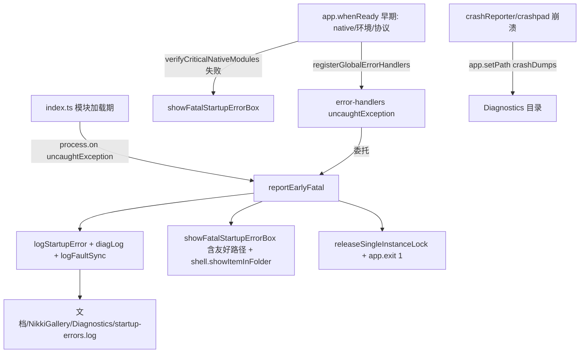

# 启动早期静默崩溃的可观测性与用户引导 — 实施计划

> 对应计划：`early-crash-observability-and-guidance`
> 适用：NikkiGallery（Electron Windows 桌面应用，主进程 CJS 产物）
> 日期：2026-08-27

## 1. 背景与现状

项目已有完整的内部日志（`logger` / electron-log）、崩溃记录（`crash-service` + electron `crashReporter`/`crashpad`）和诊断包导出功能，但均依赖程序正常启动进入主界面后使用。

启动早期（主进程初始化、原生模块加载、窗口创建前）若致命错误，进程会静默退出且无任何弹窗。经代码盘点，存在三处具体缺口：

- **Gap A（最早捕获但不弹窗）**：`src/main/index.ts` 在 `app.whenReady()` 之前注册了 `process.on('uncaughtException')`，但仅调用 `diagLog` 记录，**不弹框、不退出**。若崩溃发生在 `registerGlobalErrorHandlers()`（在 `application.initialize()` 内注册，晚于原生预检）之前，用户完全无感知。
- **Gap B（i18n 静默）**：`src/main/app/error-handlers.ts` 的 `uncaughtException` 处理器用 `dialog.showErrorBox(t('main.errorHandlers.dialog.errorTitle'), t(...))` 弹框，**依赖 i18n**。若 i18n 未就绪，`t()` 二次抛错 → 弹框失败 → 静默。
- **Gap C（隐藏路径）**：`startup-errors.log` / `diag.log` / 崩溃 dumps 全部位于 `AppData\Roaming\NikkiGallery`（默认隐藏目录），普通用户找不到；错误框给出的就是该隐藏路径。

## 2. 目标与边界

- 复用现有 `startup-diagnostic` / `logger` / `crash-service` / `native-load-guard` / `electron` 内置 `dialog.showErrorBox` + `crashReporter`，**不引入任何新增 npm 依赖**，不升级 `react-virtuoso`。
- 提示机制轻量：`electron.dialog.showErrorBox`（原生 MessageBox，无需 BrowserWindow、可在 app ready 前调用）。
- 日志路径用户友好：统一到 `文档/NikkiGallery/Diagnostics`（非隐藏）。
- 不影响正常启动流程与性能（同步、极小开销）。

## 3. 依赖声明

| 类型     | 名称                                  | 版本/来源     | 说明                                                             |
| -------- | ------------------------------------- | ------------- | ---------------------------------------------------------------- |
| 运行内置 | `electron.dialog.showErrorBox`        | Electron 40.x | 原生弹窗，早于 ready 可用，不依赖渲染进程/窗口                   |
| 运行内置 | `electron.crashReporter` / `crashpad` | Electron 40.x | 崩溃转储，已在 `lifecycle.ts` 启用                               |
| 运行内置 | `electron.shell.showItemInFolder`     | Electron 40.x | 崩溃后高亮日志文件（资源管理器定位）                             |
| 运行内置 | `app.setPath('crashDumps', dir)`      | Electron 40.x | 控制 crashpad 实际写入目录                                       |
| 现有模块 | `startup-diagnostic` / `logger`       | 项目内        | 复用 diagLog / logStartupError / logFaultSync，不重复建设        |
| 现有模块 | `native-load-guard`                   | 项目内        | 复用 `nativeLoadErrorBox` 不依赖 i18n 的双语文案最佳实践         |
| npm 依赖 | 无新增                                | —             | 沿用 `electron`/`electron-log`/`electron-vite`/`vitest` 既有版本 |

## 4. 总体设计

新增叶子模块 `src/main/utils/user-diag-path.ts`（**零项目内依赖**，仅 `electron` 惰性调用 + `os`/`path`/`fs`），作为用户友好诊断目录的单一权威：

- `getUserFacingDiagDir(deps?)`：首选 `app.getPath('documents')/NikkiGallery/Diagnostics`；fallback 链 `os.homedir()/NikkiGallery/Diagnostics` → `os.tmpdir()`；每个候选 `mkdirSync(recursive)` 成功即采用，全程 try/catch 不抛错、不阻塞。

新增中心模块 `src/main/utils/early-crash-guard.ts`（纯函数 + 可注入依赖）：

- `getUserFacingDiagDir`：重导出（兼容调用方统一入口）。
- `showFatalStartupErrorBox(err, opts?)`：**仅弹框（不退出）**，不依赖 i18n，文案含友好日志路径，并 `shell.showItemInFolder` 高亮日志文件。供 `index.ts` FATAL catch 与 `native-load-guard` 复用（调用方负责 `app.exit`）。
- `reportEarlyFatal(err, opts?)`：**完整致命处理**——`logStartupError` + `diagLog` + 同步 `logFaultSync` + `showFatalStartupErrorBox` + 释放单实例锁 + `app.exit(1)`；带 `hasReported`/`isExiting` 去重/退出竞态守卫，避免重复弹窗与重复退出。
- `showNonFatalErrorBox(err, opts?)`：偶发级错误框（不退出），i18n 无关，供 `error-handlers` 的 `unhandledRejection` 偶发分支使用。

修复三处缺口：

- **Gap A**：`index.ts` 早期 `process.on('uncaughtException')` 由「仅 diagLog」改为 `reportEarlyFatal(...)`（弹框 + 落盘 + 退出）；并在模块加载期尽早 `app.setPath('crashDumps', getUserFacingDiagDir())`。
- **Gap B**：`error-handlers.ts` 的 `uncaughtException` 处理器改为 `reportEarlyFatal(...)`（去掉 `t()` 依赖，杜绝 i18n 未就绪静默）；`unhandledRejection` 偶发分支弹框改用 `showNonFatalErrorBox`。
- **Gap C**：`startup-diagnostic.ts` 的 `getStartupLogPath`/`getDiagLogPath` 优先指向 `getUserFacingDiagDir()`；`crash-service.ts` 的 `initCrashDir` 默认与 `dir-manager.ts` 的 `crashDir` 默认对齐到 `getUserFacingDiagDir()`，并经 `custom-dirs` 的 `app.setPath('crashDumps', dir)` 保证 crashpad 写入一致。内部 `main-*.log`/`faults-*.jsonl` 仍留 `userData/logs`（开发者向，不强制用户友好）。

### 数据流

## 5. 启动说明（构建与运行）

- 受限环境构建序列（避开 Safe-Delete 网关，禁止 `npm run build` 的 clean 步）：
  `npx electron-vite build` → 写 `dist/main/package.json {"type":"commonjs"}` → `npx electron-builder --win --publish never` → `npm run verify:dist`。
- 开发调试开关：
  - `NIKKI_SKIP_NATIVE_GUARD=1`：跳过原生预检（仅严格等于 `'1'`）。
  - `NIKKI_EARLY_CRASH_SIM=1`（新增）：在 `index.ts` 模块加载期抛出一个早期崩溃，用于验证 `reportEarlyFatal` 弹框 + 日志（仅 `=== '1'`，默认关闭）。
- 正常环境跑单测：`npx vitest run src/main/utils/early-crash-guard.test.ts`（本机 vitest 沙箱损坏，以 `tsc -b` + ESLint 兜底）。

## 6. 错误处理（各分支）

| 阶段                   | 触发                                                          | 处理                                                                                |
| ---------------------- | ------------------------------------------------------------- | ----------------------------------------------------------------------------------- |
| 模块加载期（ready 前） | index.ts `uncaughtException`                                  | `reportEarlyFatal`：写 startup-errors.log + `showErrorBox`（含友好路径）+ `exit(1)` |
| whenReady 早期         | `verifyCriticalNativeModules`/`verifyStartupEnvironment` 失败 | 原生 guard 弹框（不依赖 i18n）后 `exit(1)`                                          |
| 初始化期               | error-handlers `uncaughtException`                            | 委托 `reportEarlyFatal`（去 `t()` 依赖）                                            |
| 偶发 rejection         | error-handlers `unhandledRejection` 分级                      | `showNonFatalErrorBox`（不退出，i18n 无关）                                         |
| crashpad 原生崩溃      | 进程级                                                        | `crashReporter` 写入友好目录 `Diagnostics/*.dmp`                                    |

## 7. 参数校验

- `getUserFacingDiagDir`：注入 `getDocumentsPath`/`getHomedir`/`getTmpdir` 缺省取真实实现；任一抛错被 try/catch 吞掉进入下候选，`app.getPath('documents')` 抛错时回退 `homedir`/`tmpdir`，不抛错、不阻塞。
- `reportEarlyFatal` / `showFatalStartupErrorBox`：去重守卫 `hasReported`（避免同一崩溃重复弹窗）；`isExiting` 守卫防重复 `app.exit`；`showErrorBox`/`exitApp`/`releaseLock`/`shell` 可注入便于测试。
- `crashDumps` 路径：`app.setPath('crashDumps', dir)` 仅在 `crashReporter.start()` 前调用；默认 `dir = getUserFacingDiagDir()`；自定义目录经 `isValidDir` 校验。
- `NIKKI_EARLY_CRASH_SIM` / `NIKKI_SKIP_NATIVE_GUARD`：仅 `=== '1'`（严格全等，防误触与大小写/空白）。
- 错误框文案为常量（不依赖 i18n），`t()` 仅在主界面就绪后的非致命路径使用（高频 rejection 的 `showMessageBox`）。

## 8. 基础测试用例

1. **early-crash-guard.test.ts**（vitest，正常环境）：
   - `getUserFacingDiagDir`：注入 `getDocumentsPath` → 返回 `…/Documents/NikkiGallery/Diagnostics`；`getDocumentsPath` 抛错 → 回退 `getHomedir` → `getTmpdir`。
   - `showFatalStartupErrorBox`：注入 `showErrorBox` 断言弹窗含「启动失败 / Startup Failed」与友好路径。
   - `reportEarlyFatal`：注入 `showErrorBox` 断言弹窗含友好路径与「启动失败」；断言 `logStartupError`/`logFaultSync` 被调用；断言 `exitApp(1)` + `releaseLock` 被调用；`shell.showItemInFolder` 被调用；重复调用第二次不重复弹窗/退出（去重守卫）。
   - 验收：`npx vitest run src/main/utils/early-crash-guard.test.ts` 全绿。

2. **startup-diagnostic.test.ts / error-handlers.test.ts**：更新路径与弹窗断言匹配「友好目录 + i18n 无关」（见 §9 改动文件）。
3. **本机兜底验证**：`tsc -b`（仅本次改动文件无类型错误）+ `npx eslint` 0 错误；正常环境补跑 vitest。

## 9. 改动文件清单（输入/输出/验收）

| 文件                                             | 输入                                               | 输出                                                                                                               | 验收                                              |
| ------------------------------------------------ | -------------------------------------------------- | ------------------------------------------------------------------------------------------------------------------ | ------------------------------------------------- |
| `src/main/utils/user-diag-path.ts`（新）         | 无                                                 | `getUserFacingDiagDir(deps?)`                                                                                      | `tsc -b` 0 错误；ESLint 0 错误；单测覆盖 fallback |
| `src/main/utils/early-crash-guard.ts`（新）      | 无                                                 | `getUserFacingDiagDir`/`reportEarlyFatal`/`showFatalStartupErrorBox`/`showNonFatalErrorBox`                        | 同上 + 单测全绿                                   |
| `src/main/utils/early-crash-guard.test.ts`（新） | 无                                                 | 单测                                                                                                               | vitest 全绿（正常环境）                           |
| `src/main/utils/startup-diagnostic.ts`           | `getStartupLogPath`/`getDiagLogPath` 指向 userData | 改指向 `getUserFacingDiagDir()`，移除 `wxnn-photo-manager` 旧名 fallback                                           | 单测路径断言更新后通过；`tsc -b` 0 错误           |
| `src/main/index.ts`                              | 早期 `uncaughtException` 仅 diagLog                | 委托 `reportEarlyFatal`；尽早 `app.setPath('crashDumps', …)`；FATAL catch 用友好路径；新增 `NIKKI_EARLY_CRASH_SIM` | `tsc -b` 0 错误；ESLint 0 错误                    |
| `src/main/app/error-handlers.ts`                 | `uncaughtException` 用 `t()` 弹框                  | 委托 `reportEarlyFatal`；偶发 rejection 用 `showNonFatalErrorBox`                                                  | 单测更新后通过；`tsc -b` 0 错误                   |
| `src/main/app/native-load-guard.ts`              | 自带 `showFatalStartupErrorBox`                    | 复用 early-crash-guard 的 `showFatalStartupErrorBox`（保持导出稳定）                                               | 既有 `native-load-guard.test.ts` 仍全绿           |
| `src/main/services/crash-service.ts`             | `initCrashDir` 默认 userData/crashes               | 默认 `getUserFacingDiagDir()`                                                                                      | `tsc -b` 0 错误；`crash-service.test.ts` 仍绿     |
| `src/main/utils/dir-manager.ts`                  | `resolveCustomDir` crashDir 默认 userData/crashes  | crashDir 默认 `getUserFacingDiagDir()`                                                                             | 既有 `custom-dirs.test.ts` 仍绿                   |
| 测试文件（startup-diagnostic/error-handlers）    | 旧断言                                             | 更新路径/i18n 无关断言                                                                                             | vitest 全绿（正常环境）                           |

## 10. 验证纪律与执行顺序

每步先验证再进入下一步：

1. 写 `user-diag-path.ts` + `early-crash-guard.ts` + 单测 → 运行 `tsc -b`（仅新增文件无类型错误）+ ESLint 0 错误；正常环境 `vitest` 全绿。
2. 改 `startup-diagnostic.ts` + `index.ts` → `tsc -b` 0 错误 + ESLint 0 错误；更新 `startup-diagnostic.test.ts` 断言后 vitest 绿。
3. 改 `error-handlers.ts` + `native-load-guard.ts` → `tsc -b` 0 错误 + ESLint 0 错误；更新 `error-handlers.test.ts` 断言后 vitest 绿；`native-load-guard.test.ts` 绿。
4. 改 `dir-manager.ts` + `crash-service.ts` → `tsc -b` 0 错误 + ESLint 0 错误；既有相关单测绿。
5. 端到端模拟验证：设置 `NIKKI_EARLY_CRASH_SIM=1` 启动打包产物 → 应弹出「启动失败」框并指出 `文档/NikkiGallery/Diagnostics/startup-errors.log`，且日志文件存在且含错误；清理变量后正常启动 `boot-ok.marker` 生成。

每段代码最多审查一次，审查指出具体检查项（路径解析、去重守卫、i18n 无关、不触碰无关文件），代码无严重缺陷即视为通过，立即推进下一步。

## 11. 实现注意事项（防回归）

- 仅改动上表文件，不触碰 `MasonryView.tsx`/`BatchActions.*`/`globals.css`/`ShareMenuButton.tsx` 等无关功能。
- `early-crash-guard` 不反向 import `native-load-guard`（单向依赖，避免循环）；`native-load-guard` 复用其 `showFatalStartupErrorBox`。
- `user-diag-path.ts` 不 import 任何业务模块，避免循环依赖。
- `index.ts` 保持既有 `uncaughtException`→`unhandledRejection` 注册顺序；`unhandledRejection` 仍不退出（非致命）。
- 提交遵循 conventional commits 且 subject ≤ 72 字符；中文 message 用 UTF-8 无 BOM 外部文件 + `git -c i18n.commitEncoding=utf-8 commit -F`。
