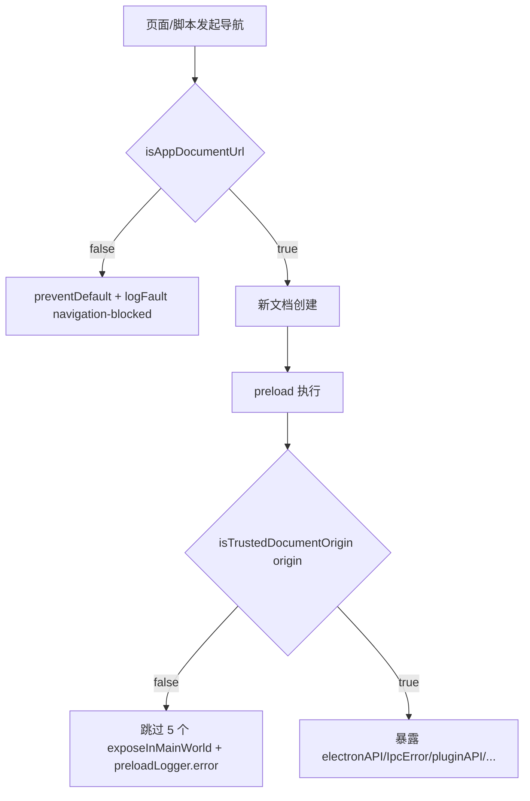

# 修复：will-navigate 白名单过宽导致的 IPC 桥泄露

- 日期：2026-08-28
- 类别：security / 权限泄露
- 影响面：主窗口导航 + preload 授权边界
- 关联文件：`src/main/app/window-manager.ts`、`src/main/preload.ts`

## 一、问题

原实现（`window-manager.ts` 导航防护块）：

```ts
const allowed =
  url.startsWith('file://') ||
  url.startsWith('app://') ||
  url.startsWith('http://localhost') ||
  url.startsWith('media://')
if (!allowed) event.preventDefault()
```

`preload` 是 **webContents 级** `webPreferences`，对该窗口加载的**任何**文档都会执行，与页面来源无关。
只要主框架被导航到白名单内的目标，`contextBridge.exposeInMainWorld('electronAPI', …)` 就会在一个
非应用自身的页面上重建完整 IPC 桥：

| 白名单条目                     | 被授予的对象                                                  | 可造成的后果                                                   |
| ------------------------------ | ------------------------------------------------------------- | -------------------------------------------------------------- |
| `file://`                      | 本地任意 HTML（如 `file:///C:/Users/me/Downloads/evil.html`） | 受 PathGuard 限制到用户主目录，但仍可读写/删除主目录下任意文件 |
| `http://localhost`（任意端口） | 本机任何进程起的 HTTP 服务（恶意软件、被劫持的 dev server）   | 同上                                                           |

`preload` 脚本不受页面 CSP 约束，因此 `window-manager.ts` 下发的 CSP **不构成**这道防线。
`http://localhost` 在 dev 下确为必需（`:129` 加载 vite dev server），但生产构建不应保留。

## 二、修复方案：双层防线，任一生效即阻断



### 第一层（主进程，新增 `src/main/app/navigation-guard.ts`）

- `isAppDocumentUrl(url, isDev)`：放行 `app://` / `media://`；**仅 dev** 放行
  `http://localhost:5173` 与 `http://127.0.0.1:5173`（同源且同端口，不再是 `startsWith('http://localhost')`）；
  `file://` 生产与 dev 一律拒绝（全仓无 `file://` 文档依赖，已 grep 确认）。
- `guardNavigation(event, url, { source, isDev })`：拒绝时 `preventDefault()` +
  `logFault('navigation-blocked', …, { source, url })`。
- `window-manager.ts` 注册两个事件：
  - `will-navigate`（主帧）
  - `will-frame-navigate`（**全部帧**，含 iframe）——子帧同样会执行 preload，必须覆盖。
    主帧事件在此处短路 `return`，交由 `will-navigate` 处理，避免同一导航产生两条故障记录。

### 第二层（preload，新增 `src/main/preload/origin-guard.ts`）

- `readDocumentOrigin()`：读 `location.origin`，无 `location`（node/单测）或读取抛错时返回 `null`。
- `isTrustedDocumentOrigin(origin, isDev)`：放行 `app://*` / `media://*`，dev 追加 dev server 源；
  **空 / `'null'` / `about:` 一律拒绝**——opaque origin 会被 evil 父页 `document.write` 进自建的
  about:blank iframe 后访问其 `contentWindow`，放行等于重新开洞。
- `src/main/preload.ts`：装配前做一次门禁，5 个 `exposeInMainWorld`（`electronAPI` / `IpcError` /
  `pluggableElectronIpc` / `__setPluginI18nT` / `pluginAPI`）统一改走 `exposeIfTrusted()`，
  非授信文档零暴露并用 `preloadLogger.error` 留痕。

### 关键设计决策

**1. preload 的 dev 开关为什么用编译期常量而不是 `process.env.NODE_ENV`**

实测 `dist/main` 全目录仅 1 处 `NODE_ENV`，正是 `window-manager.ts` 的
`process.env.NODE_ENV === 'development'` 原样保留——**electron-vite 的 lib 模式不做构建期替换**；
而 preload 运行于 `sandbox: true`，运行时 `process.env` 不可靠。故在
`electron.vite.config.ts` 的 `preload` 块注入：

```ts
define: {
  __NIKKI_PRELOAD_DEV__: JSON.stringify(process.env.NODE_ENV === 'development')
}
```

取值可靠：`electron-vite` 在加载配置文件**之前**已执行 `process.env.NODE_ENV = defaultMode`
（`build()` → `'production'`，`createServer()` → `'development'`，见 `node_modules/electron-vite/dist/chunks/lib-*.js`）。
`origin-guard.ts` 以 `typeof __NIKKI_PRELOAD_DEV__ !== 'undefined' && __NIKKI_PRELOAD_DEV__ === true` 读取，
未注入时安全缺省为 `false`（vitest 直接跑源码即走生产语义）。

**2. 两个 guard 为什么不共用模块**

`preload.test.ts` 末尾的依赖白名单守卫禁止 preload 引入主进程模块与 `src/shared` 运行时值，
因此 URL 前缀判定（主进程侧）与 origin 判定（preload 侧）各放一份，两个文件头互相注明
「放行集合必须逐字镜像，改一处要同步改另一处」（沿用 CSP 双写的既有约定）。

**3. 为什么新增 FaultType 而不是复用 `manual`**

安全事件需要在诊断面板可辨识。联动改动：`logger.ts` 的 `FaultType` 联合 +
`buildFaultTypeLabels` + zh-CN/en 文案 + `npm run sync-i18n-keys`（向其余 10 份补空串，
`check-i18n-keys` 只校验 key 存在性）+ `logger.test.ts` 计数 17→18。

## 三、改动清单

| 文件                               | 类型      | 说明                                          |
| ---------------------------------- | --------- | --------------------------------------------- |
| `src/main/app/navigation-guard.ts` | 新增      | 主进程导航授信判定 + 拦截处理                 |
| `src/main/app/window-manager.ts`   | 修改      | 替换旧白名单；新增 `will-frame-navigate`      |
| `src/main/preload/origin-guard.ts` | 新增      | preload 文档源自检                            |
| `src/main/preload.ts`              | 修改      | 5 个暴露点走 `exposeIfTrusted()` 门禁         |
| `electron.vite.config.ts`          | 修改      | preload 块新增 `__NIKKI_PRELOAD_DEV__` define |
| `src/main/utils/logger.ts`         | 修改      | 新增 `navigation-blocked` 故障类型            |
| `src/renderer/i18n/locales/*.json` | 修改      | 12 份同步 `faultTypes.navigation-blocked`     |
| 4 个测试文件                       | 新增/修改 | 见下                                          |

## 四、验证记录

1. **单测**（`npx vitest run`）
   - 新增 `src/main/app/__tests__/navigation-guard.test.ts`（28 用例，表驱动）
   - 新增 `src/main/preload/__tests__/origin-guard.test.ts`（38 用例，含 `vi.stubGlobal` 切 dev 分支）
   - `window-manager.test.ts` 新增 8 个导航用例（29 → 通过）
   - `preload.test.ts`：`vi.hoisted` 内打 `location = { origin: 'app://renderer' }` 桩
     （hoisted 早于静态 import），并新增「非授信 origin 零暴露」用例（含 file:// / 非 5173 端口 /
     opaque / 无 location 四种场景）
   - `logger.test.ts`：17 → 18 种故障类型 + 新增标签断言
   - 全量：`2 failed | 229 passed`（4082 用例），两处失败均为**既有环境问题**，与本次改动无关：
     - `src/main/utils/path-safety.test.ts`「只读目录返回 false」——Windows 下 `fs.chmodSync(dir, 0o444)`
       不阻止写入，OS 相关
     - `src/renderer/components/gallery/GalleryStackOverflow.test.tsx`——jsdom 下 react-virtuoso
       递归，已知环境相关失败
2. **ESLint / Prettier**：改动文件 0 error 0 warning，格式已统一
3. **Typecheck**（`npx tsc -b --force`）：改动文件 0 错误；剩余 24 条为既有错误，与本次无关
4. **构建验证 define 静态替换**（`npx electron-vite build`）
   - 生产 `dist/main/main/preload.js`：`__NIKKI_PRELOAD_DEV__` **0 命中**（已被替换）；
     `isTrustedDocumentOrigin` 体内 dev 分支被 DCE，仅剩「app:// / media:// 放行，其余 false」✅
   - dev 语义另用临时 vite 配置（`define: { __NIKKI_PRELOAD_DEV__: true }`，验证后已删除）构建确认：
     `DEV_SERVER_ORIGINS` 保留且 dev 分支存活，dev server 源仍被授信 ✅
   - 说明：两种构建下 `isTrustedDocumentOrigin(documentOrigin)` 的第二个实参都被 esbuild 的
     未使用参数优化丢弃了，但那是因为 `isDev` 常量折叠后函数体已不再读取它，语义正确

## 五、注意事项 / 后续

- 放行集合两处镜像（`navigation-guard.ts` 的 URL 前缀 ↔ `origin-guard.ts` 的 origin），
  改一处必须同步改另一处。
- 初始 `about:blank` 文档会执行 preload 并被拒（origin 为 `'null'`），随后 `app://`（或 dev server）
  文档会重新执行 preload 并授信。渲染层代码只由正式文档加载，无白屏风险；
  代价是 DevTools console 会多一条 `[preload] refused to expose …` 留痕（预期行为）。
- 未改动：`setWindowOpenHandler` 的 deny 语义、CSP 策略、renderer-protocol / media-protocol、
  `DetailPage.tsx:657` 的 `window.open`。
