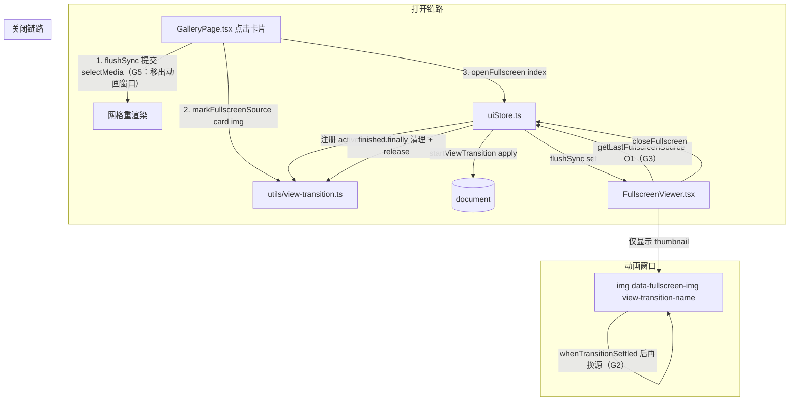

# 全屏预览过渡动画卡顿/掉帧修复实施计划（Phase 2）

- 文档编号：`PLAN-FULLSCREEN-TRANSITION-JANK-PHASE2`
- 适用版本：2.5.1
- 创建日期：2026-09-10
- 前置计划：`docs/plans/fix-fullscreen-transition-jank.md`（Phase 1，RC1–RC5 已落地）
- 状态：执行中
- 作者：AI 结对编程

---

## 0. 目标

修复从图库 / 截图 / 重复文件页点击图片进入全屏预览时，基于 View Transitions API 的共享元素过渡卡顿、掉帧问题。目标：过渡期间主线程不执行任何非必要同步工作，各场景动画能跑满显示器刷新率（60/120/144Hz）而不丢帧。

核心能力点：

- **降级正确性**：系统开启「减弱动画」（prefers-reduced-motion）时不再执行共享元素过渡，直接瞬开
- **动画窗口隔离**：4K 原图的解码与换源必须发生在过渡结束之后，不得抢占动画帧
- **零快照窗口 DOM 查询**：打开/关闭全屏的快照临界窗口内不做全文档属性选择器遍历，改用 O(1) 元素引用
- **图层收敛**：取消图库卡片常驻 `will-change`，消除整屏合成层爆炸
- **重渲染时序**：网格选中态的重渲染从动画窗口内移到过渡启动之前
- **导航正确性**：全屏「下一张」按钮的可见性以当前生效列表（`activeFiles`）为判据

---

## 1. 现状盘点（已读码核实，勿重复已做之事）

仓库已存在 Phase 1 计划 `docs/plans/fix-fullscreen-transition-jank.md`，其 RC1–RC5 已全部落地且 working tree clean：

- `src/renderer/utils/view-transition.ts`：`canUseViewTransition` / `markFullscreenSource` / `clearFullscreenSource`（O(1) 引用清理）
- `src/renderer/stores/uiStore.ts:42-57` `commitFullscreenState`（`flushSync` 同步提交 + 兜底），`:404-473` 参数校验与降级链
- `src/renderer/components/gallery/FullscreenViewer.tsx:82-112`：缩略图先行 + 离屏 `decode()` + 原子换源
- `src/renderer/styles/globals.css:746-773`：`::view-transition-group/old/new(fullscreen-media)` 合成规则

本轮只补齐 Phase 1 遗漏的 6 个缺口（G1–G6），**不触碰** ZoomableContainer、DetailPage/DuplicatesPage 源元素登记（属 Phase 1 RC6「无动画」而非掉帧）、uiStore `partialize`。

---

## 2. 根因清单（G1–G6，含文件:行号）

| 编号   | 根因                                                                                                | 位置                                                                      | 为何掉帧                                                                                                                                                                                 |
| ------ | --------------------------------------------------------------------------------------------------- | ------------------------------------------------------------------------- | ---------------------------------------------------------------------------------------------------------------------------------------------------------------------------------------- |
| **G1** | View Transitions 降级只认应用内 `html.reduce-motion` 类，不认系统 `prefers-reduced-motion`          | `src/renderer/utils/view-transition.ts:34-44`；类名来源 `App.tsx:242-246` | 「API 降级不当」：OS 关动画仍跑满 220ms。且 `globals.css:947-984` 的媒体查询用 `html:not(.reduce-motion) *`，**选择器不匹配 `::view-transition-*` 伪元素**，CSS 侧兜不住，必须 JS 侧判定 |
| **G2** | 原图换源只等 `decode()`，未等 `transition.finished`                                                 | `FullscreenViewer.tsx:93-112`                                             | 冷加载时换源落在 220ms 动画窗口内，触发 4K 全尺寸解码+重绘，直接吃掉数帧                                                                                                                 |
| **G3** | 关闭路径 `document.querySelector('img[data-media-id=...]')` 全文档遍历，且位于旧快照拍摄之前        | `FullscreenViewer.tsx:206-212`                                            | 「强制同步布局」：属性选择器遍历 keep-alive 多页 + 虚拟网格（千级节点），开销落在临界窗口。而打开时已登记过同一 `` 引用，可复用降为 O(1)                                            |
| **G4** | `.media-card { will-change: transform }` 无条件提升合成层                                           | `globals.css:776-783`                                                     | 「图层爆炸」：虚拟列表同屏数十至上百卡片各自成层，root 快照需逐一光栅化；长期驻留占 GPU 显存。仓库内已有同手法先例 `globals.css:256-257`、`:737`                                         |
| **G5** | `selectMedia(id)` 与 `openFullscreen()` 连续写入，`selectMedia` 的重渲染被 `flushSync` 拖进快照窗口 | `GalleryPage.tsx:293-298`                                                 | 「并发→强制同步」：整屏网格重渲染（数十张卡片+img）压在动画起点的同一帧                                                                                                                  |
| **G6** | 「下一张」按钮用 `filteredFiles.length` 而非 `activeFiles.length`                                   | `FullscreenViewer.tsx:551`（其余处 `:117/:329/:75` 均用 activeFiles）     | 从重复文件页（`DuplicatesPage.tsx:350-353` 显式传 files）打开时按钮显隐错判                                                                                                              |

**复杂度收益**：G3 快照前 DOM 操作 O(全文档节点数) → O(1)；G4 常驻合成层数 O(同屏卡片数) → O(动画进行中的元素数)；G2/G5 动画窗口内主线程工作量 → 0。

---

## 3. 依赖声明

### 3.1 新增依赖：**无**

不安装任何新包。全部能力来自已存在于 `package.json` 的运行时与 API：

| 能力                                              | 来源                               | 证据                                                                          |
| ------------------------------------------------- | ---------------------------------- | ----------------------------------------------------------------------------- |
| `document.startViewTransition`                    | Chromium 原生 View Transitions API | `uiStore.ts:30-40` 已在用                                                     |
| `matchMedia('(prefers-reduced-motion: reduce)')`  | 浏览器原生                         | 标准 DOM API，本次新增消费                                                    |
| `flushSync`                                       | `react-dom`（React 19 自带）       | package.json dependencies；`uiStore.ts:3` 已 import                           |
| `HTMLImageElement.decode()`                       | Chromium 原生                      | `FullscreenViewer.tsx:98-108` 已在用                                          |
| vitest 1.6 / jsdom 29 / @testing-library/react 16 | 仓库 devDependencies               | `package.json`（vitest `^1.6.1`、testing-library `^16.3.2`、jsdom `^29.1.1`） |

**安装方式**：无需安装。若 `node_modules` 缺失，**只能** `npm install`（增量）——本机 npm Safe-Delete 网关（阈值 500）会拦截 `npm ci` 与 `Remove-Item node_modules`。

### 3.2 明确不引入（含理由）

- **GSAP / framer-motion 手写 FLIP 兜底**：`motion@^12.42.2` 已在依赖中但未用于过渡。手写 FLIP 属重复造轮子，且无法解决「快照时机」这一真正瓶颈；降级路径维持「无动画直接开关」，只保证状态正确
- **任何 View Transitions polyfill**：Electron 40（Chromium 13x）原生可用
- **任何性能监控库**：本轮不引入埋点 SDK；本机 `npm run dev` 不可用，无法用 DevTools 量化，验收一律走 vitest 可判定断言

### 3.3 受影响文件清单

| 动作    | 完整路径                                                               | 说明                                                                                  |
| ------- | ---------------------------------------------------------------------- | ------------------------------------------------------------------------------------- |
| **NEW** | `docs/plans/fix-fullscreen-transition-jank-phase2.md`                  | 本计划（用户要求先入库）                                                              |
| MODIFY  | `src/renderer/utils/view-transition.ts`                                | + 系统动效偏好判定、active transition 注册表、lastSource 引用记忆（三处合计约 45 行） |
| MODIFY  | `src/renderer/utils/view-transition.test.ts`                           | + G1 用例（正常/异常/边界 3 类）                                                      |
| MODIFY  | `src/renderer/stores/uiStore.ts`                                       | `openFullscreen`/`closeFullscreen` 注册与释放 active transition                       |
| MODIFY  | `src/renderer/components/gallery/FullscreenViewer.tsx`                 | 换源等待 `finished`；`handleClose` 复用已登记引用；`:551` 改用 `activeFiles.length`   |
| MODIFY  | `src/renderer/components/gallery/FullscreenViewer.transition.test.tsx` | + G2/G3/G6 用例                                                                       |
| MODIFY  | `src/renderer/pages/GalleryPage.tsx`                                   | `selectMedia` 提交前移至 VT 之前                                                      |
| MODIFY  | `src/renderer/pages/GalleryPage.test.tsx`                              | + G5 源码结构性断言用例                                                               |
| MODIFY  | `src/renderer/styles/globals.css`                                      | 移除 `.media-card` 的 `will-change: transform`                                        |
| **NEW** | `src/renderer/styles/layer-budget.test.ts`                             | G4 图层预算源码断言                                                                   |

**不触碰**：`App.tsx`（keep-alive / reduce-motion 类名来源）、`uiStore.ts` 的 `partialize`、`mediaStore` 数据模型、`GalleryPage` 多选语义分支、`FullscreenViewer` 的 hooks 数量与顺序、VideoPlayer 分支、`ZoomableContainer`。

---

## 4. 启动说明（环境准备 / 启动命令 / 验证方式）

### 4.1 环境准备

```powershell
cd (Resolve-Path 'd:\Qode*\WXNN*').Path
node -v          # 需 Node 20+
npm -v
Test-Path node_modules   # False 时执行 npm install（禁止 npm ci）
```

### 4.2 启动命令与可用性分级

| 命令                                                  | 可用性        | 用途                                                                                                                                     |
| ----------------------------------------------------- | ------------- | ---------------------------------------------------------------------------------------------------------------------------------------- |
| `npx vitest run <文件路径>`                           | ✅ 主验收手段 | 单文件红/绿验证                                                                                                                          |
| `npm run test:renderer`（=`vitest run src/renderer`） | ✅            | 渲染层子集回归                                                                                                                           |
| `npm run typecheck`（=`tsc -b`）                      | ✅            | 类型门禁                                                                                                                                 |
| `npm run lint`（=`eslint .`）                         | ✅            | 静态检查门禁                                                                                                                             |
| `npx electron-vite build`                             | ✅            | 构建冒烟（`npm run build` 的 clean 步被 Safe-Delete 拦截，须用本命令）                                                                   |
| `npm run i18n:check`                                  | ✅            | i18n key 一致性（脚本名是 `i18n:check`，**不存在** `check-i18n-keys`）                                                                   |
| `npm run preview:check`                               | ✅            | 预览链路漂移校验                                                                                                                         |
| `npm test`（全量）                                    | ✅ 后台跑     | `Start-Process cmd.exe "/c npx vitest run > .x.log 2>&1"` 后轮询 `.x.log`（PowerShell 管道直跑会被 watch 探测吞输出），跑完删除 `.x.log` |
| `npm run dev`                                         | ❌ 本机不可用 | npm allow-scripts 拦截 electron 二进制                                                                                                   |
| `npm run e2e:smoke`                                   | ⚠️ 条件可用   | **不得**作为本轮验收手段                                                                                                                 |

### 4.3 验证方式

**A. 自动化（本机唯一阻塞性验收）**：以「动画窗口内不得有 DOM 查询 / 不得换源 / 不得有常驻合成层提示 / 系统动效偏好必须生效」为可测代理指标，全部落 vitest 断言。

**B. 真机（仅当 `npm run dev` 恢复可用时的补充，非阻塞）**：

1. 图库滚动至含数百张 4K 截图的列表
2. DevTools Performance 录制（勾选 Screenshots + Web Vitals）
3. 点击卡片进入全屏：修复前共享元素放大期间出现 >50ms Long Task 与掉帧；修复后动画窗口内无我方引入的 Long Task，Frames 轨道 60/120/144Hz 连续无间隔
4. Windows「辅助功能 → 显示 → 显示动画」关闭后重测：应瞬时打开，无 220ms 过渡
5. Esc 退出重复 3 次取均值

---

## 5. 错误处理（异常分支 / 兜底 / 日志）

| 异常分支                                                           | 检测                                                                   | 兜底                                                      | 日志（ESLint 禁中文字面量，统一英文） |
| ------------------------------------------------------------------ | ---------------------------------------------------------------------- | --------------------------------------------------------- | ------------------------------------- |
| 无 `matchMedia`（SSR / node 环境）                                 | `typeof matchMedia !== 'function'`                                     | 跳过该项判定，不影响其余条件                              | 无（静默，正常分支）                  |
| `matchMedia` 抛错（受限环境）                                      | try/catch                                                              | 视为「未开启动效减弱」，继续走 VT                         | 无                                    |
| View Transitions 不支持 / 非函数                                   | `typeof startViewTransition !== 'function'`                            | 无动画直接开关                                            | 无                                    |
| `startViewTransition` 同步抛错（Illegal invocation 等）            | try/catch                                                              | `apply()` 降级，状态必然置位                              | 既有行为，不改                        |
| `flushSync` 抛错                                                   | try/catch 兜底 `patch()`                                               | 普通提交                                                  | 既有行为，不改                        |
| `transition.finished` 被拒绝                                       | 注册表内部 `.catch(() => undefined)`                                   | 换源仍执行，不产生未处理 Promise 拒绝                     | 无                                    |
| 用户中途切图导致 active transition 与新图不匹配                    | cleanup flag `cancelled`                                               | 丢弃旧回调，不覆盖新图                                    | 无                                    |
| 关闭时「记忆的源元素」已脱离 DOM（虚拟列表回收）                   | `el?.isConnected`                                                      | 回落既有 `document.querySelector`                         | 无                                    |
| 记忆元素的 `data-media-id` 与当前文件不符（翻过页 / 列表复用节点） | `dataset.mediaId === String(currentFile.id)`                           | 同上回落查询，保证缩小目标正确                            | 无                                    |
| 记忆引用长期持有导致节点不释放                                     | `closeFullscreen` 的 `finished.finally` 调 `releaseFullscreenSource()` | 每轮结束后清空引用                                        | 无                                    |
| `style` 写入抛错（只读 style）                                     | try/catch                                                              | 不登记，无过渡但不影响开关                                | 无                                    |
| 原图 `decode()` 失败 / 不支持                                      | `.catch(() => undefined)`                                              | 仍换源，绝不误判为加载失败                                | 无                                    |
| 组件卸载后异步回调返回                                             | cleanup flag                                                           | 不 setState                                               | 无                                    |
| 移除 `will-change` 后卡片悬停观感下降                              | 人工 / DevTools 复核                                                   | 如确有回退，改 `.media-card:hover` 短时提层；不得恢复常驻 | 无                                    |

**不变量（任何分支都必须成立）**：`openFullscreen` 后 `fullscreenOpen === true`；`closeFullscreen` 后 `fullscreenOpen === false`；任何异常不得向外抛出；不得出现未处理 Promise 拒绝。

---

## 6. 参数校验

### 6.1 既有 `openFullscreen(index, files?)`（保持现状，不得回归）

| 参数    | 类型                       | 必填 | 边界与非法值                                                                     |
| ------- | -------------------------- | ---- | -------------------------------------------------------------------------------- |
| `index` | `number`                   | 是   | `NaN`/`Infinity`/`<0`/非 number → 直接 return 不打开                             |
| `files` | `MediaFile[] \| undefined` | 否   | 非数组 → 忽略并按 `null`（图库语义）；`[]` 或 `index >= files.length` → 拒绝打开 |

### 6.2 新增 / 变更接口（`view-transition.ts`）

| 函数                             | 入参类型                              | 必填 | 边界与非法值处理                                                                                                                                                                                                           |
| -------------------------------- | ------------------------------------- | ---- | -------------------------------------------------------------------------------------------------------------------------------------------------------------------------------------------------------------------------- |
| `canUseViewTransition(doc?)`     | `Document \| null \| undefined`       | 否   | `undefined` → 取全局 `document`；`null`/非对象 → `false`；无 `startViewTransition` 或非函数 → `false`；`reduce-motion` 类 → `false`；**新增**：`matchMedia('(prefers-reduced-motion: reduce)').matches === true` → `false` |
| `setActiveTransition(t \| null)` | `{ finished: Promise<void> } \| null` | 否   | `null`/undefined → 清空注册表；传输对象无 `finished` → 存已 resolve 的 Promise；内部统一 `.catch(() => undefined)`                                                                                                         |
| `whenTransitionSettled()`        | 无                                    | —    | 无 active transition → 立即 resolved Promise（同步语义，供未走 VT 的路径复用，不改变现有测试时序）                                                                                                                         |
| `getLastFullscreenSource()`      | 无                                    | —    | 未记忆 / 已 `isConnected === false` → `null`；不抛错                                                                                                                                                                       |
| `releaseFullscreenSource()`      | 无                                    | —    | 幂等；多次调用不抛错                                                                                                                                                                                                       |
| `markFullscreenSource(el)`       | `Element \| null \| undefined`        | 否   | 空值空操作；重复调用先清理旧引用（现有语义不变），另**额外记忆**最近一次有效元素供 `getLastFullscreenSource` 使用                                                                                                          |

### 6.3 `FullscreenViewer.handleClose` 决策规则

```text
候选元素 = getLastFullscreenSource()
若 候选元素 存在 且 候选元素.dataset.mediaId === String(currentFile.id)
  → 直接使用（零 DOM 查询）
否则
  → 回落 document.querySelector(`img[data-media-id="${currentFile.id}"]`)
```

`fullscreenTargetImg` 为 `null` 时 `closeFullscreen` 仍必须把 `fullscreenOpen` 置 `false` 且不抛错。

---

## 7. 架构设计

改动全部收敛在渲染进程，且全部挂在 Phase 1 已建立的 `view-transition.ts` 模块上，**不新建第二个工具模块**：



- **模块边界**：`view-transition.ts` 只做「能力判定 + 标记生命周期 + transition/source 引用记忆」，不含业务逻辑；持久化状态仍只在 `uiStore`
- **不引入新的跨层依赖**：`FullscreenViewer` 直接读 utils（与它已读 `toFileUrl`/`needsAnonymousCors` 的模式一致），不增加 store 字段（避免额外重渲染）

### 7.1 Key Code Structures

需在 `src/renderer/utils/view-transition.ts` 追加的最小接口（仅签名，不含实现）：

```ts
/** 注册当前进行中的 View Transition；传 null 清空。内部吸收 finished 的拒绝 */
export function setActiveTransition(transition: { finished: Promise<void> } | null): void

/** 取得「当前过渡已结束」的 Promise；无活动过渡时返回已 resolve 的 Promise */
export function whenTransitionSettled(): Promise<void>

/** 取得最近登记过且仍连接在文档中的源元素；无则 null */
export function getLastFullscreenSource(): HTMLElement | null

/** 释放记忆的源元素引用（幂等） */
export function releaseFullscreenSource(): void
```

`FullscreenViewer.tsx` 换源处的目标形态（保持 hooks 数量与顺序不变）：

```ts
void Promise.all([
  ready.catch(() => undefined), // decode 失败亦可换源
  whenTransitionSettled() // G2：避开动画窗口
]).then(() => {
  if (!cancelled) setDisplayUrl(fileUrl)
})
```

---

## 8. 基础测试用例（正常 / 异常 / 边界）

测试与源码同目录，命名 `*.test.ts(x)`。`vitest.config.ts:19-23` 的 `environmentMatchGlobs` 只让 `src/renderer/**/*.test.tsx` 与 `src/renderer/hooks/**/*.test.ts` 自动进 jsdom → `src/renderer/utils/**` 与 `src/renderer/stores/**` 下测试**必须**首行 `// @vitest-environment jsdom`（既有 `view-transition.test.ts:1`、`uiStore.fullscreen-vt.test.ts:1` 已是此写法）。

### 8.1 G1 — `src/renderer/utils/view-transition.test.ts`（追加）

| 类别             | 用例                                                                                 | 期望                                                          |
| ---------------- | ------------------------------------------------------------------------------------ | ------------------------------------------------------------- |
| **异常（核心）** | `vi.stubGlobal('matchMedia', () => ({ matches: true }))` 后 `canUseViewTransition()` | `false`（系统动效减弱 → 不跑 VT）。**修复前返回 true → 红灯** |
| 正常             | `matches: false` 且存在 `startViewTransition`                                        | `true`（不误伤正常用户）                                      |
| 边界             | 删除 `window.matchMedia`（`undefined`）                                              | 不抛错，回落到其余判定，`true`                                |
| 边界             | `matchMedia` 抛错                                                                    | 不抛错，`true`                                                |
| 边界             | `doc` 传 `null` 同时 `matches: true`                                                 | `false` 且不抛                                                |

### 8.2 G2 — `FullscreenViewer.transition.test.tsx`（追加 describe）

| 类别             | 用例                                                                                                     | 期望                                                            |
| ---------------- | -------------------------------------------------------------------------------------------------------- | --------------------------------------------------------------- |
| **正常（核心）** | 先 `setActiveTransition({finished: 未 resolve 的 Promise})`，再打开有缩略图的文件，推进 `decode` resolve | `src` **仍为缩略图**，不得提前换源。**修复前立即换原图 → 红灯** |
| 正常             | 随后 resolve `finished`                                                                                  | `src` 变为原图 URL（`waitFor`）                                 |
| 异常             | `finished` 被 reject                                                                                     | 仍完成换源，且测试进程无 unhandled rejection                    |
| 边界             | 无 active transition（直接 `useUIStore.setState` 打开，既有 10 个用例的路径）                            | 行为与修复前完全一致（10 个既有用例必须全绿）                   |
| 边界             | 快速切图 + pending transition                                                                            | 旧文件回调不覆盖新图（复用既有竞态用例扩展）                    |

### 8.3 G3 — `FullscreenViewer.transition.test.tsx`（追加）

| 类别             | 用例                                                                                                       | 期望                                                            |
| ---------------- | ---------------------------------------------------------------------------------------------------------- | --------------------------------------------------------------- |
| **正常（核心）** | `markFullscreenSource(卡片img)` → 打开 → 关闭（Esc / 点击遮罩），期间 `vi.spyOn(document,'querySelector')` | 关闭流程**不得**触发 `querySelector`。**修复前必被调用 → 红灯** |
| 正常             | 关闭后 `useUIStore.getState().fullscreenTargetImg`                                                         | 等于登记的卡片 img（目标正确）                                  |
| 边界             | 登记的源元素被 `remove()`（`isConnected===false`）后关闭                                                   | 回落查询，不抛错                                                |
| 边界             | 打开后翻页到下一张再关闭（元素 `data-media-id` 与当前文件不符）                                            | 回落查询且目标为**当前文件**的卡片                              |
| 异常             | 从未登记过源元素即关闭                                                                                     | `fullscreenOpen === false`，不抛错                              |

### 8.4 G4 — `src/renderer/styles/layer-budget.test.ts`（NEW，node 环境）

| 类别             | 用例                                                                                                 | 期望                                                             |
| ---------------- | ---------------------------------------------------------------------------------------------------- | ---------------------------------------------------------------- |
| **正常（核心）** | 读取 `globals.css`，截取 `.media-card { ... }` 块                                                    | 不含 `will-change`。**修复前含 `will-change: transform` → 红灯** |
| 正常             | 同文件断言 `.media-card:hover` 仍含 `transform: scale(`                                              | 悬停效果未被误删                                                 |
| 边界             | 全文 `will-change` 出现处不含 `background-color`（防止后续把不可合成属性写回 will-change）           | 通过                                                             |
| 边界             | `right-click-wiring.test.ts` 范式：用 `indexOf('{')`/`indexOf('}')` 精确截取单规则块，避免跨块误匹配 | 通过                                                             |

### 8.5 G5 — `src/renderer/pages/GalleryPage.test.tsx`（追加，沿用其既有源码断言范式 `:93-122`）

| 类别             | 用例                                                                        | 期望                                                                                                     |
| ---------------- | --------------------------------------------------------------------------- | -------------------------------------------------------------------------------------------------------- |
| **正常（核心）** | 定位 `openFullscreen(fileIndex)` 锚点，回看其前 ~400 字符                   | 必须包含 `flushSync` 且包含 `selectMedia(id)`，即选中提交位于 VT 启动之前。**修复前无 flushSync → 红灯** |
| 边界             | 同一块内 `markFullscreenSource(` 必须存在                                   | 共享元素登记未被误删（防回归）                                                                           |
| 边界             | `selectMedia` 只出现一次于该分支（不得出现「先 open 再 select」的重复写入） | 通过                                                                                                     |

### 8.6 G6 — `FullscreenViewer.transition.test.tsx`（追加）

| 类别             | 用例                                                                                        | 期望                                                                             |
| ---------------- | ------------------------------------------------------------------------------------------- | -------------------------------------------------------------------------------- |
| **正常（核心）** | `filteredFiles` 传 10 个，`useUIStore.setState({fullscreenFiles: 3个, fullscreenIndex: 2})` | 「下一张」按钮不可见（已是最后一张）。**修复前以 10 判断 → 按钮错误出现 → 红灯** |
| 边界             | 同一 fixture 改 `fullscreenIndex: 1`                                                        | 按钮可见（防过度修正）                                                           |
| 边界             | `fullscreenFiles: null` + `filteredFiles` 10 个 + index 9                                   | 按钮不可见（图库语义保持）                                                       |
| 边界             | index 0 且 activeFiles 长度 1                                                               | 「上一张」「下一张」均不可见                                                     |

按钮定位方式：`container.querySelectorAll('button')` 中按 className 含 `right-4`（下一张）/ `left-4`（上一张）筛选（见 `FullscreenViewer.tsx:543/553`）。

---

## 9. TDD 子任务清单（输入 / 输出 / 验收标准）

> 通用前置：**每个节点先跑红灯命令，必须看到失败；失败信息与预期不符（或修复前即通过）则重写用例后重跑，方可改实现。**

### 节点 0：写入计划 + 记录修复前基线

- **修改文件**：NEW `docs/plans/fix-fullscreen-transition-jank-phase2.md`（本文件；行尾须转 LF）
- **输入**：本计划全文
- **输出**：入库的计划文档 + 控制台记录的「修复前全量基线数字」
- **验收**：`Get-Content docs\plans\fix-fullscreen-transition-jank-phase2.md -TotalCount 1` 有输出；`.x.log` 中 `Test Files` / `Tests` 两个数字被记录下来（基线应该是 ≥273 文件 / ≥4627 用例，0 失败）

### 节点 1（G1）：VT 降级纳入 `prefers-reduced-motion`

- **输入**：§8.1 用例 + `view-transition.ts:34-44` 现状
- **输出**：MODIFY `src/renderer/utils/view-transition.ts`、`src/renderer/utils/view-transition.test.ts`
- **实现要点**：在 `canUseViewTransition` 内、`reduce-motion` 类判定之后追加 `prefers-reduced-motion` 判定；私有 helper 用 `typeof matchMedia === 'function'` + try/catch 双保险；不新增调试导出
- **红灯**：`npx vitest run src/renderer/utils/view-transition.test.ts` → 新增的「系统动效减弱 → false」用例失败
- **验收**：同一命令全部通过（含既有 12 例）；`npm run typecheck` exit 0

### 节点 2（G2）：原图换源等待 `transition.finished`

- **输入**：§8.2 用例
- **输出**：MODIFY `src/renderer/utils/view-transition.ts`（`setActiveTransition` / `whenTransitionSettled`）、`src/renderer/stores/uiStore.ts`（`openFullscreen` 注册、`closeFullscreen` 清空，降级分支一律清空）、`src/renderer/components/gallery/FullscreenViewer.tsx:104-108`、`src/renderer/components/gallery/FullscreenViewer.transition.test.tsx`
- **实现要点**：换源条件由「decode 完成」改为「decode 完成 **且** 过渡结束」；`Promise.all` 吸收两侧拒绝；hooks 数量与顺序不变；cleanup flag 保留
- **红灯**：`npx vitest run src/renderer/components/gallery/FullscreenViewer.transition.test.tsx` → 「pending 过渡期间不得提前换源」失败
- **验收**：该文件全部通过（含既有 10 例）+ `npx vitest run src/renderer/stores/uiStore.fullscreen-vt.test.ts src/renderer/stores/uiStore.test.ts` 全通过

### 节点 3（G3）：关闭路径消除全文档 querySelector

- **输入**：§8.3 用例
- **输出**：MODIFY `src/renderer/utils/view-transition.ts`（`getLastFullscreenSource` / `releaseFullscreenSource`）、`src/renderer/components/gallery/FullscreenViewer.tsx:206-212`、`src/renderer/stores/uiStore.ts:462-466`（finished 时 `releaseFullscreenSource()`）、`FullscreenViewer.transition.test.tsx`
- **实现要点**：`markFullscreenSource` 额外记忆最近有效元素（不受 `clearFullscreenSource` 影响）；`handleClose` 按 §6.3 决策树取值，命中则零查询，未命中回落原查询
- **红灯**：同节点 2 命令 → 「关闭不得触发 `querySelector`」失败
- **验收**：该文件全部通过；`npx vitest run src/renderer/pages/DuplicatesPage.fullscreen.test.tsx` 仍通过

### 节点 4（G6）：导航按钮改用 `activeFiles.length`

- **输入**：§8.6 用例
- **输出**：MODIFY `src/renderer/components/gallery/FullscreenViewer.tsx:551`（`filteredFiles.length` → `activeFiles.length`）、`FullscreenViewer.transition.test.tsx`
- **红灯**：同节点 2 命令 → 「3 个文件 index=2 时下一张应隐藏」失败
- **验收**：该文件全部通过 + `npx vitest run src/renderer/pages/DuplicatesPage.fullscreen.test.tsx` 通过

### 节点 5（G5）：网格重渲染移出快照窗口

- **输入**：§8.5 用例（沿用 `GalleryPage.test.tsx` 既有源码断言范式）
- **输出**：MODIFY `src/renderer/pages/GalleryPage.tsx:293-298`（`selectMedia(id)` 用 `try { flushSync(() => selectMedia(id)) } catch { selectMedia(id) }` 前置提交）、`src/renderer/pages/GalleryPage.test.tsx`
- **红灯**：`npx vitest run src/renderer/pages/GalleryPage.test.tsx` → 「openFullscreen 之前必须存在 flushSync 包裹的 selectMedia」失败
- **验收**：`npx vitest run src/renderer/pages/GalleryPage.test.tsx src/renderer/pages/GalleryPage.share.test.tsx` 全通过

### 节点 6（G4）：收敛常驻合成层

- **输入**：§8.4 用例
- **输出**：NEW `src/renderer/styles/layer-budget.test.ts`；MODIFY `src/renderer/styles/globals.css:776-783`（删除 `will-change: transform;`，紧邻处补中文注释引用既有两处先例）
- **红灯**：`npx vitest run src/renderer/styles/layer-budget.test.ts` → 「`.media-card` 块不得含 will-change」失败
- **验收**：该命令全通过；`npx vitest run src/renderer/components/gallery` 全通过（确认无 CSS 依赖用例回归）

### 节点 7：全量回归与静态检查

- **命令**（均真实存在于 `package.json`）：

```powershell
Start-Process cmd.exe "/c npx vitest run > .x.log 2>&1"   # 轮询直至结束
npm run typecheck
npm run lint
npx electron-vite build
npm run i18n:check
```

- **验收标准（可判定）**：
  1. `.x.log` 中 `Tests` 数与节点 0 记录的基线相比**只增不减**，`failed = 0`（不得出现新增失败项）
  2. `npm run typecheck` exit 0
  3. `npm run lint` exit 0（仓库基线为零问题，不得新增警告）
  4. `npx electron-vite build` 构建成功
  5. `npm run i18n:check` 通过（本轮若改注释不动 UI 文案，应无变化）
  6. 删除临时文件 `.x.log`

---

## 10. Implementation Notes（防回归要点）

- **既有 10 个 FullscreenViewer 首图用例不得改动其时序假设**：它们不注册 active transition，`whenTransitionSettled()` 必须返回已 resolve 的 Promise（不可设为永不 resolve），否则既有用例会因等待而超时
- **`vi.clearAllMocks()` 不清空 `mockReturnValueOnce` 队列**（仓库已踩坑）：本轮 `vi.spyOn(document,'querySelector')` 须在 `afterEach` 显式 `mockRestore()`
- `queueMicrotask` 层数增加会让既有「`await Promise.resolve()` 一次即换源」类断言不稳 → 本轮不改动既有断言，新断言一律用 `waitFor`
- `FullscreenViewer` 是 `App.tsx:357` 全局单例，`activeFiles = fullscreenFiles ?? filteredFiles`（`:75`）语义不得改
- 不得修改 `uiStore` 的 `partialize`（`:487-497`）：新增的 active transition / lastSource 是**模块级引用**而非 store 字段，不入持久化、不触发重渲染
- 行尾 LF：新建文件写完后必须做 CRLF→LF 转换；已存在文件一律局部改
- ESLint 禁中文字符串字面量 → 新增日志若必须写，用英文
- 每个节点改完立即跑该文件 + 相邻相关文件子集，禁止攒到最后一次性跑

---

## 11. 风险与回滚

| 风险                                                | 影响     | 缓解                                                                                                   |
| --------------------------------------------------- | -------- | ------------------------------------------------------------------------------------------------------ |
| 移除 `will-change` 后悬停微卡                       | 观感     | `scale(1.02)` 期间合成器自动提层；若实测回退则仅在 `:hover` 短时处理，不恢复常驻                       |
| `selectMedia` 前置 `flushSync` 增加点击到动画的等待 | 感知延迟 | 总工作量不变，只是从「动画首帧」移到「动画之前」，换来窗口内零掉帧                                     |
| G3 记忆引用误命中导致缩小到错误卡片                 | 功能     | 双重校验（`isConnected` + `data-media-id` 比对），不符即回落                                           |
| G2 过渡永不结束（极端情况）导致原图不显示           | 功能     | `whenTransitionSettled` 内部 `.catch` 且由 UI 清理路径兜底；必要时加超时上限（仅在测试暴露问题时引入） |
| 以上每项若违反 YAGNI                                | 债务     | 改动合计 <80 行源码 + <200 行测试，集中在 5 个源文件 + 1 个 CSS + 2 个测试文件，`git diff` 可一键回退  |

**回滚**：`git checkout -- <上述文件>`；新增测试文件 `Remove-Item -LiteralPath` 删除即可。**禁止** `cmd /c del` 删点开头文件。
