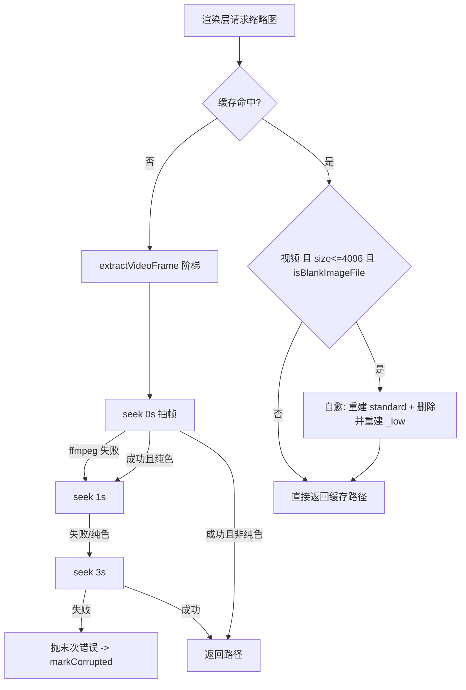

# 修复「缓存」「重复文件」板块视频缩略图显示为纯白色

- 状态：已完成（finished）
- 创建日期：2026-09-04
- 完成日期：2026-09-04

## 0. 实施结果

| 项             | 结果                                                                                                                                                                                                 |
| -------------- | ---------------------------------------------------------------------------------------------------------------------------------------------------------------------------------------------------- |
| 依赖变更       | 零新增 / 零升级 / 零移除（环境恢复用 `npm install`，1347 包）                                                                                                                                        |
| 新增文件       | `src/main/utils/video-frame.ts`、`src/main/utils/video-frame.test.ts`、本计划文档                                                                                                                    |
| 修改文件       | `src/main/thumbnail/generator.ts`、`src/main/thumbnail/generator.test.ts`、`src/main/media-worker/worker-entry.ts`、`src/main/media-worker/worker-entry.test.ts`                                     |
| 红灯→绿灯      | generator 3 条、worker 2 条，修复前分别失败于 `expected [0] to deeply equal [0,1]`、`[0,1,3]`、`expected 0 to be greater than 0`                                                                     |
| 全量测试       | **262 文件 / 4453 用例全部通过**（基线 261 / 4438，本次 +1 文件 +15 用例，含 2 项环境性用例本轮亦通过）                                                                                              |
| 子集           | `test:main` 157 / 2956、`test:renderer` 101 / 1427、`test:db` 7 / 360 全通过                                                                                                                         |
| `typecheck`    | exit 0，零错误                                                                                                                                                                                       |
| `lint`         | 仅基线 16 项（10 errors / 6 warnings），全落在 `.cache/`、`e2e/fullscreen-diagnose.e2e.ts`、`scripts/after-pack-vc-runtime.cjs`，无新增                                                              |
| `format:check` | 全部文件符合 Prettier 风格（`endOfLine: lf`）                                                                                                                                                        |
| 真实数据复核   | 对用户缓存目录 954 张标准缩略图跑判定：命中 **36 张纯白**（如 `557d8dccce996f87.jpg` 607 B、`e028f83440a35cc8.jpg` 913 B → true）；过曝但有细节的 `17aef4795a18bdbc.jpg`（25 KB）→ false，**无误伤** |

> 注：本机 `npm allow-scripts` 网关拦截了 `electron` / `ffmpeg-static` 的 install 脚本，
> 二进制未下载，`npm run dev` 手验无法在本机执行；已改用「真实 sharp + 用户真实缩略图缓存」做等效实证验证（见上表末行）。
> 待用户在可用环境执行 `npm run dev` 复核「缓存 / 重复文件」板块观感。

## 1. 缺陷现象

「缓存」板块（`currentView='launcher-cache'` → `GalleryPage` → `VirtualImageGrid`）与「重复文件」板块（`DuplicatesPage` → `DuplicateFileCard`）中，**部分视频条目的缩略图显示为纯白色方块**，图片条目正常。

特征：

- **概率性**：同一视频库内部分视频正常、部分纯白（取决于每个视频的片头内容）；
- **持久性**：一旦产生则长期不变（缩略图已落盘，后续请求直接命中缓存）；
- 无裂图、无占位图标、无报错——是一个能被正常解码的「白色 JPEG」。

## 2. 根因（含实机证据，已逐条核实）

### 2.1 实机证据

对本机缩略图缓存目录 `%APPDATA%\wxnn-photo-manager\thumbnails`（共 1384 个 `.jpg`，其中标准档位 954 个）逐张解码并缩放到 1×1 取均值：

- **156 张近似纯白**（RGB 均值均 > 230）；
- 其中 **41 张宽高比 ≥ 1.6**（视频典型比例），且**大量为精确 320×180** —— 正是 `scale=320:320:force_original_aspect_ratio=decrease` 对 1920×1080 视频的输出尺寸；
- 这批 320×180 文件中有一批体积极小：

  | 文件                   | 体积  | 尺寸    |
  | ---------------------- | ----- | ------- |
  | `557d8dccce996f87.jpg` | 607 B | 320×180 |
  | `5662bfc81ea69f78.jpg` | 652 B | 320×180 |
  | `6de06bba757be63e.jpg` | 843 B | 320×180 |
  | `68cf6379dfe5103c.jpg` | 867 B | 320×180 |
  | `e97b595ebbcb1046.jpg` | 866 B | 320×180 |
  | `e028f83440a35cc8.jpg` | 913 B | 320×180 |
  | `27f9ed078cf25240.jpg` | 901 B | 320×180 |

  320×180 的 JPEG 若含真实画面通常为 10–40 KB；600–900 B 意味着**整帧完全平坦（DCT 仅剩 DC 系数）**。

- 解析 SOF 标记确认：这些文件是**合法 JPEG**（以 `FFD9` 结束、尺寸 320×180）。**排除「文件损坏 / 写入截断」假设** → 结论是「抽到的那一帧本身就是纯白」。
- 反例佐证：另有一批 8×14 / 9×9 / 7×4、约 501 B 的极小缩略图是启动器缓存中的微小 UI 图源（sharp `withoutEnlargement` 保持原尺寸），与视频无关。

### 2.2 链路分析（逐行核对实码）

两条展示链路最终都落到同一个文件：`${cacheDir}/${contentHash}.jpg`（或其 `_low` 副本）。

1. **缓存板块** → `src/renderer/components/gallery/VirtualImageGrid.tsx`:
   - `const lowUrl = toLowQualityUrl(file.thumbnail)`（第 369 行），推导 `${hash}.jpg` → `${hash}_low.jpg`；
   - `thumbUrl = useHighQuality || !lowUrl ? standardUrl : (highUrl ? toFileUrl(highUrl) : toFileUrl(lowUrl))`（第 371-376 行）；
   - **关键：`src/main/media-worker/worker-entry.ts` 的 `generateThumbnailInWorker`（第 353-379 行）在视频抽帧成功后，会与图片一样同步生成 `${hash}_low.jpg`**（从刚生成的标准帧缩放）。因此 `lowUrl` 文件存在 → HTTP 200 → **直接展示白色低清副本，且 `onError` 回退到 standard 的路径根本不会被触发**。这是「缓存板块白图永久留存」的直接原因。
2. **重复文件板块** → `src/renderer/pages/DuplicatesPage.tsx` 的 `DuplicateFileCard`：
   - `baseSrc = toFileUrl(file.file_type === 'video' ? file.thumbnail : file.thumbnail || file.file_path)`（第 1560-1562 行）→ 标准档位 `${hash}.jpg`，同样是白帧；
   - 缺图视频按需 `thumbnail.generate` 一次（第 1566-1590 行），已有 thumbnail 时不触发。
3. **共同根因**：两处 ffmpeg 抽帧实现 `extractVideoFrame`（`src/main/thumbnail/generator.ts` 第 651-660 行；`src/main/media-worker/worker-entry.ts` 第 235-243 行，两份逐字重复）固定抽 **0s 首帧**；现有的 0s→1s 重试**只在 ffmpeg 报错（error / 超时 / 0 字节）时触发**，ffmpeg 成功但画面纯白时**不会重试**。片头存在白闪 / 淡入 / 装饰帧的视频即产出纯白缩略图并永久命中缓存。

## 3. 修复后功能与视觉效果

- 抽帧不再无条件采用 0s 首帧：抽到纯色帧时沿 seek 阶梯继续取帧（0s → 1s → 3s），取到有内容的帧即停止。
- 历史缓存自愈：已落盘的纯白缩略图（含 `_low` 副本）在下次被访问时自动重建一次，无需用户手动清理缩略图缓存。
- 正常视频零额外开销：首帧有内容时只跑一次 ffmpeg，判定与重试逻辑不触发。
- 三个位点全部为纯色帧时**保留最后一帧**（不报错、不标损坏）；ffmpeg 全部失败时维持既有「标记损坏 + 返回 null」行为。
- 图片条目、卡片布局、角标、交互完全不变；生成失败的极端情况仍降级为居中视频占位图标。

## 4. 依赖声明

**本次不新增、不升级、不移除任何 npm 依赖，无需改动 package.json。**

仅需恢复开发环境：执行前已确认工作区**不存在 `node_modules`**（`Test-Path node_modules` = False），必须先执行 `npm install` 增量安装。受本机 npm Safe-Delete 网关（阈值 500 项）限制，**禁止 `npm ci`、禁止 `Remove-Item node_modules`**。

复用清单（全部为仓库内既有能力，不重复造轮子）：

- `sharp().stats()`：判纯色，风格照抄 `src/main/utils/scene-brightness.ts:25`；
- `extractVideoFrameAtSeek`：两处既有实现，阶梯仅在其上包一层循环；
- `ThumbnailGenerator.runSharp('low', ...)`（主进程）与既有 `_low` sharp 块（worker）：重建低清副本；
- `decodeLimiter` / `process-registry` / `ffmpeg-paths`：既有并发与进程治理设施。

## 5. 技术栈（沿用现有）

- Electron 40.10 + Vite（electron-vite） + React 18 + TypeScript + Tailwind
- 缩略图：`sharp ^0.35.3` + `fluent-ffmpeg ^2.1.3` + `ffmpeg-static ^5.3.0`
- 测试：`vitest ^1.6.1`；类型 `tsc -b`；静态 `eslint .`；格式 `prettier --check`

## 6. 实施策略

把「抽帧成功」的判定标准从「ffmpeg 进程退出码为 0」升级为「ffmpeg 成功 **且** 产出帧非纯色」，纯色则沿 seek 阶梯继续取帧；再对历史缓存加一层「体积闸门 + 纯色判定」的自愈，确保存量白图能被自动修复。

关键决策与取舍：

1. **纯色判定复用仓库已有 sharp stats 写法**：`scene-brightness.ts:25` 已在用 `sharp(path).resize(...,{fit:'inside'}).stats()` 读 `stats.channels[i]`，本次照其风格读 `stdev`（通道标准差最大值 ≤ 6 视为纯色）。不引入新图像算法、不加依赖。
2. **不采用 ffmpeg 内置 `thumbnail` 滤镜**（官方「选最具代表性帧」）：
   - (a) 需解码 N 帧（默认 100），批量抽帧耗时显著上升；
   - (b) 其判据为「与批次均值最接近的帧」，片头长白淡入会把均值整体拉偏，对本场景不比 seek 阶梯更可靠；
   - (c) 无法用现有 fluent-ffmpeg mock 稳定断言。
     改为复用仓库内既有的 `extractVideoFrameAtSeek`，只在其上包一层约 15 行的阶梯循环。
3. **失败开放（fail-open）**：`isBlankImageFile` 在任何异常（文件不存在、非图片字节、解码失败）下返回 `false`，保证既有 `generator.test.ts` 里 `Buffer.alloc(64, 0xff)` 的假 JPEG 不会被判为纯色，老用例全部保持绿灯。
4. **体积闸门避免热路径解码**：缓存命中自愈先用 `stat().size > 4096` 短路（正常帧 10 KB+，实测纯色帧 600 B–2 KB），只有疑似纯色才付出一次 sharp 解码（约 1–3 ms）。
5. **`_low` 必须同步修复**：只修 standard 不修 `_low`，「缓存」板块仍会显示白图（见 2.2 第 1 条）。故自愈分支必须删除并重建 `_low`。
6. **主 / worker 双份对称修改**：`extractVideoFrame` / `extractVideoFrameAtSeek` 在两处本就是逐字重复的实现（仓库既定形态，`worker-entry.ts` 注释即「完整复刻」），本次保持该形态做对称修改，**不做跨文件重构**——worker 的 `t` 来自 `../i18n/worker-safe`，主进程来自 `../i18n`，强行共用模块会引入 i18n 冲突风险。仅把无 i18n / logger 依赖的两个纯函数抽到共享工具文件。

## 7. 启动与验证说明

- 环境准备：`npm install`（增量，禁止 `npm ci`）。
- 自动化验证命令（均已在 `package.json` 真实存在）：
  - 单文件：`npx vitest run <测试文件路径>`
  - 子集：`npm run test:main`、`npm run test:renderer`、`npm run test:db`
  - 全量：`npm run test`
  - 类型：`npm run typecheck`（基线 exit 0，零错误）
  - 静态：`npm run lint`、`npm run format:check`
- 手验：`npm run dev` → 侧边栏「缓存」与「重复文件」→ 视频条目缩略图不再纯白（历史白帧首次访问时自动重建一次，可观察缩略图由白变实）。
- 等价手动兜底：设置 → 缓存管理 → 清理全部缩略图缓存（按钮已存在，`src/renderer/pages/settings/data-sections.tsx`），清理后重新进入板块。

## 8. 错误处理

- **ffmpeg 报错 / 超时 / 产出 0 字节**：记 warn 后进入阶梯下一位点；全部位点失败 → 抛最后一次错误，由 `doGenerate` 既有 `markCorrupted` + `logger.error` 分支接管（行为不变）。
- **ffmpeg 成功但纯色**：非最后位点 → warn 后进下一位点；最后位点仍纯色 → **保留该帧并返回，不报错、不标损坏**（降级优于失败）。
- **自愈失败**：整段 try/catch，异常时保留旧图并 `logger.warn`（主进程）/ `workerLog('warn', ...)`（worker），绝不因自愈失败让 `generate` 返回 null。
- **纯色判定异常**：`isBlankImageFile` 一律返回 `false`（失败开放），不影响正常抽帧。
- **进程内单次守卫**：`blankHealedHashes: Set<string>`（主进程私有字段 / worker 模块级常量）确保真正纯色的视频不会每次访问都重建。
- **日志**：新增日志用中文硬编码（沿用仓库既有先例 `[Thumbnail] 文件不存在: ${filePath}`），**不新增 i18n key**；worker 侧只用 `workerLog`，不引入主进程 `logger`、不引入 `../i18n`。

## 9. 参数校验

- `extractVideoFrameAtSeek` 现有三处校验保持不变：`videoPath` 非空字符串、`outputPath` 非空字符串、`seekSeconds` 为 `[0, 60]` 闭区间内的有限数；阶梯新增位点 `3` 在既有上限内，不改动校验边界。
- `isBlankImageFile(filePath)`：`null` / `undefined` / 空串 / 不存在路径 / 非图片字节 → 统一 `false`；`stats.channels` 为空或长度不足 → `false`。
- `isBlankCachedThumbnail(filePath)`：`stat` 失败 → `false`；`size > 4096` → `false`（不解码）。
- `stdev` 取值做有限数兜底（`Number.isFinite`），`NaN` / `undefined` 不参与比较，避免误判为纯色。

## 10. 基础测试用例（正常 / 异常 / 边界）

### 10.1 `src/main/utils/video-frame.test.ts`（新增，用真实 sharp，不 mock）

| 类别 | 用例                                 | 期望                                                                                    |
| ---- | ------------------------------------ | --------------------------------------------------------------------------------------- |
| 正常 | 320×180 纯白 JPEG                    | `isBlankImageFile` = `true`                                                             |
| 正常 | 320×180 纯黑 JPEG                    | `isBlankImageFile` = `true`                                                             |
| 异常 | 渐变 / 噪点 JPEG                     | `isBlankImageFile` = `false`                                                            |
| 异常 | 文件不存在                           | `isBlankImageFile` = `false`（失败开放）                                                |
| 异常 | 非图片随机字节文件                   | `isBlankImageFile` = `false`                                                            |
| 边界 | 2048×2048 纯白 JPEG（体积 > 4096 B） | `isBlankImageFile` = `true`，`isBlankCachedThumbnail` = `false`（体积闸门生效，不解码） |
| 边界 | 极小纯白 JPEG（体积 < 4096 B）       | 两个函数均为 `true`                                                                     |

### 10.2 `src/main/thumbnail/generator.test.ts`（修改现有文件）

先给现有 `vi.mock('sharp', ...)`（第 115-123 行）补 `stats: () => Promise.resolve({ channels: [{ stdev: ctl.statsStdev }] })`，由 `ctl` 控制；`resize` / `jpeg` / `toFile` 链保持不变，保证老用例不受影响。

| 类别 | 用例                                 | 修复前（红灯）      | 修复后（绿灯）                                                        |
| ---- | ------------------------------------ | ------------------- | --------------------------------------------------------------------- |
| 正常 | 首帧纯白 → 继续 1s 抽帧              | `ctl.seeks` = `[0]` | `ctl.seeks` = `[0, 1]` 且返回非 null                                  |
| 异常 | 三位点全纯白 → 保留末帧              | `ctl.seeks` = `[0]` | `ctl.seeks` = `[0, 1, 3]` 且 `generate` 返回路径（非 null、不标损坏） |
| 边界 | 缓存命中纯白 → 自愈重建并刷新 `_low` | 不触发任何 ffmpeg   | `ctl.seeks` 非空，且 `_low` 被重建                                    |

现有 5 条用例（成功 / ffmpeg error / 0 字节 / 0s 失败 1s 成功 / 参数校验 / 超时 / GamePlayPhotos 两条例外）必须保持绿灯（`ctl.statsStdev` 默认值取 50 = 非纯色，使其行为与修复前一致）。

### 10.3 `src/main/media-worker/worker-entry.test.ts`（修改现有文件）

该文件已有视频用例（第 1139 / 1155 / 1173 行）与 `ctl.ffmpegSeeks` / `ctl.ffmpegMode` 控制态、fluent-ffmpeg 与 sharp 的 mock（第 100-183 行）。实施时需先用 code-explorer 核实 mock 结构，确认是否需要补 `stats()`。

| 类别 | 用例                                     | 修复前（红灯）            | 修复后（绿灯）               |
| ---- | ---------------------------------------- | ------------------------- | ---------------------------- |
| 正常 | 首帧纯白 → 继续 1s                       | `ctl.ffmpegSeeks` = `[0]` | `ctl.ffmpegSeeks` = `[0, 1]` |
| 边界 | 视频缓存命中纯白 → 自愈重建并刷新 `_low` | `ctl.ffmpegSeeks` 为空    | 非空，且 `_low` 被重建       |

## 11. 目录结构与子任务（文件路径 + 输入 / 输出 + 验收标准）

### 子任务 0：计划文档落盘

- 文件：`docs/plans/fix-video-thumbnail-white-frame.md`（本文件，新增）
- 输入：根因分析、实机证据、修复方案。输出：完整实施计划。
- 验收：`docs/plans/` 下生成该 MD，含依赖声明 / 启动说明 / 错误处理 / 参数校验 / 基础测试用例 / 子任务清单。

### 子任务 1：恢复开发环境

- 命令：`npm install`（增量）
- 输入：缺失 `node_modules` 的工作区。输出：可运行的依赖树。
- 验收：`Test-Path node_modules` = True；`npx vitest run src/main/utils/constants.test.ts` 通过。

### 子任务 2：新增纯色帧判定共享工具（RED→GREEN）

- 文件：
  - `src/main/utils/video-frame.ts`（新增，约 45 行）
  - `src/main/utils/video-frame.test.ts`（新增）
- 输入：图片文件路径。输出：`boolean`（是否近乎纯色）。
- 导出：
  - `BLANK_STDEV_THRESHOLD = 6`
  - `BLANK_CACHE_SIZE_HINT_BYTES = 4096`
  - `isBlankImageFile(filePath: string): Promise<boolean>`
  - `isBlankCachedThumbnail(filePath: string): Promise<boolean>`
- 约束：不 import `t` / `logger`，保证主进程与 worker 通用。
- 验收：`npx vitest run src/main/utils/video-frame.test.ts` 全绿（7 条用例，见 10.1）。

### 子任务 3：主进程 `ThumbnailGenerator` 改造（RED→GREEN）

- 文件：`src/main/thumbnail/generator.ts`（修改）
  1. 新增常量 `VIDEO_THIRD_SEEK_SECONDS = 3`（与第 46-49 行既有常量并列）；
  2. 重写私有 `extractVideoFrame`（现第 651-660 行）为 seek 阶梯 `[0, VIDEO_RETRY_SEEK_SECONDS, VIDEO_THIRD_SEEK_SECONDS]`；`extractVideoFrameAtSeek`（第 668-743 行）**签名与内部实现保持不变**；
  3. `doGenerate`（现第 435-515 行）：把 `ext` / `isVideo` 计算（现第 464-465 行）**上移到第 456 行缓存命中判定之前**；缓存命中分支加视频白帧自愈（`blankHealedHashes: Set<string>` 私有字段做进程内单次守卫 + 重建 standard + 删除并重建 `_low`，复用既有 `this.runSharp('low', filePath, fileHash)`）。
- 输入：视频文件路径 + 缓存目录。输出：非纯色的缩略图路径。
- 验收：`npx vitest run src/main/thumbnail/generator.test.ts` 全绿，含 3 条新增 RED 用例转绿 + 既有 7 条保持绿灯。

### 子任务 4：media worker 对称改造（RED→GREEN）

- 文件：`src/main/media-worker/worker-entry.ts`（修改）
  1. 新增 `VIDEO_THIRD_SEEK_SECONDS = 3`（与第 223-226 行既有常量并列）；
  2. `extractVideoFrame`（现第 235-243 行）改为阶梯版（warn 走 `workerLog('warn', ...)`）；
  3. `generateThumbnailInWorker`（现第 326-387 行）：`ext` / `isVideo` / `lowPath` 上移到第 346 行缓存命中判定之前；命中分支加自愈（模块级 `const blankHealedHashes = new Set<string>()`），自愈后删除并重建 `_low`；现有第 367-379 行的 `_low` 生成块抽成局部 helper `writeLowFromStandard(thumbnailPath, lowPath)`（沿用 `LOW_MAX_WIDTH` / `LOW_MAX_HEIGHT` / `LOW_QUALITY` 与 `fit:'inside', withoutEnlargement:true`），两分支共用。
- 约束：不得改动 pHash / 重复标记 / 尺寸补读等其他任务。
- 验收：`npx vitest run src/main/media-worker/worker-entry.test.ts` 全绿，含 2 条新增 RED 用例转绿 + 既有用例保持绿灯。

### 子任务 5：回归与全局校验

- 命令（依次）：`npm run test:main`、`npm run test:renderer`、`npm run test:db`、`npm run test`、`npm run typecheck`、`npm run lint`、`npm run format:check`
- 验收：对齐已知基线——全量 261 文件 / 4438 用例中仅 2 项环境性失败（`path-safety.test.ts`「只读目录返回 false」、`GalleryStackOverflow.test.tsx`）；`npm run typecheck` exit 0；`npm run lint` 仅 16 个历史问题且全落在 `.cache/`、`e2e/fullscreen-diagnose.e2e.ts`、`scripts/after-pack-vc-runtime.cjs`。只出现这些即视为通过，无新增失败项。
- 收尾：把改动文件的行尾恢复为 CRLF，核对 `git diff --numstat` 无意外全量变更。

## 12. 已知限制与附带发现（本次不修）

- 主进程 `doGenerate` 对视频不生成 `_low`，worker 会生成 → 两处产物集合不一致；自愈逻辑已同时处理 `_low`，但不统一两者生成策略（避免扩大改动面）。
- 主进程 `generate(path, 'high')` → `doGenerateHigh`（第 394-433 行）对视频**直接调用 `this.doGenerate(filePath)`，绕过 `generatingLocks`**；且主进程与 media worker 是两个进程、无跨进程锁，理论上可能对同一 `${hash}.jpg` 并发跑 ffmpeg。经实机验证白图均为合法 JPEG（非截断），与本 bug 无因果关系，不在本次范围。
- `17aef4795a18bdbc.jpg`（320×160, 25 KB, avg 248）等「有细节但过曝」的帧按正常内容处理，不触发重试（HDR→SDR 未做色调映射属独立议题）。

## 13. 架构流程

