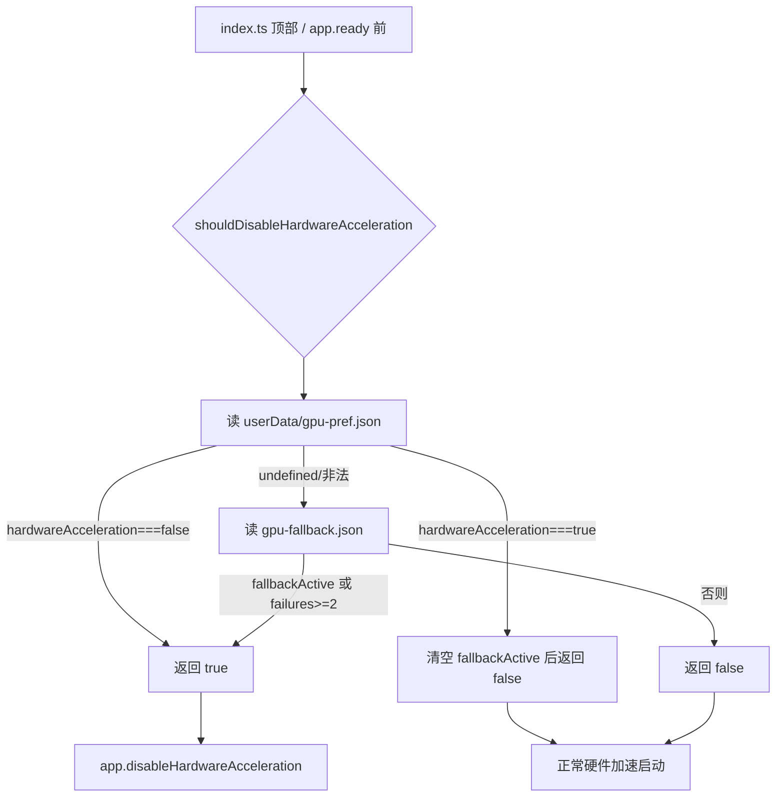

# GPU 硬件加速：自动降级 + 用户开关 实施计划

> 交付物：本 MD 计划 + 代码改动 + 测试，目标是让软件在 GPU 硬件加速不可用时自动以软件渲染启动，并在"设置"板块提供 GPU 硬件加速开关。

## 1. 背景与现状

- 仓库已落地一套 **GPU 崩溃自愈合"安全网"**（`src/main/app/gpu-fallback.ts`，VS Code 同源自愈算法），在 `src/main/index.ts` 顶部、`app.ready()` 之前调用 `shouldDisableHardwareAcceleration()` 决定是否 `app.disableHardwareAcceleration()`。
- 该安全网只处理"运行时 GPU 进程崩溃 → 下次启动回退软件渲染"，**不提供用户主动开关**。
- 设置类型 `SettingKey` / `SettingKeyMap` 中已存在 `hardwareAcceleration: boolean`，但：
  1. 不在 `RENDERER_PREF_KEYS` 白名单 → 渲染层无法经 `settings:set` 写入；
  2. 未被 `shouldDisableHardwareAcceleration()` 读取；
  3. 设置 UI 中无对应开关。

本次改动聚焦补齐"用户偏好"维度，复用既有安全网，零新增依赖，不动其他功能。

## 2. 依赖声明

- **不引入任何新的第三方 npm 包**（lockfile 已锁定 `electron@40.x`、`electron-vite`、`zod`、`vitest`、`react-i18next`）。
- 复用首方/既有能力：
  - Electron 首方 API：`app.disableHardwareAcceleration()`、`app.relaunch()`、`app.getPath('userData')`。
  - 本仓库 `src/main/app/gpu-fallback.ts` 已有自愈合方案（不再造轮子）。
  - 渲染层现有 `SettingsToggle` 组件（`src/renderer/pages/settings/shared.tsx`）。
  - 现有 IPC 通道 `settings:get` / `settings:set` / `app:relaunch`（`window.electronAPI.relaunch()`）。
- 开源复用结论：VS Code 的"GPU 崩溃自动回退软件渲染"为业界成熟方案，本实现以最小代码复刻其核心并叠加用户偏好开关，不引入 `electron-serve` 或第三方 GPU 检测库。

## 3. 启动说明

### 3.1 开发模式

```bash
npm run dev            # electron-vite dev，渲染层走 http://localhost:5173
```

### 3.2 构建打包（本机绕过 Safe-Delete 网关序列）

```bash
npx electron-vite build
node -e "require('fs').writeFileSync('dist/main/package.json',JSON.stringify({type:'commonjs'}))"
npm run pre-dist-check
npx electron-builder --win --publish never
npm run verify:dist
```

### 3.3 启动期决策时序



为何需要 `userData/gpu-pref.json` 镜像：`app.disableHardwareAcceleration()` 必须在 `app.ready()` 之前调用，而 sqlite 业务库在 `new Application()`（`whenReady` 之后）才初始化，启动期无法读库 → 用同步可读 JSON 镜像。镜像与 DB 均仅由 `settings-handler` 双写，不会漂移；启动决策只看镜像，UI 读取以 DB 为准。

## 4. 错误处理

- `readHardwareAccelPref`：文件不存在 → 返回 `undefined`；JSON 损坏 / 字段非布尔 → 返回 `undefined`（不抛错，等同未设置，回退到崩溃自愈逻辑）。
- `writeHardwareAccelPref`：路径被目录占用（`EISDIR`）/ 不可写 → 静默吞掉并 `logger.error` 记录，不影响主流程（与现有 state 写盘一致）；全部 `try/catch`。
- `settings-handler` 中 `hardwareAcceleration` 非布尔 → 抛 `AppError.validation`，不写库、不写镜像。
- 渲染层保存失败 → 捕获异常，toast 提示，状态回滚到旧值。
- GPU 观测仅记日志与落盘，不干预进程存活；`logger` 未初始化时降级为仅 `diagLog`。

## 5. 参数校验

- `settings:set('hardwareAcceleration', value)`：`value` 必须为布尔（`z.boolean()` + 显式 `typeof` 断言），否则拒绝并报错。
- `RENDERER_PREF_KEYS` 必须新增 `'hardwareAcceleration'`（否则前端无法写入）；先过白名单，再走镜像双写分支（仿 `customScanPaths` 特判放行模式）。
- `gpu-pref.json` 读取端对 `hardwareAcceleration` 字段做布尔类型守卫，非布尔视为未设置。
- JSON 解析结果字段校验：`consecutiveFailures` 必须为有限非负数，`fallbackActive` 必须 `=== true`；与既有逻辑一致。

## 6. 基础测试用例

`src/main/app/__tests__/gpu-fallback.test.ts`（复用现有 `mkdtempSync` + mock `app.getPath` 指向临时目录模式）新增：

- a) pref=false 且 fallbackActive=true → `shouldDisableHardwareAcceleration()` 返回 true（用户关闭绝对优先）。
- b) pref=true 且 fallbackActive=true → 返回 false，且 `gpu-fallback.json` 的 `fallbackActive` 已被 `writeHardwareAccelPref(true)` 清空。
- c) pref=undefined（无镜像文件）且 fallbackActive=true → 返回 true（保持既有逻辑，无回归）。
- d) pref=undefined 且无状态文件 → 返回 false（保持既有逻辑）。
- e) `gpu-pref.json` 损坏（JSON 非法 / 字段非布尔）→ `readHardwareAccelPref` 返回 undefined，判定不抛错。

`src/main/ipc/handlers/settings-handler.test.ts` 新增：

- 调用 `settings:set('hardwareAcceleration', false)` 后，`userData/gpu-pref.json` 落盘 `{hardwareAcceleration:false}`；
- 传入非布尔值 → 抛校验错误且不落盘镜像。

验收命令：

```bash
npx vitest run src/main/app/__tests__/gpu-fallback.test.ts src/main/ipc/handlers/settings-handler.test.ts
npx tsc --noEmit
npx eslint src/main/app/gpu-fallback.ts src/main/ipc/handlers/settings-handler.ts src/shared/settings-keys.ts
```

## 7. 分步实施子任务

> 每个子任务先验证通过（门禁）再进入下一步，错误消灭在当下。

### 子任务 1：放开渲染层写入白名单
- **修改文件**：`src/shared/settings-keys.ts`
- **输入**：无
- **输出**：`RENDERER_PREF_KEYS` 增加 `'hardwareAcceleration'`
- **验收标准 / 门禁**：`npx tsc --noEmit` 通过；该键出现在 `RENDERER_PREF_KEYS`。

### 子任务 2：gpu-fallback.ts 增加用户偏好镜像与决策优先级
- **修改文件**：`src/main/app/gpu-fallback.ts`
- **新增**：`readHardwareAccelPref()`、`writeHardwareAccelPref(value)`、`getHardwareAccelPrefPath()`（复用现有 `app.getPath('userData')` 模式）。
- **改写**：`shouldDisableHardwareAcceleration()` 加入第 3 节优先级逻辑；`writeHardwareAccelPref(true)` 时复位 `gpu-fallback.json` 的 `fallbackActive`。
- **输入**：`gpu-pref.json`（含 `{hardwareAcceleration:boolean}`，可选）；`gpu-fallback.json`。
- **输出**：`shouldDisableHardwareAcceleration()` 的布尔判定；落盘的 `gpu-pref.json` / 复位的 `gpu-fallback.json`。
- **验收标准 / 门禁**：子任务 6 的 gpu-fallback 测试 a/b/c/d/e 全部通过；`npx tsc --noEmit` 通过。

### 子任务 3：settings-handler 双写镜像
- **修改文件**：`src/main/ipc/handlers/settings-handler.ts`
- **改动**：在 `settings:set` 的 `else` 分支、`setSetting` 之后，对 `key === 'hardwareAcceleration'` 做布尔校验并调用 `writeHardwareAccelPref(value)`（仿 `customScanPaths` 分支）。
- **输入**：IPC `settings:set('hardwareAcceleration', boolean)`
- **输出**：DB `app_settings` 写入 + `userData/gpu-pref.json` 落盘
- **验收标准 / 门禁**：子任务 6 的 settings-handler 测试通过；非布尔入参被拒。

### 子任务 4：渲染层设置开关
- **修改文件**：`src/renderer/pages/settings/general-sections.tsx`（`GeneralStartupSection` 内用现有 `SettingsToggle` 增加 `hardwareAcceleration` 开关）；必要时在 `shared.tsx` 的 `onToggle` 回调里追加：调用 `settings.set` → 成功后 toast（`toast.gpuOn`/`toast.gpuOff`）→ 提示"需重启生效"并提供 `window.electronAPI.relaunch()` 一键重启。
- **输入**：用户切换开关
- **输出**：`settings.set('hardwareAcceleration', boolean)` 调用 + 重启提示
- **验收标准 / 门禁**：`npx tsc --noEmit` + `npx eslint` 通过；手动启动可在 设置→启动行为 看到开关并能保存、重启后生效（子任务 7）。

### 子任务 5：i18n 多语言
- **修改文件**：`src/renderer/i18n/locales/` 下 12 个 json（`ar/de/en/es/fr/ja/ko/pt/ru/th/zh-CN/zh-TW`）。
- **改动**：`settings.startup` 增 `hardwareAcceleration`（"GPU 硬件加速"）、`hardwareAccelerationDesc`（"关闭后改用软件渲染，可规避部分显卡导致的启动崩溃；修改需重启生效"）；`toast` 增 `gpuOn`（"已开启 GPU 硬件加速（重启后生效）"）、`gpuOff`（"已关闭 GPU 硬件加速（重启后生效）"）。
- **验收标准 / 门禁**：`npm run i18n:check` 无本次引入的新增缺失 key（注意该命令存在与本次无关的既有失败项，用 `git stash` 对比 HEAD 确认）；JSON 合法可解析。

### 子任务 6：测试
- **修改文件**：`src/main/app/__tests__/gpu-fallback.test.ts`、`src/main/ipc/handlers/settings-handler.test.ts`
- **输入/输出**：见第 6 节用例
- **验收标准 / 门禁**：`npx vitest run src/main/app/__tests__/gpu-fallback.test.ts src/main/ipc/handlers/settings-handler.test.ts` 全部 passed。

### 子任务 7：端到端验证（自己运行、自己修错）
- **验收标准**：
  1. 默认（无 `gpu-pref.json`）：启动逻辑与改动前一致（崩溃自愈仍可触发）。
  2. 设置→启动行为 关闭 GPU 硬件加速 → 重启后 `app.disableHardwareAcceleration()` 被调用（可在 `shouldDisableHardwareAcceleration` 临时打印/写日志确认返回 true）。
  3. 重新开启 → 重启后恢复硬件加速且 `gpu-fallback.json` 的 `fallbackActive` 已被清空。
  4. 手动制造 GPU 崩溃（或临时把 `gpu-fallback.json` 置 `fallbackActive=true`）时，无论 UI 如何设置，安全网生效、应用可正常启动不报错。

## 8. 风险与回退

- 启动期读库不可行（已说明），故用 `gpu-pref.json` 镜像；镜像与 DB 不一致风险为零（仅由 `settings-handler` 双写）。
- 不改 `index.ts` 既有调用点语义，仅在 `gpu-fallback.ts` 内部扩展判定，回归风险低。
- 仅触及设置白名单、gpu-fallback、settings-handler、一个设置分区、i18n、测试，不改动其他功能。
