# 无限暖暖相册管理工具 · 全流程使用教程

> 本教程面向所有玩家，不需要任何电脑专业知识。
> 教程中的配图全部来自软件在电脑上实际运行的画面（版本 2.5.0-beta，Windows）。
> 跟着章节一步步来，从第一次打开到高级玩法，都能找到对应的操作方法。

---

## 目录

1. [认识这款软件](#一认识这款软件)
2. [安装与第一次启动](#二安装与第一次启动)
3. [认识主界面](#三认识主界面)
4. [把照片收进来：扫描与导入](#四把照片收进来扫描与导入)
5. [浏览照片](#五浏览照片)
6. [整理照片：评分、收藏、标签、套装](#六整理照片评分收藏标签套装)
7. [批量操作：一次处理一堆照片](#七批量操作一次处理一堆照片)
8. [编辑照片](#八编辑照片)
9. [游戏视频怎么看](#九游戏视频怎么看)
10. [游戏专属：共鸣录（抽卡记录）](#十游戏专属共鸣录抽卡记录)
11. [清理重复照片](#十一清理重复照片)
12. [回收站：删除的两道保险](#十二回收站删除的两道保险)
13. [分享与导出](#十三分享与导出)
14. [分类管理](#十四分类管理)
15. [三个实用板块：截图 / 收藏 / 缓存](#十五三个实用板块截图--收藏--缓存)
16. [设置详解](#十六设置详解)
17. [常见问题 FAQ](#十七常见问题-faq)

---

## 一、认识这款软件

**无限暖暖相册管理工具**是一款帮你管理《无限暖暖》游戏照片的电脑软件。它能：

- 🔍 **自动找到**游戏保存在电脑里的照片和视频，整理成一个好浏览的相册；
- 🖼️ 提供网格、时间线、瀑布流等多种**浏览方式**，支持按日期、评分、类型筛选和搜索；
- ✏️ 自带**修图**功能：调亮度、加滤镜、加水印，不用再装别的修图软件；
- 🎮 有游戏专属功能：给照片**标注套装**、记录**抽卡历程**（共鸣录）、展示游戏内**相机参数**；
- 🧹 帮你找出**重复/相似的照片**，一键释放硬盘空间；
- 📤 一键**分享到微信/QQ**，或用**WiFi 分享**传到手机；
- 🗑️ 双层**回收站**保护，误删的照片能找回来。

打开软件后，你会看到最主要的「图库」页面：

---

## 二、安装与第一次启动

### 2.1 下载与安装

1. 前往项目的 GitHub Releases 页面（或作者在抖音/B 站主页提供的下载地址）；
2. 下载名字类似 `NikkiGallery-Setup-2.5.0-beta.exe` 的安装包；
3. 双击安装包，像安装普通软件一样一路「下一步」即可；
4. 安装完成后，桌面和开始菜单会出现「无限暖暖相册管理工具」图标。

### 2.2 第一次打开：它会自动去找你的游戏照片

第一次打开软件时，图库是空的，显示「暂无媒体文件」：

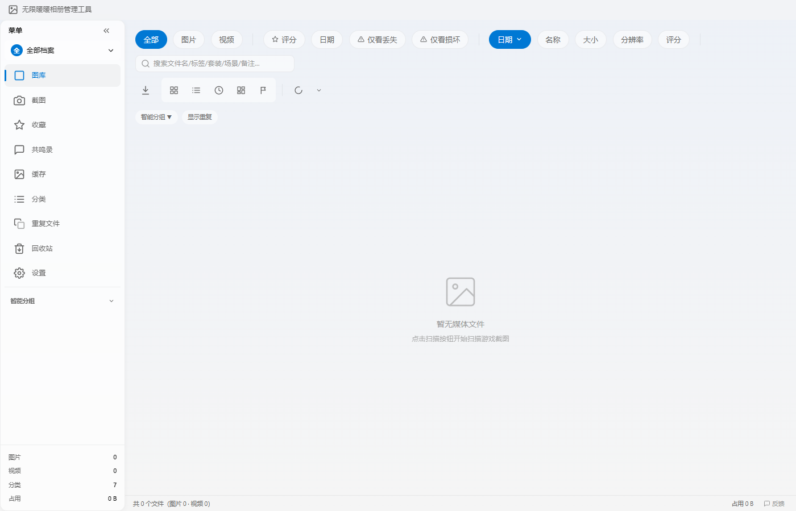

不用着急手动设置——软件会在启动几秒后**自动寻找**电脑上安装的《无限暖暖》，找到游戏保存照片的文件夹后开始扫描。扫描完成后，你的所有游戏照片就会出现在图库里。

### 2.3 自动扫描没找到？手动指定文件夹

如果自动扫描没有找到照片（比如游戏装在特别的目录），可以手动指定：

1. 点击工具栏右侧扫描按钮旁的**小箭头**，打开扫描菜单；

2. 菜单里有三种扫描方式：
   - **增量扫描（仅扫描新增文件）**：只找新拍的照片，速度快，日常推荐；
   - **自动定位游戏目录**：让软件再尝试自动寻找一次游戏；
   - **指定目录**：自己选择文件夹——如果你的游戏装在特殊位置，选这项，然后在弹出的窗口中找到游戏的 `X6Game\Saved\GamePlayPhotos` 文件夹（或你存照片的任意文件夹），点「选择文件夹」即可。

3. 扫描时软件右下角会显示进度，完成后照片就会出现在图库中。

> 💡 **小贴士**：软件默认「启动时自动扫描」，每次打开都会自动查找新增照片，不需要你手动操作。这个开关可以在 设置 → 通用 → 启动行为 中调整。

---

## 三、认识主界面

软件主界面分为三个区域：

- **左侧菜单栏**：九大板块的入口——图库、截图、收藏、共鸣录、缓存、分类、重复文件、回收站、设置；
- **顶部工具栏**：筛选（全部/图片/视频）、评分、日期、排序方式、搜索框，以及导入、视图切换、扫描等按钮；
- **中间内容区**：照片就在这里展示。左下角可以看到照片和视频的数量统计。

上面第一张「图库全景」截图里已经把这三个区域都框出来了，对照着看一遍就能熟悉。

> 💡 **小贴士**：左上角「全部档案」下拉可以切换角色档案（按游戏的 UID 区分）。如果你有多个游戏账号，每个账号的照片会分开管理，也可以选择「全部档案」一起看。

---

## 四、把照片收进来：扫描与导入

### 4.1 三种扫描方式

日常使用中，**每次启动软件都会自动扫描新增照片**，你不需要做任何事。需要手动扫描时，点击扫描按钮旁的小箭头，选择合适的扫描方式即可（见第二章截图）。

### 4.2 从其他文件夹导入照片（导入向导）

除了游戏目录，你还可以把电脑里**任何文件夹**的图片/视频复制进软件统一管理：

1. 点击工具栏左侧的**导入**按钮（第一个图标），打开导入向导；

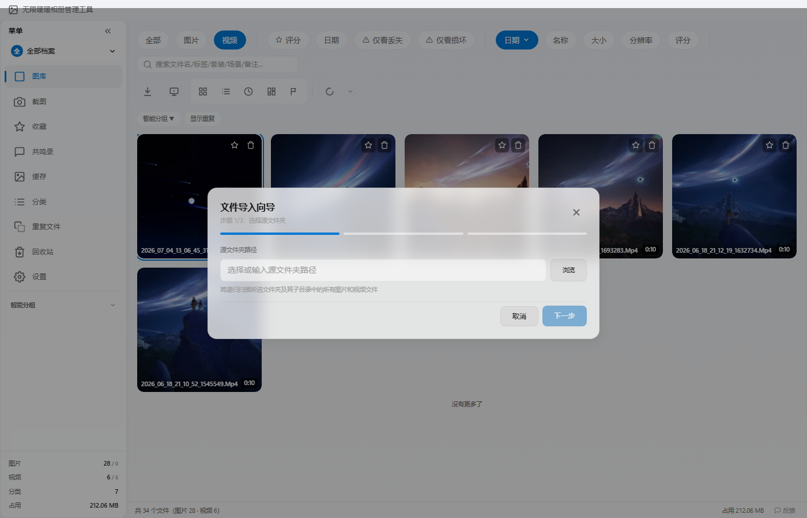

2. **第 1 步**：点击「浏览」选择照片所在的文件夹；
3. **第 2 步**：预览将要导入的文件，勾选你想要的；
4. **第 3 步**：设置导入规则（放到哪个目录、如何命名、遇到同名文件怎么办），点击开始导入。

导入完成后，这些照片会和游戏照片一起出现在图库里。

> 💡 **小贴士**：导入是「复制」方式——原文件夹里的照片不会被移动或改动，可以放心导入。

---

## 五、浏览照片

### 5.1 换一种排版方式：四种视图

工具栏中间有几个视图切换按钮，点一下即可切换：

- **网格视图**（默认）：整齐的方格排列；
- **列表视图**：一行一张，信息更详细；
- **时间线视图**：按日期分组，方便回忆「某天拍了什么」；
- **瀑布流视图**：图片按原始比例高矮错落地排列，看大图更舒服。

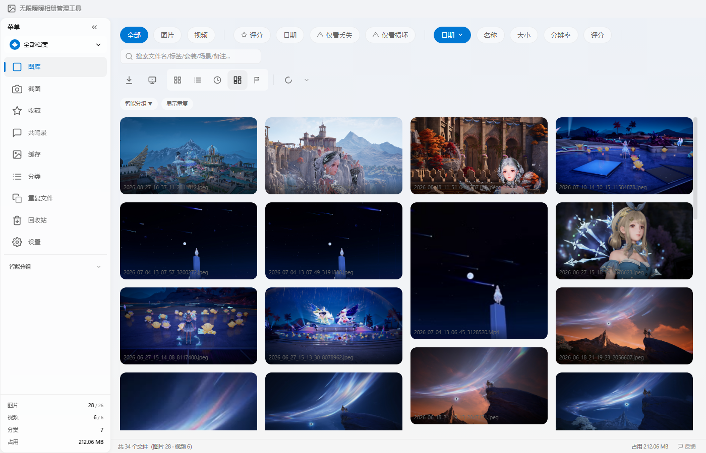

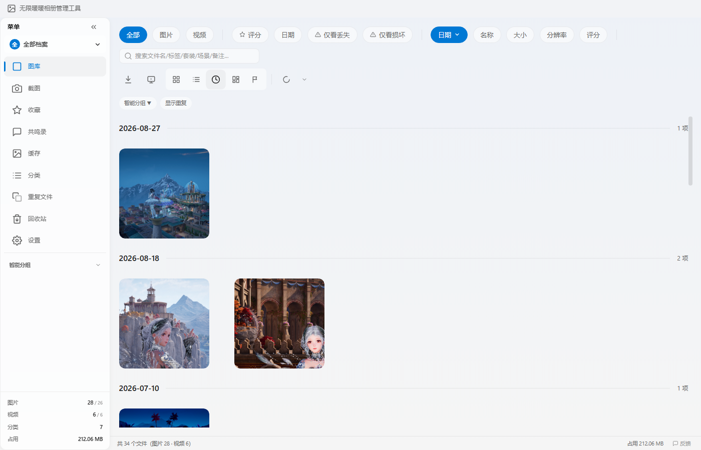

### 5.2 筛选：快速找到想看的照片

工具栏提供多种筛选方式，可以同时使用：

- **类型**：全部 / 图片 / 视频；
- **评分**：只看评过星的照片（比如「3星+」表示三星及以上）；

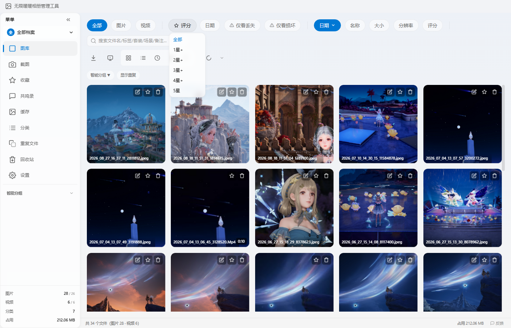

- **日期**：选择开始和结束日期，只看这段时间拍的照片；
- **仅看丢失 / 仅看损坏**：检查有没有照片文件出问题（比如被手动删掉、文件损坏）。

### 5.3 排序

「日期 / 名称 / 大小 / 分辨率 / 评分」这一排按钮用来排序，点一次按该方式排列，再点一次可切换「从大到小 / 从小到大」。

### 5.4 搜索

在搜索框里输入关键词，软件会**实时**在「文件名、标签、套装、场景、备注」中查找。比如输入文件名里的一段数字，立刻就能筛出对应的照片：

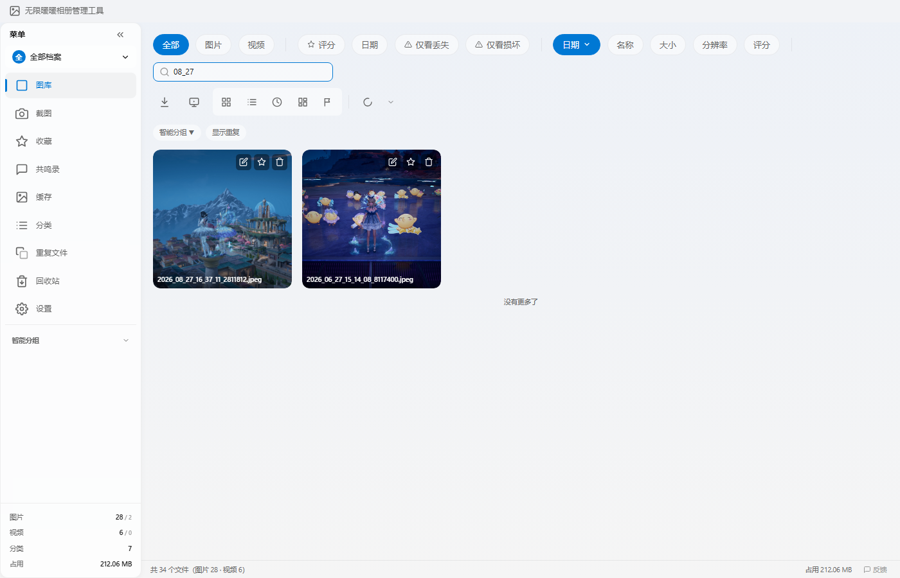

### 5.5 智能分组

点击「智能分组」按钮，可以按 **相册类型 / 类型 / 套装 / 场景 / 时段** 等维度把照片自动分组，分组入口显示在左侧菜单栏下方，点哪个组就只看哪组照片：

### 5.6 全屏查看大图

**单击任意一张照片**，进入全屏查看：

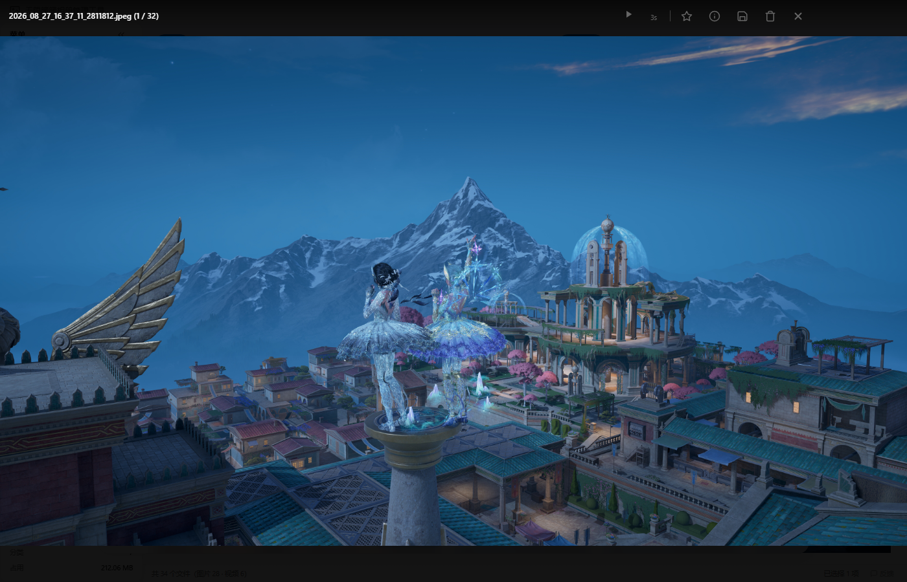

全屏时可以：

- 按 **← / →** 键或点两侧箭头切换上一张/下一张；
- 点击右下角的**星标**按钮收藏；点击**信息**按钮查看这张照片的详细信息——游戏内拍摄的照片还能看到**游戏相机参数**（光圈、焦距、灯光、滤镜等拍摄设置）；
- 按 **Esc** 或点右上角 × 返回图库。

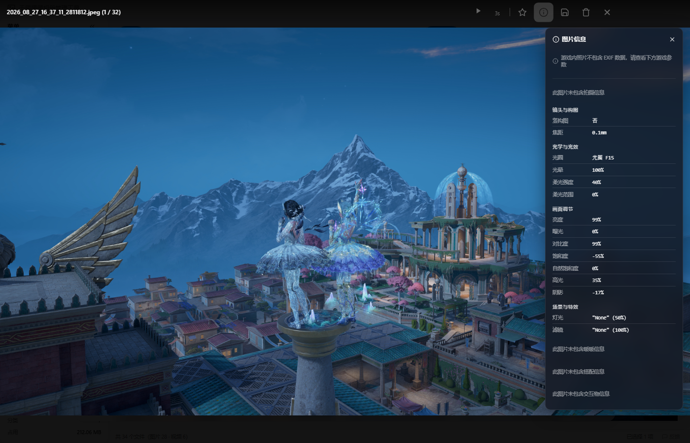

### 5.7 幻灯片放映

全屏查看时点击顶部的**播放**按钮，照片就会像放映幻灯片一样自动播放。点击旁边的间隔按钮（如「3s」）可以选择每张停留的时间（1/2/3/5/8 秒）：

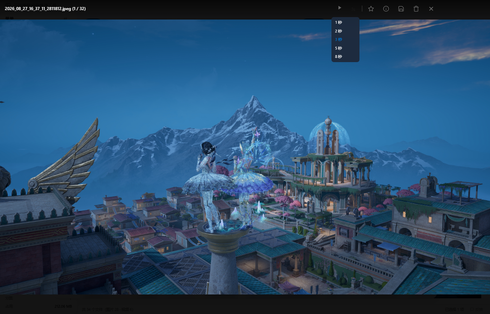

---

## 六、整理照片：评分、收藏、标签、套装

这些整理工作都在「详情页」完成。从全屏查看返回，或在编辑器里点「返回」，就能看到一张照片的详情页：

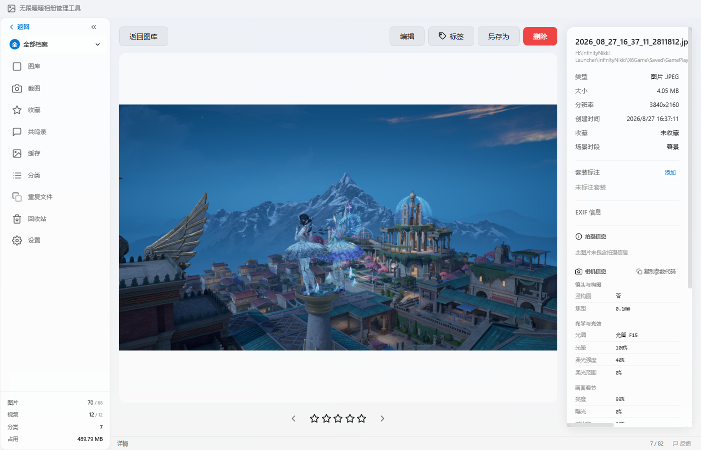

### 6.1 评分

详情页底部有 **5 颗星**，点几颗星就是几分。评过分的照片可以用第五章讲的「评分筛选」快速找出佳作。

### 6.2 收藏

详情页右侧信息面板中有「收藏」开关；图库缩略图上悬停也会出现星标按钮。收藏过的照片都集中在左侧「收藏」板块里。

### 6.3 标签

点击顶部的**标签**按钮，可以给照片添加自定义标签（也提供了风景、人物、剧情等常用标签一键选用）。以后搜索标签名就能找出这批照片。

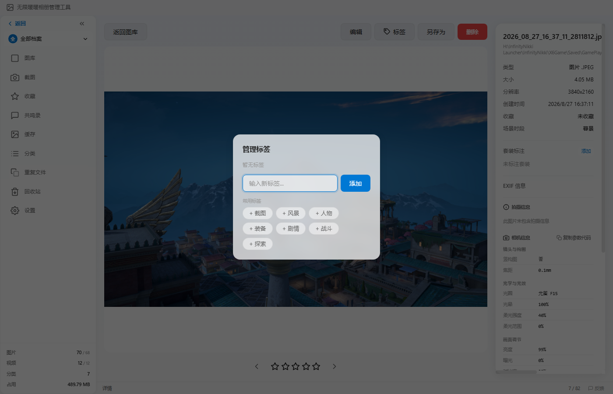

### 6.4 套装标注：告诉软件照片里穿的是什么

在详情页右侧找到「套装标注」，点击**添加**，可以直接输入套装名，也可以从下拉列表的 35 个内置套装预设中选择，然后点「保存」：

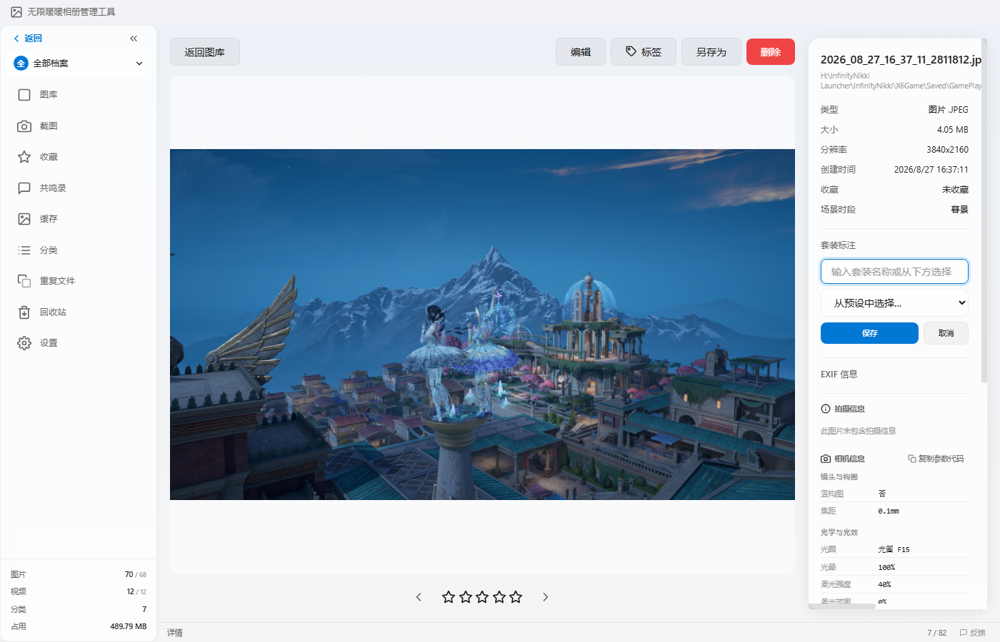

标注过的照片可以配合「智能分组 → 套装」按套装浏览，搜索套装名也能立刻找到。

### 6.5 右键菜单：最常用的操作都在这

在图库中**右键点击**任意照片，会弹出快捷菜单：打开、编辑、另存为、导出、复制到、移动到、重命名、分享、收藏、删除、属性等：

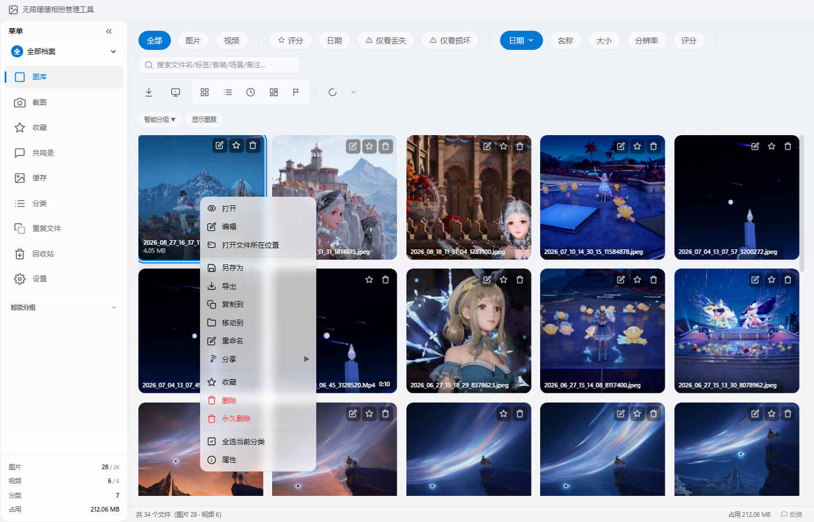

### 6.6 手滑了怎么办：全局撤销

移动、删除、重命名等操作完成后，画面上弹出的提示条里可以**撤销**，照片原样恢复，放心操作。

---

## 七、批量操作：一次处理一堆照片

### 7.1 怎么选中多张

- **Ctrl + 单击**：选中/取消选中单张（可跳着选）；
- **Shift + 单击**：选中两点之间的连续一段；
- 选中后底部会出现「全选 / 反选」按钮。

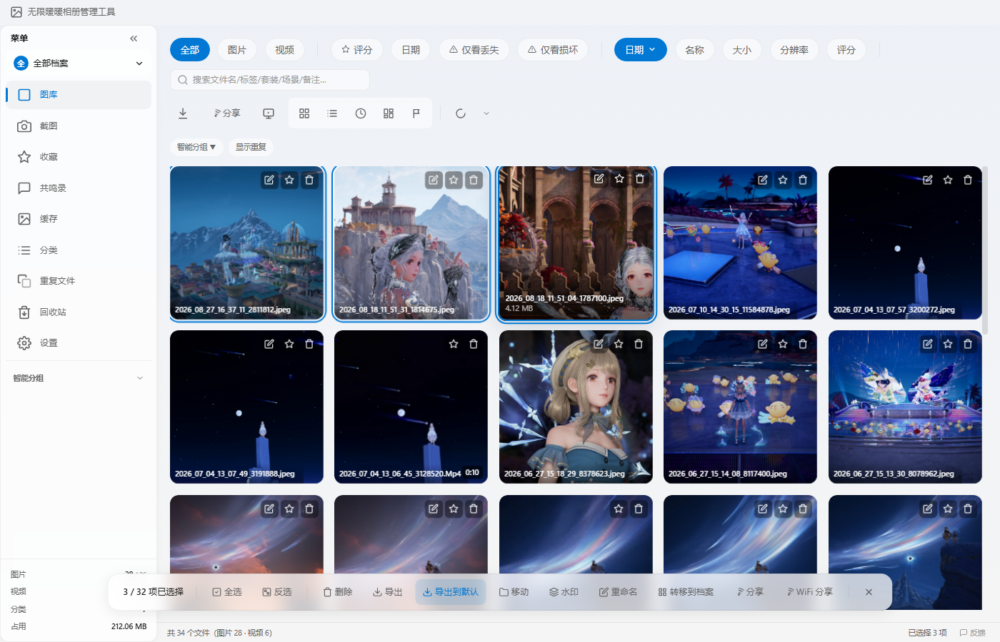

### 7.2 底部批量操作栏能做什么

选中照片后，屏幕底部出现一排批量按钮：

| 按钮       | 作用                                                                 |
| ---------- | -------------------------------------------------------------------- |
| 删除       | 把选中的照片移入软件回收站（可恢复）                                 |
| 导出       | 选择一个文件夹，把照片复制出去                                       |
| 导出到默认 | 一键导出到你设置好的默认文件夹（在 设置 → 通用 → 导出工作流 中配置） |
| 移动       | 把照片移动到另一个文件夹                                             |
| 水印       | 给选中的照片统一加上水印                                             |
| 重命名     | 按模板批量改名（可用日期、序号、套装名等组合）                       |
| 转移到档案 | 把照片换到另一个 UID 档案下                                          |
| 分享       | 复制到剪贴板并分享到微信/QQ（见第十三章）                            |
| WiFi 分享  | 开启局域网分享，用手机扫码访问（见第十三章）                         |

处理完点击右侧 **×** 即可清除选择。

---

## 八、编辑照片

软件内置了不输专业软件的修图功能。进入方式：**右键照片 → 编辑**（或详情页点「编辑」）。

### 8.1 编辑器界面

中间是大图预览和色彩直方图，右侧是调整面板，顶部是工具按钮：

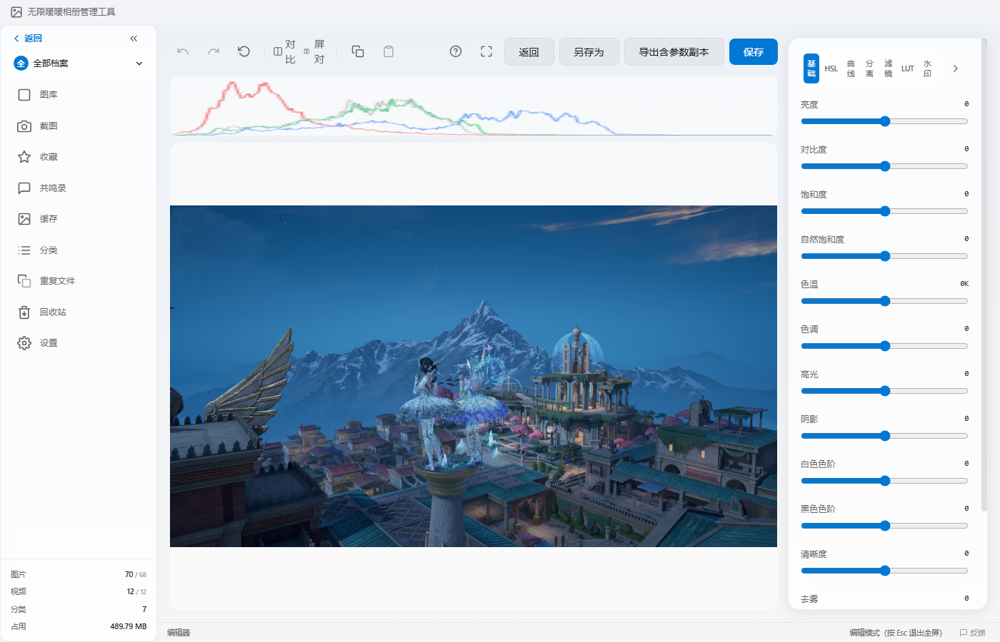

### 8.2 基础调整

右侧面板的「基础」页签里有亮度、对比度、饱和度、色温、高光、阴影、清晰度、锐化等十几个滑杆，拖动滑杆实时生效：

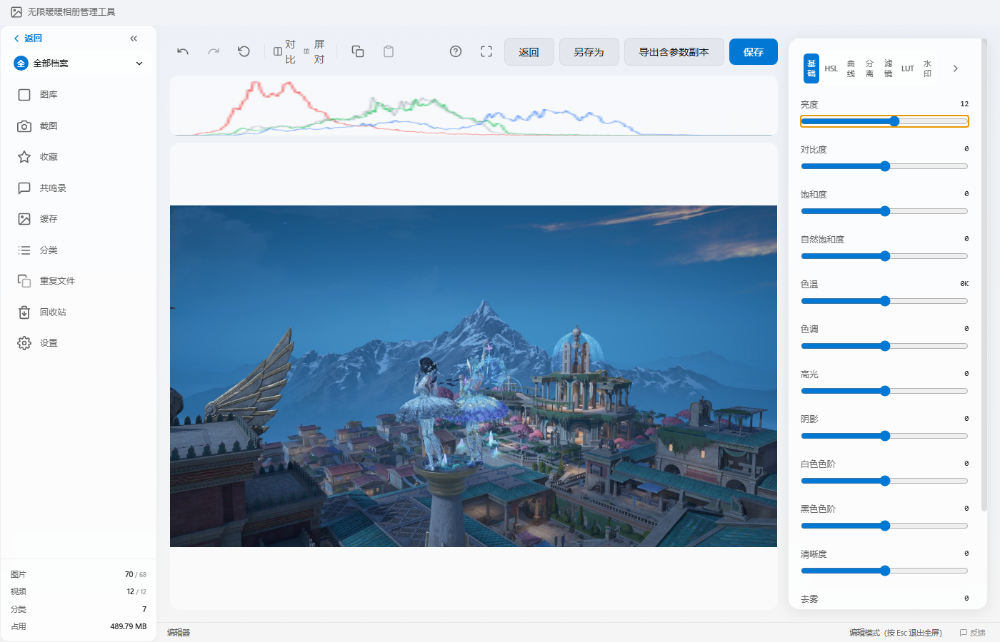

### 8.3 滤镜与 LUT

- **滤镜**页签：内置自然、复古、艺术、电影四大类共 20 款滤镜，点一下即可套用，还能调「滤镜强度」；

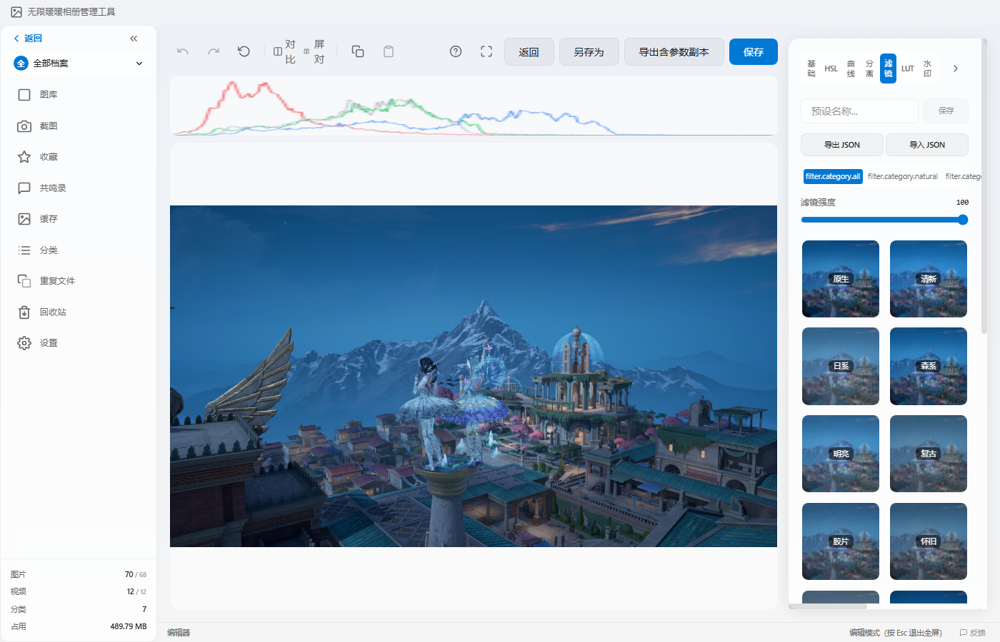

- **LUT** 页签：5 种影调风格，还支持导入网上下载的 `.cube` 调色文件。

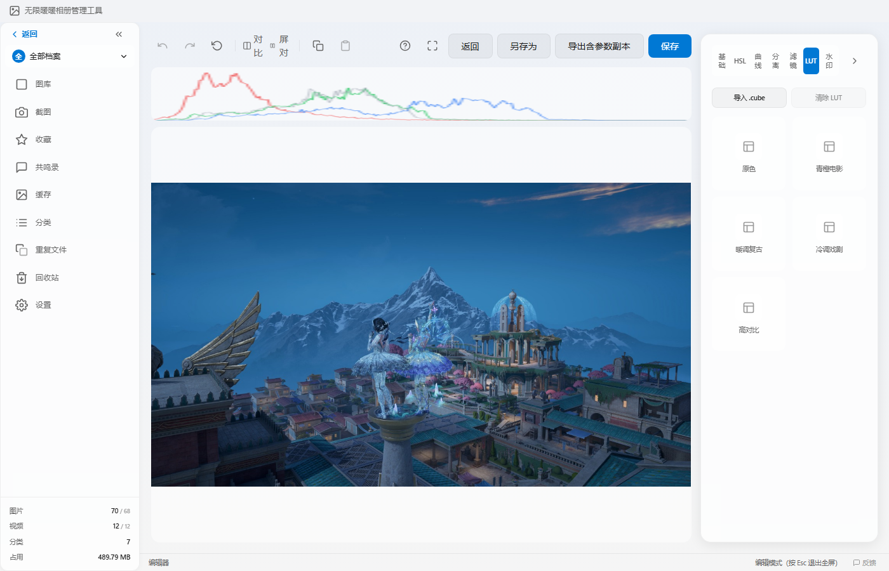

### 8.4 水印

「水印」页签可以添加**文字水印**（支持自动填入文件名、日期）或**图片水印**，九宫格自由安排位置，还有拍立得、签名水印等现成样式，右侧预览图实时显示效果：

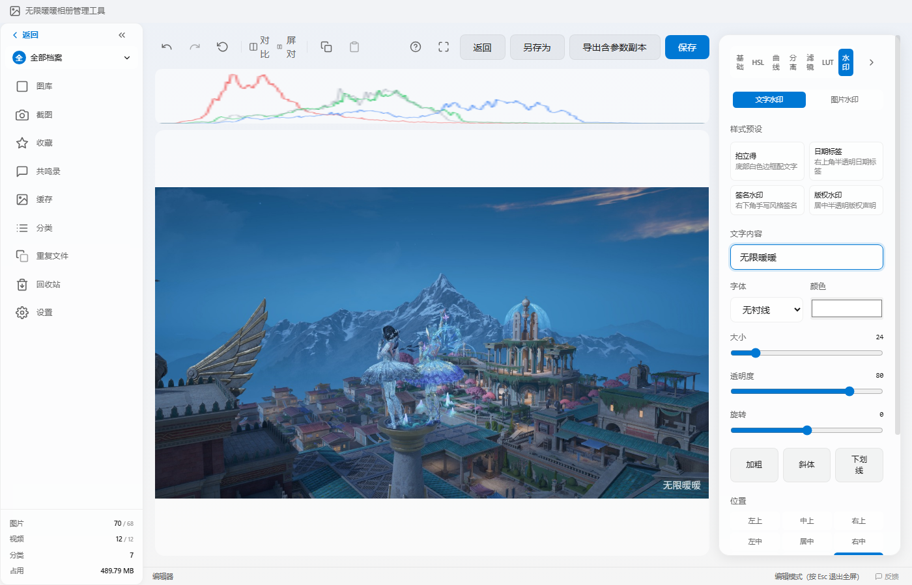

### 8.5 对比原图

调完了想知道「改了多少」？两种方式：

- **按住「对比」按钮**：按住时显示原图，松开回到效果；
- **分屏对比**：左半边原图、右半边效果，一目了然。

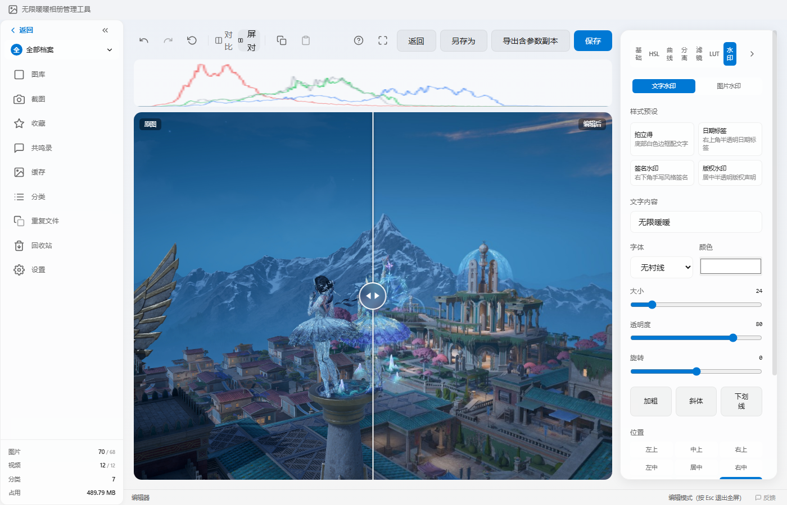

### 8.6 保存与导出

- **保存**：把修改写回这张照片。不用担心——软件会**自动备份原文件**，需要时可以找回；
- **另存为**：保留原图，把修改后的版本另存一份；
- **导出含参数副本**：导出一个带调色参数的副本，以后可以把参数一键「恢复到编辑器」继续调整；
- **应用到选中**：把当前调好的参数批量套用到你多选的其他照片上，不用一张张调。

顶部还有**撤销/重做/重置**按钮，随时可以反悔。

### 8.7 常用快捷键

| 快捷键              | 功能           |
| ------------------- | -------------- |
| Ctrl + S            | 保存           |
| Ctrl + Z / Ctrl + Y | 撤销 / 重做    |
| 空格（按住）        | 对比原图       |
| F11                 | 全屏编辑       |
| ?                   | 查看全部快捷键 |

---

## 九、游戏视频怎么看

游戏录制的视频和照片一起出现在图库里，缩略图右下角有时长角标。点击顶部的**视频**筛选，可以只看视频：

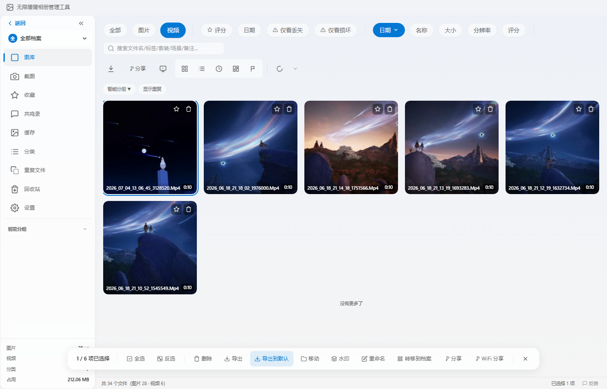

单击视频即可全屏播放。视频同样支持收藏、评分、标签、分享、导出等所有管理功能。

> ⚠️ **说明**：在当前的体验版本中，视频的「编辑」功能入口尚未开放（右键菜单里的「编辑」对视频是灰色的），这是正常现象，后续版本会提供视频裁剪、调速、转格式等能力。

---

## 十、游戏专属：共鸣录（抽卡记录）

左侧菜单的「共鸣录」是给玩家记录抽卡历程的小工具，分四个页签：

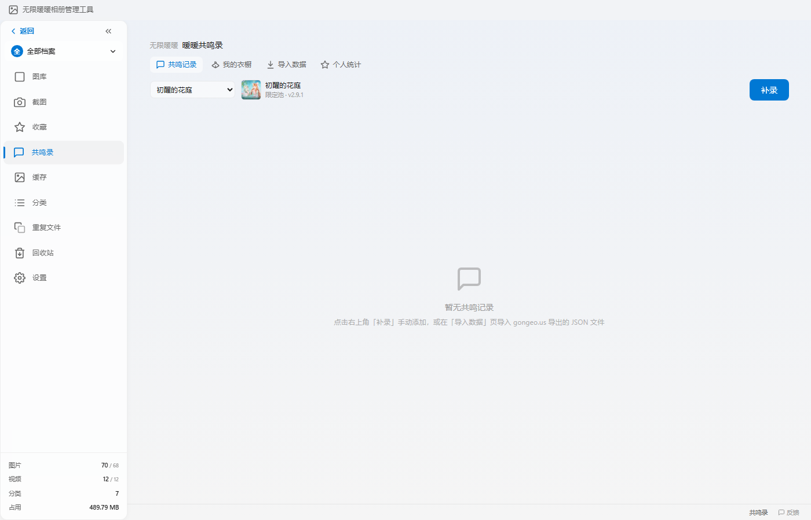

### 10.1 共鸣记录：手动补录抽卡结果

选择卡池后，点击右上角**补录**按钮，选择获得的物品和获得时间，就能逐条记录你的抽卡结果。页面上方会实时统计总抽数、距离上次出金/出紫多少抽。

### 10.2 我的衣橱：收集进度图鉴

「我的衣橱」里是完整的套装图鉴（部件、妆容、Momo、道具、共鸣色五大类），可以搜索名称、按拥有状态和稀有度筛选。手动标太多？点右上角**从共鸣记录推断**，软件会根据你补录的抽卡记录自动判断你拥有哪些物品：

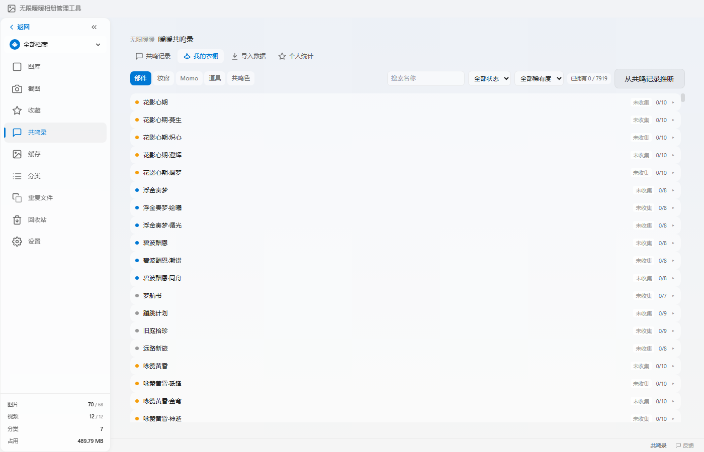

### 10.3 导入数据：一键导入抽卡记录

如果你用过 gongeo.us 等抽卡记录工具，在「导入数据」页选择它导出的 JSON 文件，软件会解析并批量导入，无需逐条补录；也可以在这里把记录**导出**成 JSON 备份：

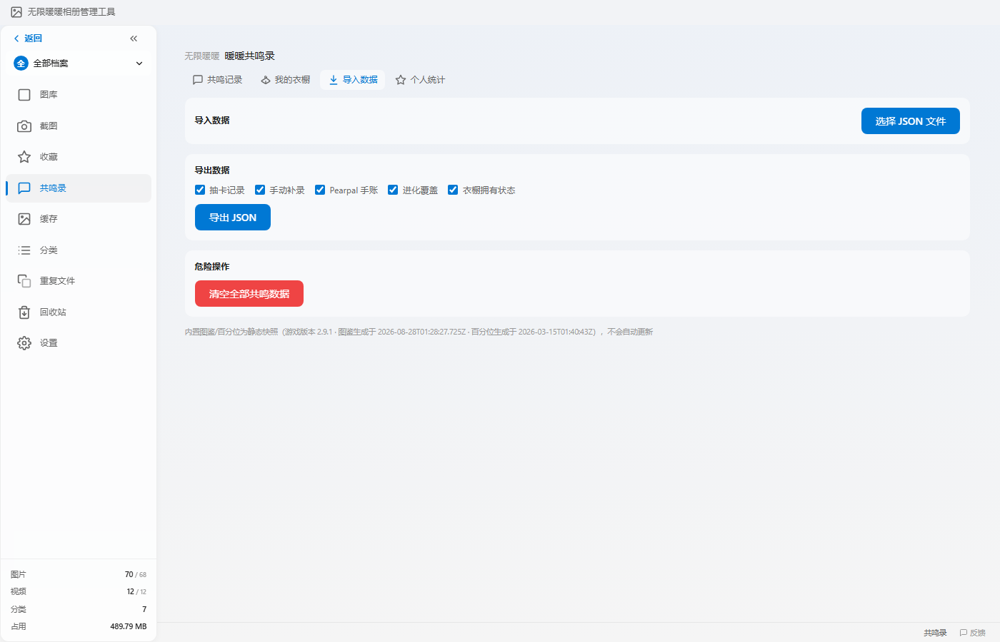

### 10.4 个人统计：欧非一目了然

「个人统计」页展示总抽数、出金分布、卡池明细和社区百分位对比，看看你是不是「欧皇」：

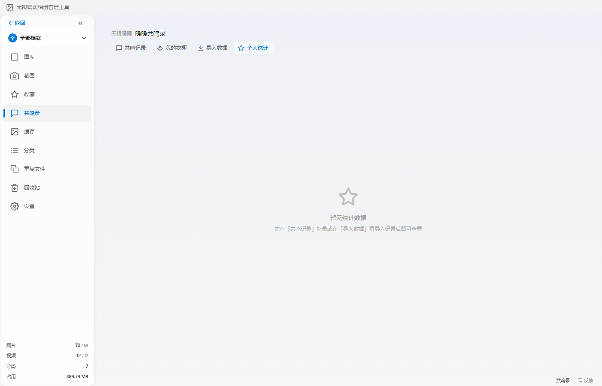

---

## 十一、清理重复照片

游戏连拍和多次导出很容易产生重复文件。打开左侧「重复文件」板块，软件会**自动开始检测**：

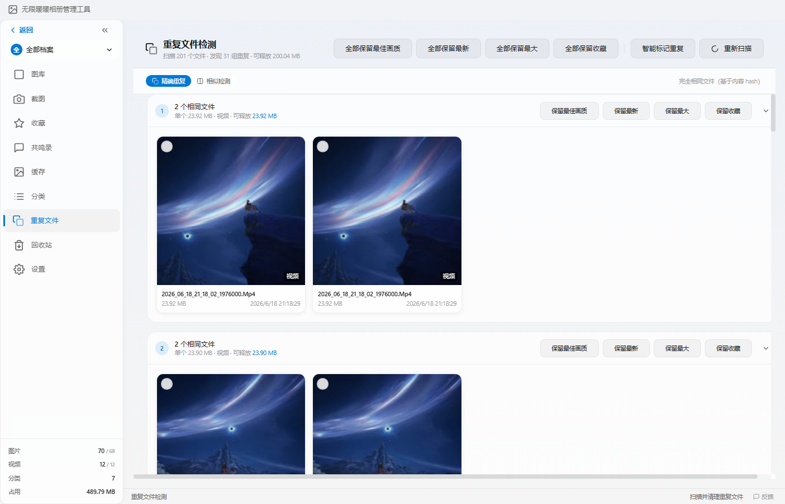

- **精确重复**：找出内容完全相同的文件（比如同一张照片存了两份）；
- **相似检测**：更进一步，把「拍的是同一个画面、只有细微差别」的照片也找出来，还可以调整匹配的严格程度；

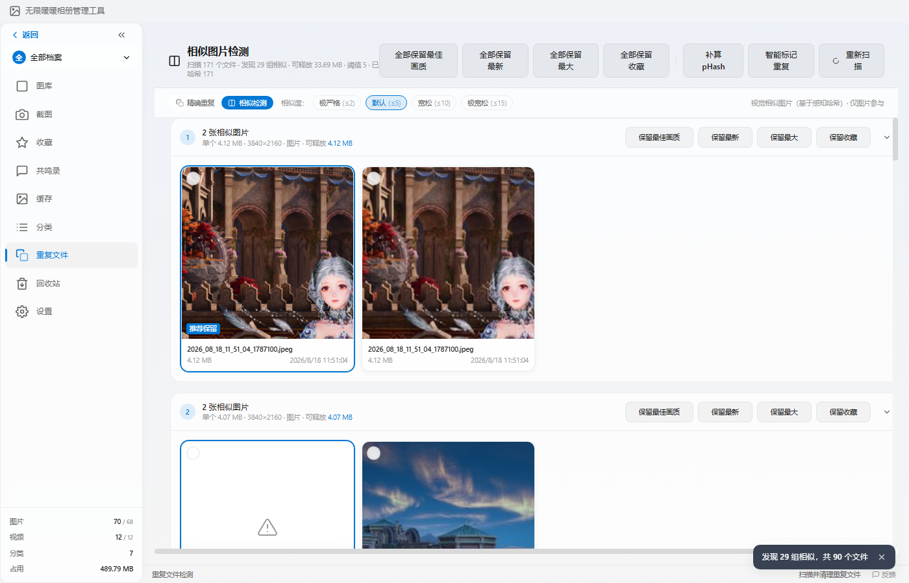

每个重复组里，软件会用**高亮推荐**标出最值得保留的那张（综合清晰度、大小、拍摄时间判断）。你可以：

- 使用顶部一键策略：「全部保留最佳画质 / 保留最新 / 保留最大 / 保留收藏」；
- 或逐组勾选要删的，点底部「移至回收站」（进回收站，可反悔）；
- **智能标记重复**：一键把重复项标记出来，之后图库里会自动隐藏它们（想看的时候打开图库的「显示重复」开关）。

> 💡 **小贴士**：所有清理都先经过回收站，不会直接删文件，放心使用。

---

## 十二、回收站：删除的两道保险

在软件里删除照片（右键删除、批量删除、重复清理），照片首先进入**软件自己的回收站**——此时照片文件还在原处，随时可以恢复：

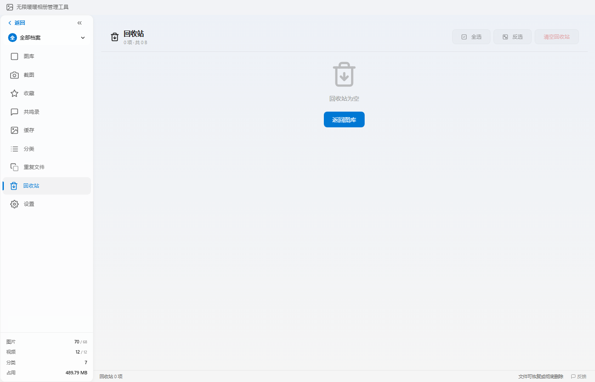

- **恢复**：勾选后点「恢复」，照片回到图库；
- **彻底删除 / 清空回收站**：这一步才会把文件送进**系统回收站**（还有一次确认提示）。

所以误删照片有两道保险：先在软件回收站找回；就算彻底删除了，系统回收站里也还有一份。

> ⚠️ **注意**：右键菜单里的「永久删除」是跳过回收站的直接删除，删前会反复确认，请谨慎使用。

---

## 十三、分享与导出

### 13.1 一键分享到微信 / QQ

选中照片后（单张可以在右键菜单里选「分享」），点击**分享**按钮，菜单里选择「分享到微信 / 分享到QQ / 分享到vivo办公套件」：

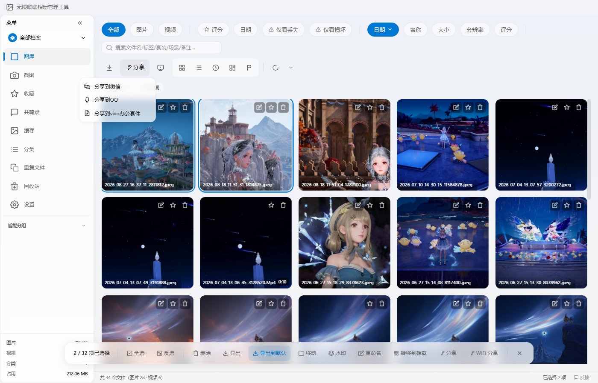

软件会把照片放进剪贴板，并检测相应软件是否在运行：已运行就直接提示你 **Ctrl + V 粘贴发送**；没运行会提示你先打开。

### 13.2 WiFi 分享：手机直接下载

想让手机拿照片？选中照片后点 **WiFi 分享**，软件会开启一个局域网分享：

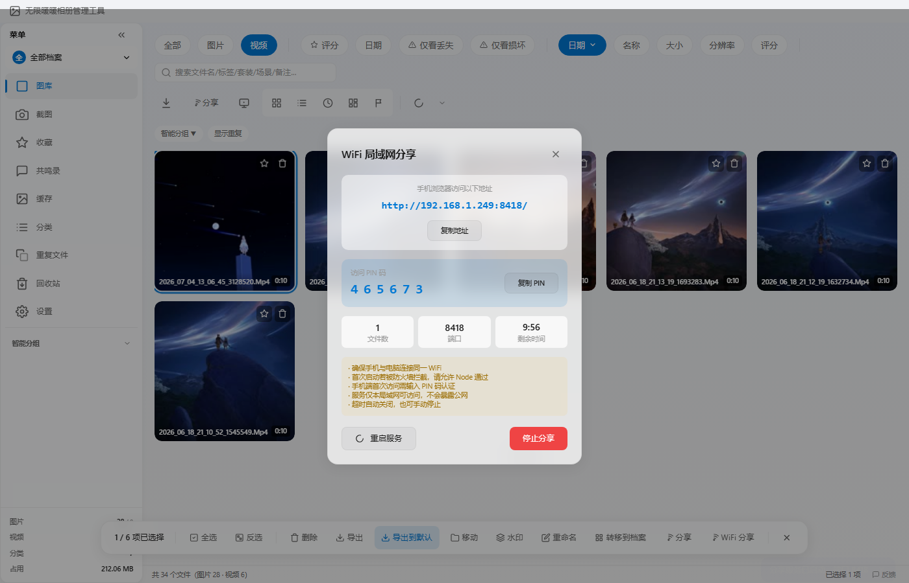

1. 让手机和电脑连**同一个 WiFi**；
2. 用手机浏览器打开画面上显示的**网址**；
3. 输入画面上的 **PIN 码**确认，就能在手机上查看和下载这些照片了。

分享会自动倒计时结束，也可以随时点「停止分享」。每次开启的地址和 PIN 都可能变化，以画面显示为准。

### 13.3 导出

- **右键 → 导出 / 另存为**：把照片复制到指定文件夹；
- **批量导出**：多选后点「导出」；「导出到默认」则一键导出到设置里配置好的文件夹，还能按「日期 + 套装 + 序号」等规则自动重命名（在 设置 → 通用 → 导出工作流 配置）。

---

## 十四、分类管理

左侧「分类」板块可以建立自己的照片分类体系：

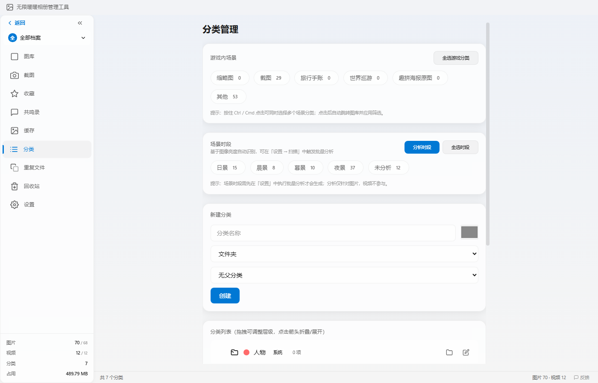

- **新建分类**：设置名称、颜色、图标，还能挂到另一个分类下面形成层级（比如「风景」下再分「平原」「雪山」）；
- **归类照片**：点某个分类的「归类媒体」，搜索并勾选照片即可归入；一张照片也可以在图库里右键拖拽到分类上；
- 软件还内置了**游戏场景分类**（缩略图、截图、旅行手账、世界巡游等），会按照片来源自动归类，不用手动维护；
- **场景时段**：在 设置 → 扫描 → 扫描选项 中点「立即分析」，软件会自动识别每张照片是日景、晨景、暮景还是夜景，之后就能按时段筛选照片。

> 💡 **小贴士**：删除自定义分类不会删除里面的照片，放心整理。

---

## 十五、三个实用板块：截图 / 收藏 / 缓存

侧边栏还有三个按来源自动归类的板块：

- **截图**：游戏内按截图键保存的图片集中在这里；

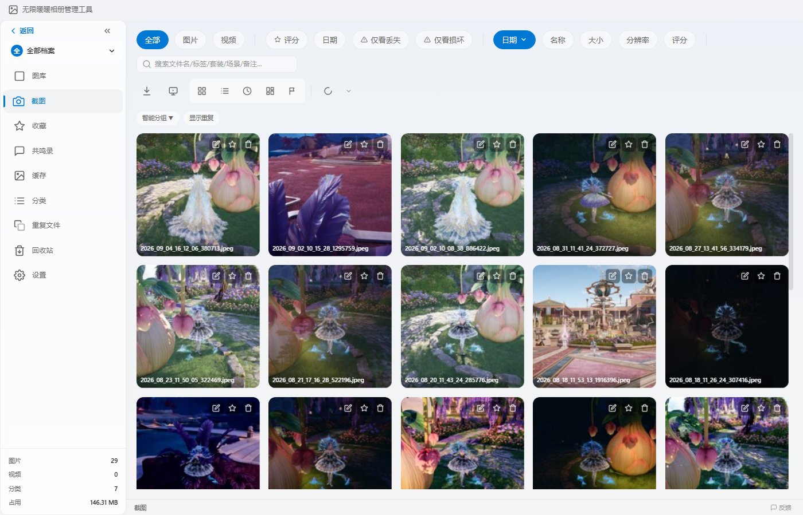

- **收藏**：所有打上星标的照片；

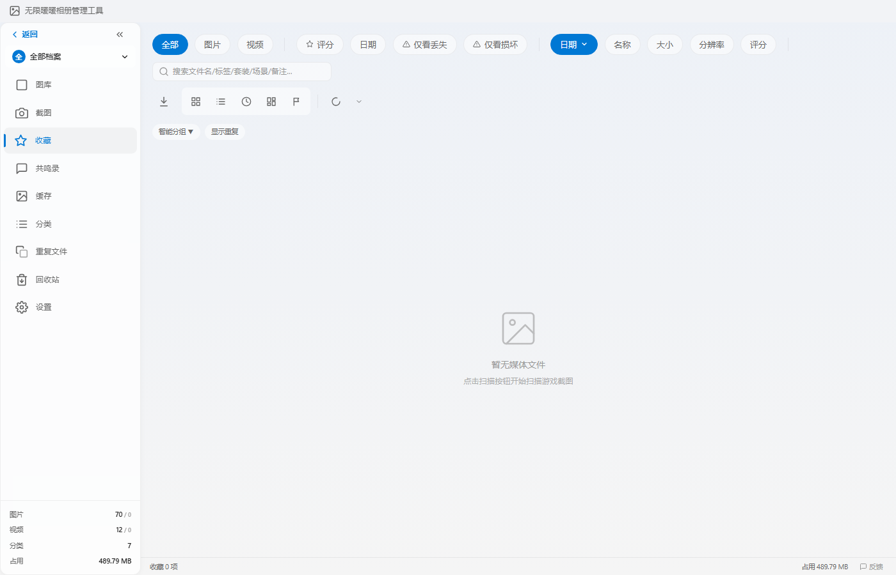

- **缓存**：游戏启动器下载的壁纸、宣传图等素材。想找官方高清壁纸做桌面？来这里翻翻：

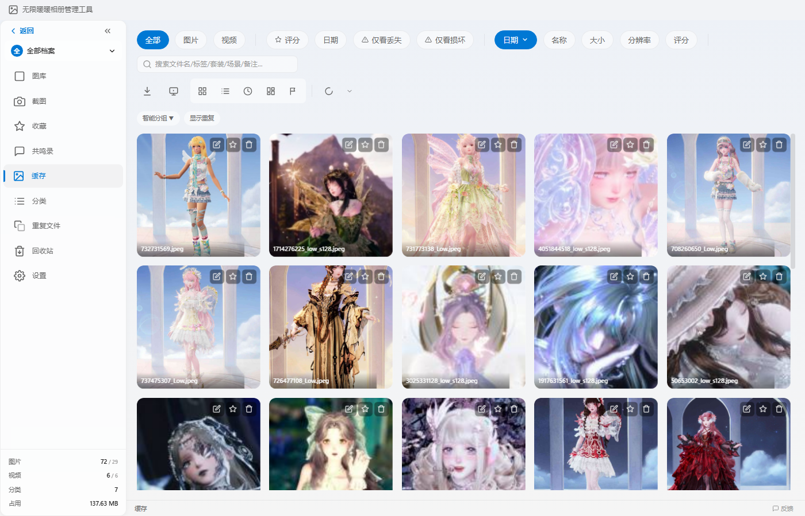

---

## 十六、设置详解

左侧菜单最底部的「设置」里，按分组整理了全部配置项：

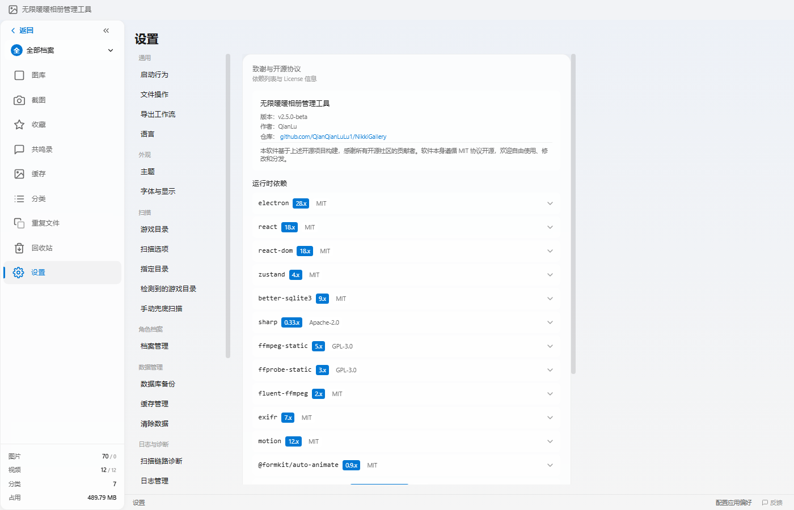

### 16.1 通用

- **启动行为**：「启动时自动扫描」开关、GPU 硬件加速（显卡驱动异常导致白屏/崩溃时可关闭，需重启软件）；
- **文件操作**：删除前是否确认、是否优先用软删除（先进回收站）、批量操作超过一定数量时二次确认；
- **导出工作流**：设置「导出到默认」的目标文件夹和自动命名规则；
- **语言**：支持简繁中文、英日韩法德西葡俄泰越等 13 种语言，切换即时生效。

### 16.2 外观

**主题**页签里可在「默认简约」和「柔粉轻奢」两款主题间切换，还可以调整字号大小、开启紧凑模式、减弱动效：

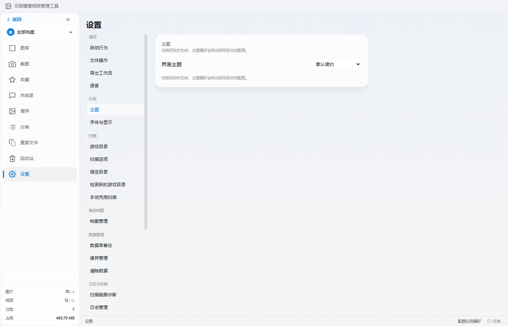

### 16.3 文件操作

删除确认、二次确认等安全开关都在这里：

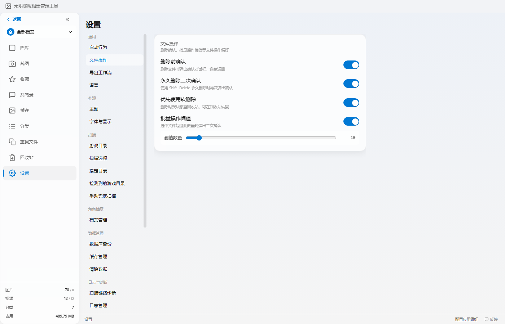

### 16.4 扫描

- **扫描选项**：增量扫描开关、场景时段「立即分析」；

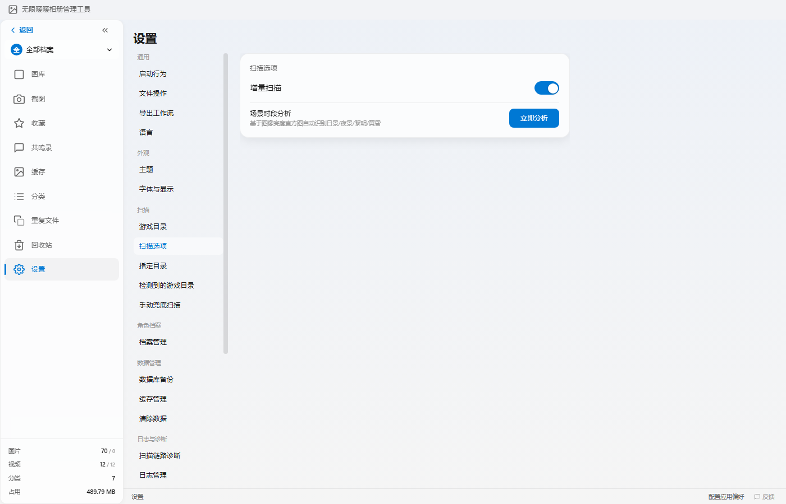

- **游戏目录 / 检测到的游戏目录 / 手动兜底扫描**：管理软件从哪里找照片。软件会把检测到的游戏目录列出来供你勾选；多游戏安装、特殊目录的情况都能在这里手动添加。

### 16.5 角色档案

按游戏 UID 管理档案：新增档案、切换档案、编辑昵称、查看每个档案的拍摄统计（数量、时间范围、套装偏好等）：

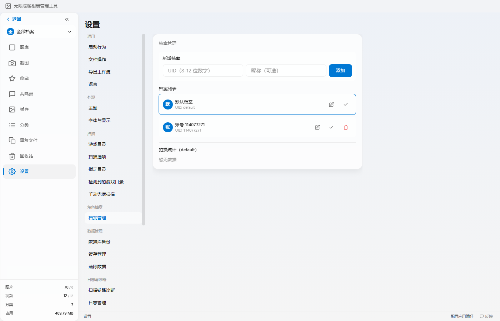

### 16.6 数据管理

- **数据库备份**：软件每隔 7 天自动备份一次相册记录（保留最近 5 份），也可以点「立即备份」手动备份；换电脑、重装系统前备份一份更安心；

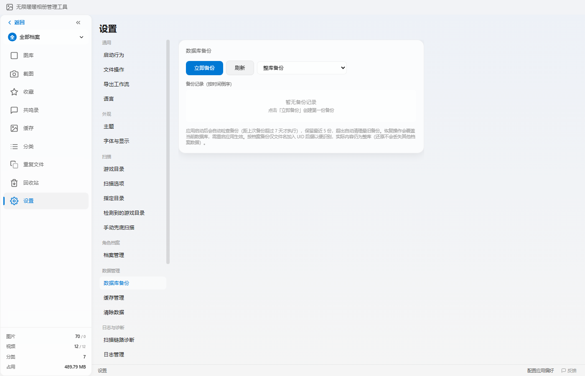

- **缓存管理**：缩略图缓存的占用情况与清理。设置缓存上限后，最久没看的缩略图会被自动清理以腾出空间，原图不受影响；

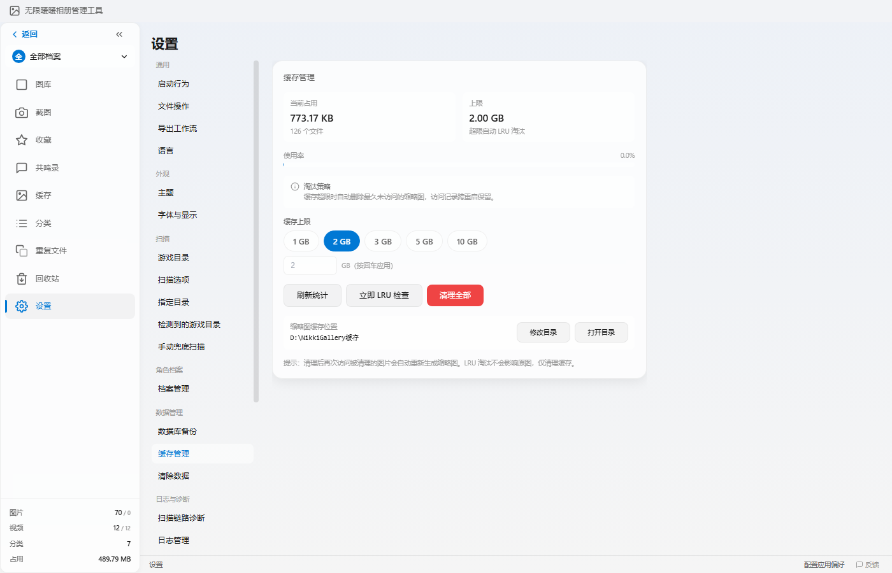

- **清除数据**：「清理丢失记录」只清掉失效的索引；「清除本地数据」会清空软件的相册记录和标签等（**不动硬盘上的照片文件**），适合想从头再扫一遍的情况。

### 16.7 关于

- **应用信息**：版本号与「检查更新」；

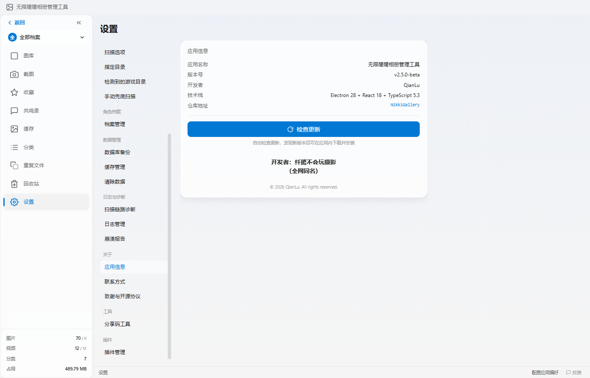

- **联系方式**：GitHub 仓库、QQ 群、B 站/抖音/小红书，遇到问题欢迎反馈；

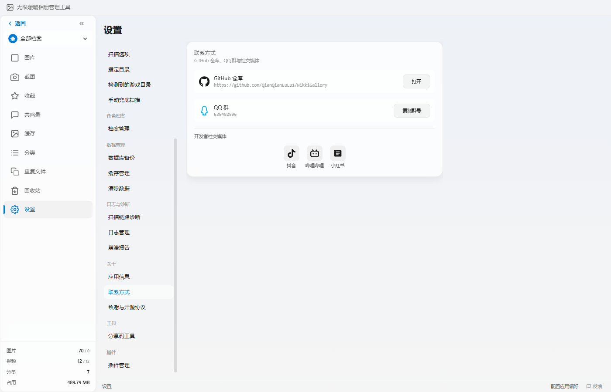

- **致谢与开源协议**：软件基于 MIT 协议开源。

### 16.8 工具：分享码解码器

游戏内的**染色分享码**、**家园建造分享码**可以在这里解码，查看其中的时间、UID 等信息：

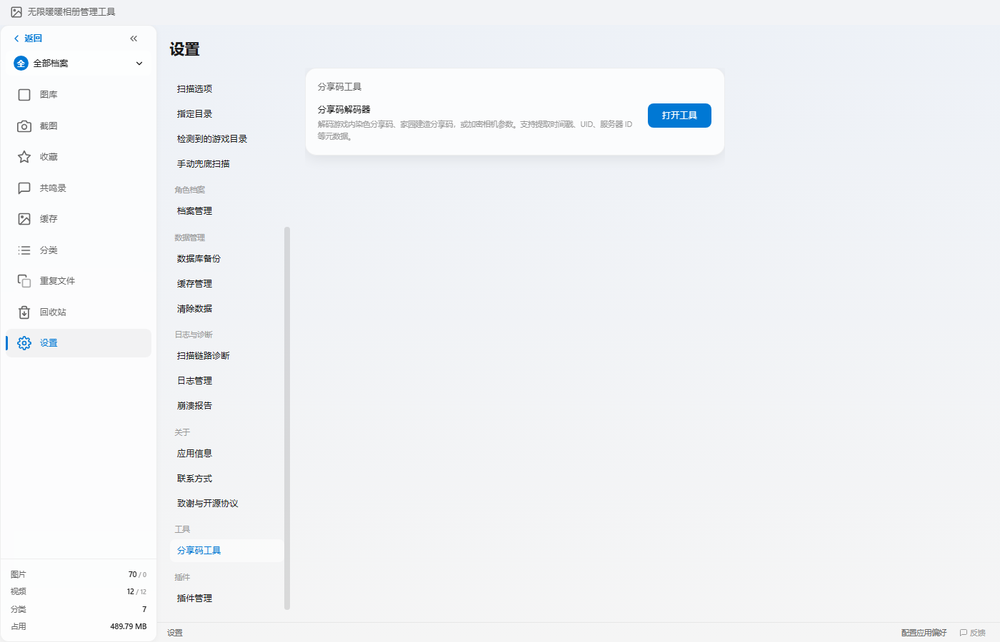

### 16.9 插件（体验功能）

插件系统用于扩展软件功能（比如给水印面板增加新模板）。当前体验版中该功能显示「不可用」，属于正常现象，等后续版本开放即可：

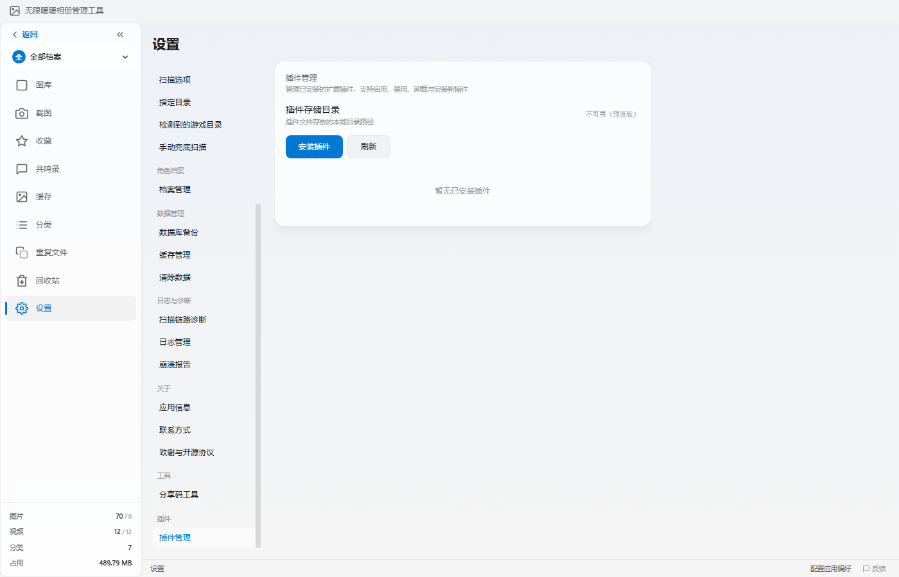

---

## 十七、常见问题 FAQ

**Q1：打开软件后图库是空的？**
软件启动几秒后会自动扫描。如果一直没有照片：点扫描按钮旁的小箭头 → 选择「指定目录」，手动选择游戏的 `GamePlayPhotos` 文件夹或你存照片的文件夹（见 2.3 节）。

**Q2：扫描时提示权限不足（E003）？**
软件没有权限读取游戏目录。到 设置 → 扫描 → 手动兜底扫描，点击「以管理员身份重启」再扫描。

**Q3：照片还在硬盘上，但图库里不见了？**
可能是文件被移动过位置。用图库的「仅看丢失」开关找出失效记录，把文件放回原位后重新扫描；确认不要的记录可以用 设置 → 数据管理 → 清理丢失记录 清掉。

**Q4：误删了照片怎么办？**
去「回收站」板块勾选恢复。就算彻底删除了，系统回收站里也还有一份。

**Q5：编辑照片后后悔了？**
编辑器里按 Ctrl + Z 撤销，或点「重置」恢复全部调整；没保存直接退出就不会改动原照片。保存过的照片，软件也自动留有原文件备份。

**Q6：软件崩溃或白屏？**
到 设置 → 通用 → 启动行为 关闭「GPU 硬件加速」后重启软件。软件自身也有自动恢复机制，崩溃后重开会尝试修复。更多日志在 设置 → 日志与诊断 里查看和导出。

**Q7：想把软件搬到新电脑？**
旧电脑：设置 → 数据管理 → 数据库备份 → 立即备份；新电脑装好软件后，在同一页面选择备份文件「恢复」即可（照片文件本身需要自行拷贝）。

**Q8：缩略图缓存占了太多空间？**
设置 → 数据管理 → 缓存管理 里可以一键清理或设置自动上限，只影响缩略图，照片原图不受影响。

**Q9：界面是英文/其他语言，怎么改回中文？**
设置 → 通用 → 语言，选择「简体中文」即可即时切换。

**Q10：微信/QQ 分享没反应？**
分享是把照片放进剪贴板，需要微信/QQ **正在运行**：先打开微信或 QQ，再在软件里点分享，然后到聊天窗口 Ctrl + V 粘贴发送。

---

_本教程对应软件版本 2.5.0-beta，界面可能随版本更新略有变化。祝您拍出更多好看的游戏照片！_
